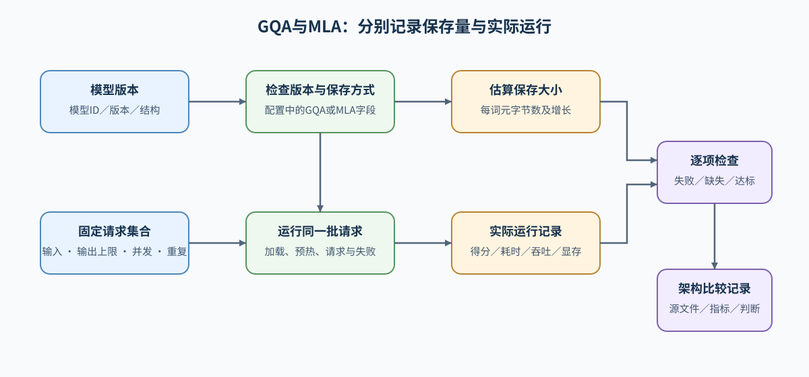
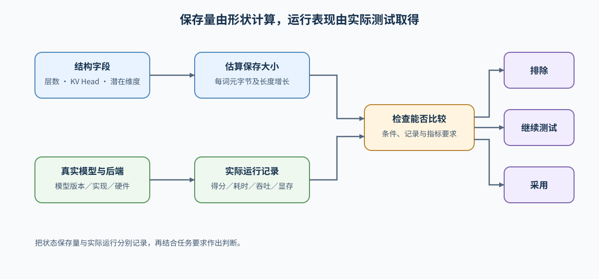

# 71. MLA KV Cache Architecture Benchmark | MLA 与 KV Cache 结构基准

**难度：** Hard | **环境：** CPU-first；GPU/backend 可选 | **标签：** `推理优化`, `MLA`, `KV Cache`

> 🚀 **云端运行环境**
>
> 本章节的实战代码可以点击以下链接在免费 GPU 算力平台上直接运行：
>
> [](https://colab.research.google.com/github/datawhalechina/llm-algo-leetcode/blob/main/02_PyTorch_Algorithms/71_MLA_KV_Cache_Architecture_Benchmark.ipynb)
> [](https://modelscope.cn/my/mynotebook) *(国内推荐：魔搭社区免费实例)*


## 本节导读

MLA 通过低维潜在状态改变推理时保存和读取注意力历史的方式。这个项目在固定请求工作负载下，对照 GQA 与 MLA 的理论状态账本、后端兼容性、运行成本和质量证据，判断 MLA 候选是否具备继续评测的条件。

CPU 部分实现比较契约、状态账本和证据门禁；真实环境部分加载模型并采集首词元延迟、逐词元延迟、吞吐、峰值显存和失败记录。最终产物是一份可追溯的架构比较记录，而不是仅凭理论压缩比例作出的速度结论。
## 前置阅读

先理解 Attention 张量形状、KV Cache 增长和 MLA 的潜在状态，再进入架构项目。
- [04. Attention / MHA / GQA](./04_Attention_MHA_GQA.md)
- [ARCH-MLA. Multi-head Latent Attention | 多头潜在注意力](./ARCH-MLA_Multihead_Latent_Attention.md)
- [Part 01: 04. Attention Memory Optimization](../01_Hardware_Math_and_Systems/04_Attention_Memory_Optimization.md)
- [11. KV Cache and Memory Growth](../01_Hardware_Math_and_Systems/11_KV_Cache_and_Memory_Growth.md)
### Step 1：从模型资产到架构比较记录

项目接收两个可追溯模型快照和一份固定请求工作负载。它先核对模型身份、架构族、训练方案与结构差分，再建立状态账本并运行配对请求，最后把结构差异、运行指标、失败记录和证据等级写入同一份架构比较记录。只有架构族和训练方案一致、且唯一声明变化是状态表示时，结果才属于受控比较；否则只能作为跨模型观察。

| 阶段 | 输入 | 主要操作 | 输出 |
| --- | --- | --- | --- |
| 身份核对 | 模型 ID、不可变版本、架构族、训练方案、结构配置 | 确认 GQA 与 MLA 表示及差分来源 | 受控候选对或观察性候选对 |
| 固定比较 | 请求集合、生成上限、并发、重复次数 | 保持请求条件一致，分别执行两个候选 | 原始运行记录 |
| 证据汇总 | 状态账本、质量与成本指标、失败信息 | 区分理论值、实测值和缺失值 | 架构比较记录 |
| 项目决策 | 证据门槛与资源限制 | 拒绝失败候选，标记待补证据项 | `accept / tune / reject` |



### Step 2：分开解释状态容量与运行成本

理论账本回答每个词元需要保存多少状态；后端测量回答该模型在当前执行栈上的实际显存和时间。设批量为 $B$、序列长度为 $L$、层数为 $N$、每个元素字节数为 $s$。GQA 每层保存 K/V 两份状态，理论字节数为 $2BLNH_{kv}D_hs$；本节采用的 MLA 简化账本保存潜在状态与位置分量，理论字节数为 $BLN(D_{latent}+D_{rope})s$。这些公式只描述状态表示，不包含分配器、临时张量和内核工作区。跨模型比较还包含宽度、权重和算子实现差异，因此只能作为观察性证据，不能把全部运行差异归因于 MLA。

| 证据层 | 比较对象 | 能确认什么 | 不能推出什么 |
| --- | --- | --- | --- |
| 结构配置 | KV Head、潜在维度、位置分量、层数 | 状态表示及理论增长关系 | 实际分配器峰值与执行速度 |
| 状态账本 | 同一 batch、长度和数据类型下的理论字节数 | 容量随长度变化的方向 | 内核是否命中、质量是否保持 |
| 后端结果 | 固定请求下的延迟、吞吐、显存和失败 | 当前模型与执行栈的运行表现 | 单一结构变量的因果收益 |



### Step 3：用证据门槛控制项目状态

候选首先要成功加载并完成全部请求；随后检查工作负载一致性、独立质量结果和实测峰值显存。跨模型观察即使运行成功，也保留为 `tune`，不能升级为结构因果结论；运行失败或身份不清进入 `reject`，只有受控候选满足全部门槛时才进入 `accept`。多个 `accept` 候选按项目目标选择：先比较峰值显存，再比较每输出词元时间，最后用模型 ID 保证并列结果可复现。这个排序表达的是本项目的容量优先目标，不代表所有部署都应采用同一顺序。

| 状态 | 触发条件 | 是否继续 | 下一动作 |
| --- | --- | --- | --- |
| `pending` | 尚未取得配对后端结果 | 否 | 完成真实执行并保存原始记录 |
| `reject` | 身份、工作负载、加载或请求执行失败 | 否 | 修复候选或运行环境后重测 |
| `tune` | 运行成功但质量、峰值显存或执行路径证据缺失 | 是 | 补齐缺失证据并保持同一比较条件 |
| `accept` | 可比候选通过质量、容量和运行门槛 | 是 | 交给架构审计项目汇总 |
### Step 4：实现比较契约、状态账本与证据门禁

题目提供模型配置、请求条件和运行记录的简化输入。学习者需要补全会改变项目结论的四项判断；字段读取、结果装配和错误信息由骨架提供。

| 任务与目的 | 已知条件 | 完成标准 | 测试验证 |
| --- | --- | --- | --- |
| TODO 1：核对比较契约 | 两个模型身份、结构表示和工作负载 | 识别观察性比较与不可比字段 | 身份缺失、请求条件变化 |
| TODO 2：建立状态账本 | 已归一化结构字段和请求长度 | 分别得到 GQA 与 MLA 理论状态字节数 | 非法维度、长度增长关系 |
| TODO 3：判定证据状态 | 配对运行、质量、显存和能力记录 | 返回全部缺失项与 `reject/tune/accept` | 运行失败、证据缺失、完整证据 |
| TODO 4：选择项目结论 | 一个或多个候选的门禁结果 | 只从合格候选中按目标排序 | 空候选、未合格候选和排序方向 |

```python
from typing import Dict

```


```python
def validate_comparison_contract(baseline, candidate, baseline_workload, candidate_workload):
    """核对模型身份、表示类型和配对工作负载。"""
    issues = []
    required_identity = ('model_id', 'revision', 'representation')
    for role, model in (('baseline', baseline), ('candidate', candidate)):
        issues.extend(f'{role}.{key}' for key in required_identity if not model.get(key))
    comparable_fields = ('prompt_set_id', 'max_tokens', 'concurrency', 'warmup', 'repeats')
    mismatches = [key for key in comparable_fields if baseline_workload.get(key) != candidate_workload.get(key)]
    issues.extend(f'workload.{key}' for key in mismatches)
    # TODO 1：架构族与训练方案相同、唯一声明变化为表示时是受控比较；否则是观察性比较。
    # comparison_mode = ???
    raise NotImplementedError('请先完成 TODO 1')


def build_state_ledger(model, workload):
    """根据已归一化的结构字段计算每个候选的理论状态字节数。"""
    dimensions = [workload['batch_size'], workload['sequence_length'], model['num_layers'], model['dtype_bytes']]
    if any(not isinstance(value, int) or value <= 0 for value in dimensions):
        raise ValueError('工作负载和公共结构维度必须是正整数')
    representation = model['representation']
    # TODO 2：GQA 保存 K/V 两份状态；MLA 保存潜在状态与位置分量。
    # bytes_per_token_layer = ???
    raise NotImplementedError('请先完成 TODO 2')


def qualify_architecture_evidence(record, limits):
    """根据运行、可比性、质量、显存和能力证据判定项目状态。"""
    failures = list(record.get('failures', []))
    missing = []
    if not record.get('workload_comparable', False):
        failures.append('workload_mismatch')
    if not record.get('backend_capability_observed', False):
        failures.append('backend_capability')
    for field in ('quality_score', 'peak_memory_mb'):
        if record.get(field) is None:
            missing.append(field)
    # TODO 3：硬失败为 reject；缺证据或观察性比较为 tune；完整且过门槛才 accept。
    # status = ???
    raise NotImplementedError('请先完成 TODO 3')


def select_architecture_candidate(candidates):
    """只从 accept 候选中选择质量合格、显存更低且 TPOT 更短的方案。"""
    accepted = [item for item in candidates if item['status'] == 'accept']
    if not accepted:
        return {'decision': 'tune' if candidates else 'reject', 'candidate': None}
    # TODO 4：按峰值显存、TPOT、模型 ID 依次排序，保证结果稳定。
    # selected = ???
    raise NotImplementedError('请先完成 TODO 4')

```


```python
BASELINE_MODEL = {
    'model_id': 'toy-gqa', 'revision': 'gqa-commit', 'representation': 'gqa',
    'family_id': 'toy-family', 'training_recipe_id': 'recipe-v1',
    'num_layers': 2, 'num_kv_heads': 8, 'head_dim': 128, 'dtype_bytes': 2,
}
CANDIDATE_MODEL = {
    'model_id': 'toy-mla', 'revision': 'mla-commit', 'representation': 'mla',
    'family_id': 'toy-family', 'training_recipe_id': 'recipe-v1', 'changed_fields': ['representation'],
    'num_layers': 2, 'latent_dim': 512, 'rope_dim': 64, 'dtype_bytes': 2,
}
WORKLOAD = {
    'prompt_set_id': 'fixed-prompts-v1', 'batch_size': 1, 'sequence_length': 1024,
    'max_tokens': 64, 'concurrency': 1, 'warmup': 2, 'repeats': 5,
}
LIMITS = {'quality_min': 0.80, 'peak_memory_mb_max': 12000}

def test_comparison_contract():
    result = validate_comparison_contract(BASELINE_MODEL, CANDIDATE_MODEL, WORKLOAD, WORKLOAD)
    assert result == {'valid': True, 'issues': [], 'comparison_mode': 'controlled'}
    observational = validate_comparison_contract(BASELINE_MODEL, {**CANDIDATE_MODEL, 'training_recipe_id': 'other'}, WORKLOAD, WORKLOAD)
    assert observational['comparison_mode'] == 'observational'
    changed = {**WORKLOAD, 'max_tokens': 32}
    assert 'workload.max_tokens' in validate_comparison_contract(BASELINE_MODEL, CANDIDATE_MODEL, WORKLOAD, changed)['issues']

def test_state_ledger():
    gqa = build_state_ledger(BASELINE_MODEL, WORKLOAD)
    mla = build_state_ledger(CANDIDATE_MODEL, WORKLOAD)
    assert gqa['state_bytes'] == 8388608
    assert mla['state_bytes'] == 2359296
    assert build_state_ledger(CANDIDATE_MODEL, {**WORKLOAD, 'sequence_length': 2048})['state_bytes'] == 2 * mla['state_bytes']

def test_evidence_gate():
    complete = {
        'model_id': 'toy-mla', 'comparison_mode': 'controlled', 'workload_comparable': True,
        'backend_capability_observed': True, 'quality_score': 0.84,
        'peak_memory_mb': 6200, 'tpot_ms': 8.0, 'failures': [],
    }
    assert qualify_architecture_evidence(complete, LIMITS)['status'] == 'accept'
    assert qualify_architecture_evidence({**complete, 'quality_score': None}, LIMITS)['status'] == 'tune'
    assert qualify_architecture_evidence({**complete, 'failures': ['request_failed']}, LIMITS)['status'] == 'reject'

def test_candidate_selection():
    candidates = [
        {'model_id': 'a', 'status': 'accept', 'peak_memory_mb': 7000, 'tpot_ms': 7.0},
        {'model_id': 'b', 'status': 'accept', 'peak_memory_mb': 6000, 'tpot_ms': 8.0},
    ]
    assert select_architecture_candidate(candidates) == {'decision': 'accept', 'candidate': 'b'}
    assert select_architecture_candidate([]) == {'decision': 'reject', 'candidate': None}

test_comparison_contract()
test_state_ledger()
test_evidence_gate()
test_candidate_selection()
print('测试通过：比较契约、状态账本、证据门禁与候选决策相互一致。')

```

---
🛑 **STOP HERE** 🛑
请先完成 CPU 账本，再查看参考答案。
---
## 参考代码与解析

### 代码

```python
def validate_comparison_contract(baseline, candidate, baseline_workload, candidate_workload):
    """核对模型身份、表示类型和配对工作负载。"""
    issues = []
    required_identity = ('model_id', 'revision', 'representation')
    for role, model in (('baseline', baseline), ('candidate', candidate)):
        issues.extend(f'{role}.{key}' for key in required_identity if not model.get(key))
    comparable_fields = ('prompt_set_id', 'max_tokens', 'concurrency', 'warmup', 'repeats')
    mismatches = [key for key in comparable_fields if baseline_workload.get(key) != candidate_workload.get(key)]
    issues.extend(f'workload.{key}' for key in mismatches)
    same_family = bool(baseline.get('family_id')) and baseline.get('family_id') == candidate.get('family_id')
    same_recipe = bool(baseline.get('training_recipe_id')) and baseline.get('training_recipe_id') == candidate.get('training_recipe_id')
    representation_only = candidate.get('changed_fields') == ['representation']
    comparison_mode = 'controlled' if same_family and same_recipe and representation_only else 'observational'
    return {'valid': not issues, 'issues': issues, 'comparison_mode': comparison_mode}


def build_state_ledger(model, workload):
    """根据已归一化的结构字段计算每个候选的理论状态字节数。"""
    dimensions = [workload['batch_size'], workload['sequence_length'], model['num_layers'], model['dtype_bytes']]
    if any(not isinstance(value, int) or value <= 0 for value in dimensions):
        raise ValueError('工作负载和公共结构维度必须是正整数')
    representation = model['representation']
    if representation == 'gqa':
        specific = (model['num_kv_heads'], model['head_dim'])
        if any(not isinstance(value, int) or value <= 0 for value in specific):
            raise ValueError('GQA 结构维度必须是正整数')
        bytes_per_token_layer = 2 * model['num_kv_heads'] * model['head_dim'] * model['dtype_bytes']
    elif representation == 'mla':
        specific = (model['latent_dim'], model['rope_dim'])
        if any(not isinstance(value, int) or value <= 0 for value in specific):
            raise ValueError('MLA 结构维度必须是正整数')
        bytes_per_token_layer = (model['latent_dim'] + model['rope_dim']) * model['dtype_bytes']
    else:
        raise ValueError(f'不支持的状态表示：{representation}')
    state_bytes = workload['batch_size'] * workload['sequence_length'] * model['num_layers'] * bytes_per_token_layer
    return {'model_id': model['model_id'], 'representation': representation, 'state_bytes': state_bytes, 'evidence_level': 'cpu_theoretical_ledger'}


def qualify_architecture_evidence(record, limits):
    """根据运行、可比性、质量、显存和能力证据判定项目状态。"""
    failures = list(record.get('failures', []))
    missing = []
    if not record.get('workload_comparable', False):
        failures.append('workload_mismatch')
    if not record.get('backend_capability_observed', False):
        failures.append('backend_capability')
    for field in ('quality_score', 'peak_memory_mb'):
        if record.get(field) is None:
            missing.append(field)
    if failures:
        status = 'reject'
    elif missing or record.get('comparison_mode') != 'controlled':
        status = 'tune'
    elif record['quality_score'] < limits['quality_min'] or record['peak_memory_mb'] > limits['peak_memory_mb_max']:
        status = 'reject'
    else:
        status = 'accept'
    return {**record, 'status': status, 'gate_failures': failures, 'missing_evidence': missing}


def select_architecture_candidate(candidates):
    """只从 accept 候选中选择质量合格、显存更低且 TPOT 更短的方案。"""
    accepted = [item for item in candidates if item['status'] == 'accept']
    if not accepted:
        return {'decision': 'tune' if candidates else 'reject', 'candidate': None}
    selected = min(accepted, key=lambda item: (item['peak_memory_mb'], item['tpot_ms'], item['model_id']))
    return {'decision': 'accept', 'candidate': selected['model_id']}

```


```python
test_comparison_contract()
test_state_ledger()
test_evidence_gate()
test_candidate_selection()

```

### 解析

题目把结构事实、运行证据和采用判断分开，避免用理论容量替代真实后端结果。

- **TODO 1 · 比较契约：** 模型身份不同意味着比较中还有权重和结构差异，因此只能标记为观察性；工作负载字段不一致则直接破坏可比性。测试同时覆盖正常跨模型比较和生成上限变化。
- **TODO 2 · 状态账本：** GQA 按 K/V 两份 Head 状态计算，MLA 按潜在状态与位置分量计算；两者都应随 batch、长度和层数线性增长。测试检查具体字节数与长度翻倍关系。
- **TODO 3 · 证据门禁：** 加载或请求失败属于硬失败；缺少质量或峰值显存只能进入补证据状态；观察性比较不能直接升级为采用结论。测试分别覆盖完整、缺失和失败记录。
- **TODO 4 · 候选决策：** 只有 `accept` 候选进入排序，先比较峰值显存，再比较逐词元延迟，并用模型 ID 保证并列结果稳定。测试覆盖合格候选和空集合。
### Step 5：机制证据消费、资产准入与可选 backend 对照

本节先消费 `ARCH-MLA` 机制小节已经生成的受控表示证据，再检查真实 GQA/MLA 模型是否已缓存、结构是否匹配以及权重规模是否满足当前显存预算。只有准入通过时才顺序启动两个服务；两者结构和权重不同，因此后端结果始终是观察性对照，不能把全部差异归因于 KV 表示。

| CPU 项目模型 | 真实环境补充 | 最终项目资产 |
| --- | --- | --- |
| 比较契约、理论状态账本、证据门禁与候选决策 | 机制记录、模型快照、容量准入；通过后才采集 TTFT、TPOT、吞吐和设备显存 | `ARCH-MLA-KV` 架构比较记录及可选原始后端结果引用 |

#### 5.1 环境、模型与结果位置

配置只保留运行标签、两个模型、机制证据和显存预算。模型默认只从本地缓存解析，不会因为运行 Notebook 而下载大型 MLA 权重。GQA 与 MLA 服务顺序启动，不要求同时驻留。

| 条目 | 固定内容 | 记录目的 |
| --- | --- | --- |
| 基线 | 本地 GQA 模型快照 | 提供可运行的系统参照 |
| 候选 | 本地 MLA 模型快照 | 验证资产、容量与 MLA capability |
| workload | prompt、输出长度、并发、warmup、重复次数 | 保证请求口径一致 |
| 证据 | 机制 JSON + 准入记录 + 可选 backend JSON | 分离机制事实、可运行性与跨模型观察 |

```python
# 5.1：唯一可编辑配置。默认只使用本地资产；准入不通过时不会启动服务。
from pathlib import Path
import json
import sys

RUN_LABEL = 'rtx5070ti_mla_architecture_v1'
RUN_BACKEND_IF_ADMITTED = True
MLA_BASELINE_MODEL = 'Qwen/Qwen2.5-0.5B-Instruct'  # GQA 运行参照，不是权重匹配基线
MLA_CANDIDATE_MODEL = 'deepseek-ai/DeepSeek-V2-Lite'  # MLA 候选
MODEL_CACHE_RELATIVE = '02_PyTorch_Algorithms/model_cache'
MECHANISM_RESULT_RELATIVE = 'benchmarks/results/arch_mla_representation_rtx5070ti_mla_v3.json'
GPU_MEMORY_LIMIT_GB = 10.5  # 为桌面和后端运行时保留约 1.5 GB。
MLA_DTYPE = 'bfloat16'
MLA_WORKLOAD = 'benchmarks/workloads/mla_architecture.jsonl'
MLA_BACKEND_WORKLOAD = {
    'num_prompts': 4, 'max_tokens': 64, 'temperature': 0.0,
    'concurrency': 1, 'warmup': 2, 'repeats': 3,
}
MLA_RESULT_DIR_RELATIVE = 'benchmarks/results/71_mla_kv_architecture'

```

#### 5.2 机制、模型资产与容量预检

预检只读取本地文件：机制结果必须来自 `ARCH-MLA-REPRESENTATION-MECHANISM`，模型快照必须包含 `config.json`。权重文件大小只用于保守准入，不冒充运行时峰值显存；缺少候选资产时登记 `asset_missing`，不自动下载。

```python
MLA_REPOSITORY_ROOT = next(
    (path for path in (Path.cwd(), *Path.cwd().parents) if (path / 'tools' / 'benchmark_inference_backend.py').is_file()),
    None,
)
if MLA_REPOSITORY_ROOT is None:
    raise RuntimeError('未找到 tools/benchmark_inference_backend.py，请从教程仓库中运行本节。')
if str(MLA_REPOSITORY_ROOT) not in sys.path:
    sys.path.insert(0, str(MLA_REPOSITORY_ROOT))

from tools.model_runtime import find_cached_snapshot

MLA_MODEL_CACHE = MLA_REPOSITORY_ROOT / MODEL_CACHE_RELATIVE
MLA_MECHANISM_PATH = MLA_REPOSITORY_ROOT / MECHANISM_RESULT_RELATIVE
MLA_RESULT_DIR = MLA_REPOSITORY_ROOT / MLA_RESULT_DIR_RELATIVE
MLA_EVIDENCE_PATH = MLA_RESULT_DIR / f'71_mla_kv_{RUN_LABEL}.json'
if not MLA_MECHANISM_PATH.is_file():
    raise FileNotFoundError(f'缺少 MLA 机制证据：{MLA_MECHANISM_PATH}')
mechanism_record = json.loads(MLA_MECHANISM_PATH.read_text(encoding='utf-8'))
mechanism_identity = mechanism_record.get('identity', {})
mechanism_ok = (
    mechanism_identity.get('semantic_id') == 'ARCH-MLA-REPRESENTATION-MECHANISM'
    and str(mechanism_record.get('decision', '')).startswith('accept_')
)

def inspect_local_model(model_id, expected_representation):
    snapshot = find_cached_snapshot(model_id, MLA_MODEL_CACHE)
    if snapshot is None:
        return {'model_id': model_id, 'asset_ready': False, 'representation': None,
                'expected_representation': expected_representation, 'reason': 'asset_missing'}
    config = json.loads((snapshot / 'config.json').read_text(encoding='utf-8'))
    if config.get('kv_lora_rank') and config.get('qk_rope_head_dim'):
        representation = 'mla'
    elif config.get('num_key_value_heads'):
        representation = 'gqa' if config.get('num_key_value_heads') < config.get('num_attention_heads', 0) else 'mha'
    else:
        representation = 'unknown'
    weight_bytes = sum(
        path.stat().st_size for path in snapshot.rglob('*')
        if path.is_file() and path.suffix in {'.safetensors', '.bin'}
    )
    weight_gb = weight_bytes / 1024**3
    estimated_runtime_gb = weight_gb * 1.2 + 1.0
    return {
        'model_id': model_id, 'revision': snapshot.name, 'snapshot': str(snapshot),
        'asset_ready': True, 'representation': representation,
        'expected_representation': expected_representation,
        'representation_ok': representation == expected_representation,
        'weight_files_gb': round(weight_gb, 3),
        'estimated_runtime_gb': round(estimated_runtime_gb, 3),
        'capacity_ok': estimated_runtime_gb <= GPU_MEMORY_LIMIT_GB,
    }

MLA_MODEL_ADMISSION = {
    'baseline': inspect_local_model(MLA_BASELINE_MODEL, 'gqa'),
    'candidate': inspect_local_model(MLA_CANDIDATE_MODEL, 'mla'),
}
admission_failures = []
if not mechanism_ok:
    admission_failures.append('mechanism_evidence_not_accepted')
for role, record in MLA_MODEL_ADMISSION.items():
    if not record.get('asset_ready'):
        admission_failures.append(f'{role}.asset_missing')
    elif not record.get('representation_ok'):
        admission_failures.append(f'{role}.representation_mismatch')
    elif not record.get('capacity_ok'):
        admission_failures.append(f'{role}.capacity_exceeded')
MLA_ADMISSION = {
    'status': 'runnable' if not admission_failures else 'blocked',
    'failures': admission_failures,
    'mechanism_ok': mechanism_ok,
    'models': MLA_MODEL_ADMISSION,
}
print(json.dumps(MLA_ADMISSION, ensure_ascii=False, indent=2))

```

#### 5.3 查看冻结 workload 与准入结果

两个模型使用同一份 JSONL、生成长度、并发、warmup 和重复次数。模型 tokenizer 与架构不同仍属于观察性差异；准入失败时保留明确原因，不运行无意义的单边 baseline。

```python
# 只读展示；需要修改请求条件时回到 5.1。
workload_path = MLA_REPOSITORY_ROOT / MLA_WORKLOAD
if not workload_path.is_file():
    raise FileNotFoundError(f'冻结 workload 不存在：{workload_path}')
workload_rows = [json.loads(line) for line in workload_path.read_text(encoding='utf-8').splitlines() if line.strip()]
if len(workload_rows) != MLA_BACKEND_WORKLOAD['num_prompts']:
    raise ValueError('MLA_BACKEND_WORKLOAD.num_prompts 与 JSONL 请求数不一致')
print({'workload': MLA_WORKLOAD, **MLA_BACKEND_WORKLOAD, 'admission_status': MLA_ADMISSION['status']})

```

#### 5.4 准入通过后顺序执行 backend benchmark

执行单元自动重载共享运行时并顺序启动 GQA、MLA 服务；每个服务结束后完整清理，再启动下一组。当前候选缺失或容量不满足时自动跳过，不下载模型、不升级后端，也不产生伪 baseline。

```python
MLA_RESULT_DIR.mkdir(parents=True, exist_ok=True)
MLA_RESULT_PATHS = {
    role: MLA_RESULT_DIR / f'71_{role}_{RUN_LABEL}.json'
    for role in ('baseline', 'candidate')
}
MLA_BACKEND_REPORTS = None
MLA_BACKEND_FAILURES = {}
if RUN_BACKEND_IF_ADMITTED and MLA_ADMISSION['status'] == 'runnable':
    import importlib
    from tools import backend_runtime
    from tools import inference_project_runtime as inference_runtime
    backend_runtime = importlib.reload(backend_runtime)
    inference_runtime = importlib.reload(inference_runtime)
    MLA_BACKEND_REPORTS = {}
    for role in ('baseline', 'candidate'):
        model_record = MLA_MODEL_ADMISSION[role]
        server = log_handle = None
        try:
            server, log_handle, port, selected_dtype, _ = inference_runtime.start_optional_vllm(
                model_id=model_record['snapshot'], model_source='local', cache_dir=MLA_MODEL_CACHE,
                dtype=MLA_DTYPE, max_model_len=2048, gpu_memory_utilization=0.8,
                enforce_eager=True, served_model_name=model_record['model_id'],
                log_path=MLA_RESULT_DIR / f'71_{role}_{RUN_LABEL}.log',
            )
            MLA_BACKEND_REPORTS[role] = inference_runtime.run_backend_benchmark(
                project='71', base_url=f'http://127.0.0.1:{port}', model=model_record['model_id'],
                label=f'mla_{role}', output=MLA_RESULT_PATHS[role], workload=MLA_WORKLOAD,
                num_prompts=MLA_BACKEND_WORKLOAD['num_prompts'],
                max_tokens=MLA_BACKEND_WORKLOAD['max_tokens'],
                concurrency=MLA_BACKEND_WORKLOAD['concurrency'], warmup=MLA_BACKEND_WORKLOAD['warmup'],
                repeats=MLA_BACKEND_WORKLOAD['repeats'], temperature=MLA_BACKEND_WORKLOAD['temperature'],
                backend='vllm', dtype=selected_dtype, role=role, include_requests=True,
                measure_device_peak_memory=True, quiet=True,
            )
        except Exception as exc:
            MLA_BACKEND_FAILURES[role] = {'type': type(exc).__name__, 'message': str(exc)}
            break
        finally:
            inference_runtime.stop_optional_vllm(server, log_handle)
    if MLA_BACKEND_FAILURES:
        print(json.dumps({'backend_failures': MLA_BACKEND_FAILURES}, ensure_ascii=False, indent=2))
        MLA_BACKEND_REPORTS = None
else:
    reason = MLA_ADMISSION['failures'] if MLA_ADMISSION['status'] != 'runnable' else ['execution_disabled']
    print({'backend_run': 'skipped', 'reason': reason})

```

#### 5.5 核对可比条件与运行证据

若 5.4 已执行，先核对请求数、输出上限、并发、warmup 和重复次数，再查看 TTFT、TPOT、吞吐与设备显存。若准入被阻塞，则展示机制证据中最长序列的状态量对照；缺失值保持为空，不用零代替。

```python
if MLA_BACKEND_REPORTS is None and all(path.is_file() for path in MLA_RESULT_PATHS.values()):
    MLA_BACKEND_REPORTS = {role: json.loads(path.read_text(encoding='utf-8'))
                           for role, path in MLA_RESULT_PATHS.items()}
if MLA_BACKEND_REPORTS is not None:
    comparable_keys = ('requests', 'max_tokens', 'concurrency', 'warmup', 'repeats')
    baseline_workload = MLA_BACKEND_REPORTS['baseline']['workload']
    candidate_workload = MLA_BACKEND_REPORTS['candidate']['workload']
    mismatches = [key for key in comparable_keys if baseline_workload.get(key) != candidate_workload.get(key)]
    if mismatches:
        raise ValueError(f'backend workload 不一致：{mismatches}')
    for role, report in MLA_BACKEND_REPORTS.items():
        metrics = report['metrics']
        normalized = report.get('normalized_result', {})
        print(role, {
            'model': report['model'],
            'ttft_ms': metrics['ttft_ms'],
            'tpot_ms': metrics['tpot_ms'],
            'throughput_tokens_per_s': metrics['output_token_throughput_per_s'],
            'peak_memory_mb': normalized.get('metrics', {}).get('peak_memory_mb'),
        })
else:
    mechanism_rows = mechanism_record.get('metrics', {}).get('rows', [])
    longest = max((row.get('sequence_length', 0) for row in mechanism_rows), default=0)
    mechanism_view = [
        {key: row.get(key) for key in ('sequence_length', 'representation', 'cache_bytes',
                                        'materialized_kv_bytes', 'mean_step_ms', 'peak_memory_mb')}
        for row in mechanism_rows if row.get('sequence_length') == longest
    ]
    print(json.dumps({'backend_pair': 'not_recorded', 'mechanism_longest_sequence': mechanism_view},
                     ensure_ascii=False, indent=2))

```

#### 5.6 保存架构证据并形成判断

无论后端是否可运行，都保存一份 `ARCH-MLA-KV` 证据：准入阻塞时记录机制来源和阻塞原因；真实配对成功时记录观察性成本。跨模型对照固定标记为 `observational`，仍需匹配质量集和 kernel 证据才能交给 61 形成采用判断。

```python
from tools.architecture_result_schema import make_producer_record, save_record

reports_ok = (
    MLA_BACKEND_REPORTS is not None
    and set(MLA_BACKEND_REPORTS) == {'baseline', 'candidate'}
    and all(report.get('metrics', {}).get('successful_requests') == MLA_BACKEND_WORKLOAD['num_prompts']
            and report.get('metrics', {}).get('failed_requests') == 0
            for report in MLA_BACKEND_REPORTS.values())
)

def backend_cost(report):
    metrics = report.get('metrics', {})
    normalized_metrics = report.get('normalized_result', {}).get('metrics', {})
    return {
        'ttft_ms': metrics.get('ttft_ms'), 'tpot_ms': metrics.get('tpot_ms'),
        'throughput_tokens_per_s': metrics.get('output_token_throughput_per_s'),
        'peak_memory_mb': normalized_metrics.get('peak_memory_mb'),
    }

mechanism_rows = mechanism_record.get('metrics', {}).get('rows', [])
longest = max((row.get('sequence_length', 0) for row in mechanism_rows), default=0)
theoretical_cost = {
    row['representation']: {
        'sequence_length': row.get('sequence_length'), 'cache_bytes': row.get('cache_bytes'),
        'materialized_kv_bytes': row.get('materialized_kv_bytes'),
    }
    for row in mechanism_rows
    if row.get('sequence_length') == longest and row.get('representation') in {'gqa_shared_kv', 'latent_kv_absorbed_proxy'}
}
if reports_ok:
    record_status, evidence_level = 'ok', 'observational_gpu_benchmark'
    failure = {}
    decision_reason = '真实配对完成；仍需匹配质量集与 MLA kernel 证据'
    cost = {role: backend_cost(report) for role, report in MLA_BACKEND_REPORTS.items()}
elif MLA_BACKEND_FAILURES:
    record_status, evidence_level = 'failed', 'theoretical'
    failure = {'reason': 'backend_execution_failed', 'details': MLA_BACKEND_FAILURES}
    decision_reason = '后端执行失败，保留机制证据并修复后复测'
    cost = {'theoretical_mechanism': theoretical_cost}
else:
    record_status, evidence_level = 'blocked', 'theoretical'
    failure = {'reason': 'backend_admission_blocked', 'details': MLA_ADMISSION['failures']}
    decision_reason = '机制证据有效，但真实 MLA 候选尚未通过资产与容量准入'
    cost = {'theoretical_mechanism': theoretical_cost}

architecture_record = make_producer_record(
    semantic_id='ARCH-MLA-KV', comparison_mode='observational',
    source={
        'notebook': '02_PyTorch_Algorithms/71_MLA_KV_Cache_Architecture_Benchmark.ipynb',
        'mechanism_result': str(MLA_MECHANISM_PATH.relative_to(MLA_REPOSITORY_ROOT)),
        'raw_result_paths': {role: str(path.relative_to(MLA_REPOSITORY_ROOT))
                             for role, path in MLA_RESULT_PATHS.items() if path.is_file()},
    },
    runtime={'backend': 'vllm', 'dtype': MLA_DTYPE, 'device': 'cuda',
             'gpu_memory_limit_gb': GPU_MEMORY_LIMIT_GB, 'run_label': RUN_LABEL},
    workload={'source': MLA_WORKLOAD, **MLA_BACKEND_WORKLOAD},
    baseline={'name': 'gqa_reference', **MLA_MODEL_ADMISSION['baseline']},
    candidates=[{'name': 'mla_candidate', **MLA_MODEL_ADMISSION['candidate']}],
    quality={'status': 'not_recorded', 'reason': 'independent matched quality set is required'},
    cost=cost,
    mechanism={
        'source_identity': mechanism_identity, 'mechanism_accepted': mechanism_ok,
        'baseline_representation': 'gqa', 'candidate_representation': 'mla',
        'backend_capability_observed': reports_ok,
        'theoretical_ledger_is_measured_memory': False,
    },
    evidence_level=evidence_level, status=record_status, failure=failure,
    decision={'status': 'tune', 'reason': decision_reason,
              'next_action': ('add matched quality and kernel evidence' if reports_ok
                              else 'provide a local MLA artifact that fits the memory budget')},
)
if MLA_EVIDENCE_PATH.exists():
    print(f'Evidence already exists and was not overwritten: {MLA_EVIDENCE_PATH.relative_to(MLA_REPOSITORY_ROOT)}')
else:
    save_record(MLA_EVIDENCE_PATH, architecture_record)
    print(f'Saved evidence: {MLA_EVIDENCE_PATH.relative_to(MLA_REPOSITORY_ROOT)}')
print(json.dumps({'status': record_status, 'decision': architecture_record['decision'],
                  'admission': MLA_ADMISSION['status']}, ensure_ascii=False, indent=2))

```

## 相关阅读

- [61. 模型架构审计](./61_Model_Architecture_Exploration.md)
- [74. 性能分析驱动的端到端优化](./74_Profiling_Driven_End_to_End_Optimization.md)
- [81. 分布式推理项目](./81_Distributed_Inference_Project.md)
