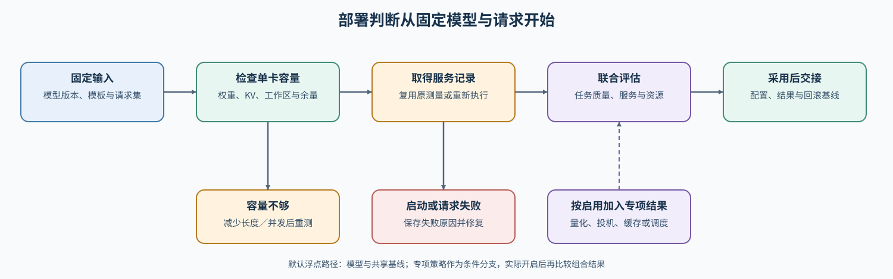
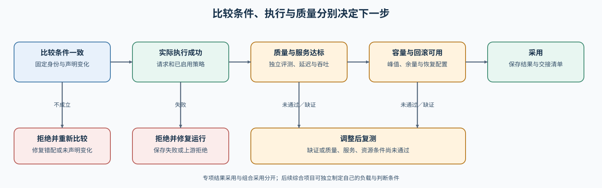

# 72. Multi Model Deployment Comparison | Single-GPU Deployment and Backend Comparison

**难度：** Hard | **环境：** CPU 完成候选审计与决策；NVIDIA 单 GPU 完成可选 backend benchmark | **标签：** `推理优化`, `单卡部署`, `vLLM`, `SGLang`, `部署交接` | **目标人群：** 项目决策练习者

> 🚀 **云端运行环境**
>
> 本章节的实战代码可以点击以下链接在免费 GPU 算力平台上直接运行：
>
> [](https://colab.research.google.com/github/datawhalechina/llm-algo-leetcode/blob/main/02_PyTorch_Algorithms/72_Multi_Model_Deployment_Comparison.ipynb)
> [](https://modelscope.cn/my/mynotebook) *(国内推荐：魔搭社区免费实例)*


---

## 本节导读

同一个模型能否稳定部署，取决于模型产物、分词器、显存预算、服务后端和请求负载是否形成一套可复测配置。本项目读取共享推理基线和专项策略证据，在单卡容量约束下执行候选服务，并把请求结果、质量、资源和失败状态汇总为部署判断。

学习过程中，你会先固定模型产物与 workload，再检查候选能否装入目标 GPU、后端是否执行了声明的策略，最后形成带回滚基线的交接清单。vLLM 是当前默认可运行后端；SGLang 在独立环境和稳定 Profile 就绪后作为可选对照。

**关键词：** `单卡部署`, `模型产物`, `容量准入`, `服务指标`, `回滚基线`, `部署交接`

---
## 前置阅读

先理解共享推理指标、量化产物和三个专项策略怎样形成独立证据，再进入本节组合部署候选。阅读时重点确认每份上游结果的模型身份、workload、决策状态和适用范围。

- [66. Inference Performance Comparison | 共享推理基线](./66_Inference_Performance_Comparison.md)
- [67. Quantized Inference and Deployment | 量化推理与部署](./67_Quantized_Inference_and_Deployment.md)
- [68. Speculative Decoding Benchmark | 投机解码候选](./68_Speculative_Decoding_Benchmark.md)
- [69. Prefix Caching Benchmark | 前缀缓存候选](./69_Prefix_Caching_Benchmark.md)
- [70. Serving Scheduler Benchmark | 服务调度候选](./70_Serving_Scheduler_Benchmark.md)
- [83. Quantized Serving Profile Benchmark | 量化服务配置](./83_Quantized_Serving_Profile_Benchmark.md)
### Step 1：把输入资产变成可执行的单卡部署候选

项目从一份可追溯的模型产物开始，将模型身份、请求负载、单卡容量和候选后端绑定成部署配置。共享基线提供参考指标；量化、投机解码、前缀缓存和调度结果只在实际启用时进入候选。项目输出不是“最快后端”标签，而是一份能够说明采用条件、缺失证据和回滚入口的交接资产。

| 项目阶段 | 输入 | 操作 | 输出 |
|:---|:---|:---|:---|
| 资产固定 | 模型版本、分词器、权重或量化产物 | 核对身份、格式与加载器 | 不可变资产清单 |
| 容量准入 | GPU 容量、上下文、并发和运行时余量 | 检查常驻权重、KV Cache 与工作区 | `ready / over_budget` |
| 候选执行 | 固定 workload、候选后端和启用策略 | 发送真实请求并保存原始结果 | 服务指标、输出和失败证据 |
| 证据汇总 | 共享基线、专项结果和质量记录 | 检查配对、证据完整性与 SLO | `accept / tune / reject` |
| 项目交接 | 已采用候选与参考基线 | 登记产物、配置、风险和回滚路径 | 单卡部署交接清单 |


### Step 2：用容量账本和执行身份建立准入条件

模型名称不能代表实际部署对象。候选必须固定模型 revision、分词器、聊天模板、产物摘要和数据类型，并把显存拆成常驻产物、KV Cache、运行时工作区和安全余量。后端名称也不能证明策略生效；只有加载记录、启动配置和运行指标与声明一致，候选才允许进入服务比较。

| 检查对象 | 使用证据 | 通过条件 | 失败动作 |
|:---|:---|:---|:---|
| 模型身份 | revision、分词器和模板摘要 | 基线与候选指向预期模型语义 | 修复身份后重新加载 |
| 服务产物 | artifact 路径、格式、摘要和加载器 | 实际加载产物与登记资产一致 | 更换产物或兼容后端 |
| 容量账本 | 权重、KV Cache、工作区、峰值显存和余量 | 峰值不越界且保留安全余量 | 降低上下文、并发或更换硬件 |
| 执行路径 | 后端版本、启动配置和策略指标 | 声明的缓存、投机或调度路径真实生效 | 排查回退，不解释性能收益 |
| workload | 请求集、生成长度、采样、并发和重复次数 | 比较组使用相同请求语义与测量流程 | 重建配对结果 |
### Step 3：把专项证据转成采用、补测或拒绝

部署候选先处理硬失败，再处理证据缺口，最后判断质量、服务目标、容量和回滚条件。启用某项策略却没有对应结果时，候选只能进入 `tune`；上游结果已经 `reject`、产物无法加载或请求执行失败时进入 `reject`；只有证据完整且全部门槛通过时才进入 `accept`。

| 证据层 | 需要回答的问题 | `tune` 条件 | `reject` 条件 |
|:---|:---|:---|:---|
| 共享基线 | 当前 workload 的参考指标是否完整 | 缺模型快照、质量或资源字段 | 基线执行失败且无法复测 |
| 量化配置 | 产物是否被目标加载器消费且质量可接受 | 缺 loader、kernel 或质量证据 | 产物不兼容或质量越界 |
| 投机解码 | 提议—验证路径是否生效且输出一致 | 缺接受统计或收益不稳定 | 输出不一致或执行失败 |
| 前缀缓存 | 命名空间与真实命中是否成立 | 缺命中、容量或驱逐证据 | 错误复用或性能明显退化 |
| 服务调度 | 同负载策略对照是否满足延迟与公平性 | 只有负载扫描、缺真实候选 | 请求丢失、重复或 SLO 越界 |
| 综合采用 | 质量、成功率、TTFT、TPOT、吞吐、显存和回滚是否齐全 | 任一关键证据待补 | 硬失败或不可恢复门槛失守 |


### Step 4：实现部署配对、证据汇总与交接决策

题目使用简化的基线、候选和上游项目记录。骨架已经提供字段读取、问题列表和结果装配；学习者需要补全配对条件、上游证据状态、部署门槛和最终状态顺序。测试覆盖可采用候选、未声明变化、证据缺失、上游拒绝、SLO 未达标和后端失败。

| 任务与目的 | 已知条件 | 完成标准 | 测试验证 |
|:---|:---|:---|:---|
| TODO 1：核对部署配对 | 基线、候选、固定身份与声明变化 | 固定资产和 workload 一致，所有实际变化均已声明，容量状态可用 | 合法候选、产物错配和未声明变化 |
| TODO 2：汇总专项证据 | 启用策略与量化、投机、缓存、调度记录 | 缺记录、待补结果和上游拒绝分别保留 | 完整证据、缺失记录、`tune` 与 `reject` |
| TODO 3：检查部署门槛 | 质量、成功率、TTFT、TPOT、吞吐、显存与回滚 | 指标方向正确且全部满足当前服务目标 | 延迟越界、吞吐不足和容量越界 |
| TODO 4：形成部署状态 | 硬失败、证据缺口和门槛结果 | 硬失败拒绝，缺证或未达标调优，全部通过才采用 | `accept`、`tune`、`reject` |

```python
from typing import Any, Dict, List

```


```python
# 题目区只挖空会改变部署结论的配对、证据、门槛与状态判断。

def compare_deployment_pair(baseline, candidate):
    """检查固定资产、workload、声明变化和候选容量。"""
    fixed_fields = ('model_id', 'revision', 'tokenizer_revision', 'artifact_digest', 'dtype', 'workload_key')
    controlled_fields = ('backend', 'enabled_strategies', 'max_model_len', 'concurrency')
    mismatches = [field for field in fixed_fields if baseline.get(field) != candidate.get(field)]
    changed_fields = [field for field in controlled_fields if baseline.get(field) != candidate.get(field)]
    declared_changes = sorted(candidate.get('declared_changes', []))
    # ==========================================
    # TODO 1：核对部署配对
    # ==========================================
    # identity_ok = ???  # 所有固定身份字段必须一致
    # changes_ok = ???  # 实际变化集合必须与声明变化集合完全一致且非空
    # capacity_ok = ???  # 候选容量状态必须为 ready
    raise NotImplementedError('TODO 1：请核对部署配对')
    issues = [f'fixed.{field}' for field in mismatches]
    if not changes_ok:
        issues.append('undeclared_or_empty_change')
    if not capacity_ok:
        issues.append('capacity')
    return {'comparable': identity_ok and changes_ok and capacity_ok,
            'issues': issues, 'changed_fields': changed_fields}


def summarize_strategy_evidence(enabled_strategies, evidence_by_strategy):
    """区分缺失、待补和已拒绝的上游证据。"""
    supported = {'quantized_profile', 'speculative', 'prefix_cache', 'scheduler'}
    unknown = sorted(set(enabled_strategies) - supported)
    records = {name: evidence_by_strategy.get(name) for name in enabled_strategies if name in supported}
    missing = sorted(name for name, record in records.items() if record is None)
    statuses = {name: (record or {}).get('decision') for name, record in records.items() if record is not None}
    # ==========================================
    # TODO 2：汇总专项证据
    # ==========================================
    # rejected = ???  # decision 为 reject 的已启用策略
    # incomplete = ???  # decision 不是 accept/reject 或仍待补的已启用策略
    raise NotImplementedError('TODO 2：请汇总专项证据')
    return {'unknown_strategies': unknown, 'missing_evidence': missing,
            'incomplete_evidence': incomplete, 'hard_failures': rejected,
            'records': records}


def evaluate_deployment_gates(candidate, limits):
    """检查质量、服务指标、容量和回滚门槛。"""
    # ==========================================
    # TODO 3：检查部署门槛
    # ==========================================
    # quality_ok = ???  # 质量状态通过且成功率不低于下限
    # service_ok = ???  # TTFT/TPOT 不越界且吞吐不低于下限
    # capacity_ok = ???  # 峰值显存不越界并保留正余量
    # rollback_ok = ???  # 已登记可恢复的参考基线
    raise NotImplementedError('TODO 3：请检查部署门槛')
    return {'quality_ok': quality_ok, 'service_ok': service_ok,
            'capacity_ok': capacity_ok, 'rollback_ok': rollback_ok}


def decide_single_gpu_deployment(comparison, strategy_summary, gates, candidate):
    """按硬失败、缺证和部署门槛顺序形成状态。"""
    hard_failures = list(strategy_summary['hard_failures'])
    if candidate.get('failure'):
        hard_failures.append('backend')
    if not comparison.get('comparable'):
        hard_failures.append('deployment_pair')
    evidence_gaps = (list(strategy_summary['unknown_strategies'])
                     + list(strategy_summary['missing_evidence'])
                     + list(strategy_summary['incomplete_evidence']))
    all_gates_passed = all(gates.values())
    # ==========================================
    # TODO 4：形成部署状态
    # ==========================================
    # decision = ???  # hard failure→reject；缺证或门槛未过→tune；否则 accept
    # next_action = ???  # 与 decision 对应的修复、补测或交接动作
    raise NotImplementedError('TODO 4：请形成部署状态')
    return {'decision': decision, 'next_action': next_action,
            'hard_failures': hard_failures, 'evidence_gaps': evidence_gaps,
            'gates': gates}

```

### 测试

测试分别验证配对中的未声明变化、四类上游证据状态、指标方向、容量边界和决策优先级。CPU 结果只证明项目门禁正确，不替代 Step 5 的真实服务证据。

```python
def _deployment_pair():
    """构造固定资产一致、只改变后端的合法部署配对。"""
    baseline = {
        'model_id': 'model', 'revision': 'commit', 'tokenizer_revision': 'tokenizer-commit',
        'artifact_digest': 'sha256:a', 'dtype': 'bf16', 'workload_key': 'fixed-v1',
        'backend': 'vllm', 'enabled_strategies': (), 'max_model_len': 2048,
        'concurrency': 1, 'capacity_status': 'ready',
    }
    candidate = {**baseline, 'backend': 'sglang', 'declared_changes': ['backend']}
    return baseline, candidate


def _ready_candidate(**updates):
    """构造满足质量、服务、容量与回滚门槛的候选记录。"""
    record = {
        'quality_status': 'passed', 'success_rate': 1.0,
        'ttft_p95_ms': 90.0, 'tpot_p95_ms': 12.0,
        'throughput_tokens_per_s': 120.0, 'peak_memory_gb': 9.5,
        'memory_headroom_gb': 1.5, 'rollback_ready': True, 'failure': None,
    }
    record.update(updates)
    return record


def _limits():
    """返回测试使用的部署服务目标。"""
    return {'min_success_rate': 0.99, 'max_ttft_p95_ms': 120.0,
            'max_tpot_p95_ms': 15.0, 'min_throughput_tokens_per_s': 100.0,
            'max_peak_memory_gb': 11.0}


def test_deployment_pair_contract():
    """验证合法后端变化以及产物错配和未声明变化。"""
    baseline, candidate = _deployment_pair()
    assert compare_deployment_pair(baseline, candidate)['comparable']
    assert not compare_deployment_pair(baseline, {**candidate, 'artifact_digest': 'sha256:b'})['comparable']
    assert not compare_deployment_pair(baseline, {**candidate, 'concurrency': 4})['comparable']


def test_strategy_evidence_states():
    """验证缺失、待补和上游拒绝不会被当作完整证据。"""
    complete = summarize_strategy_evidence(
        ['quantized_profile', 'prefix_cache'],
        {'quantized_profile': {'decision': 'accept'}, 'prefix_cache': {'decision': 'accept'}},
    )
    assert not complete['missing_evidence'] and not complete['incomplete_evidence'] and not complete['hard_failures']
    missing = summarize_strategy_evidence(['scheduler'], {})
    assert missing['missing_evidence'] == ['scheduler']
    mixed = summarize_strategy_evidence(
        ['speculative', 'prefix_cache'],
        {'speculative': {'decision': 'tune'}, 'prefix_cache': {'decision': 'reject'}},
    )
    assert mixed['incomplete_evidence'] == ['speculative']
    assert mixed['hard_failures'] == ['prefix_cache']


def test_deployment_gate_directions():
    """验证延迟与显存使用上限、吞吐与成功率使用下限。"""
    assert all(evaluate_deployment_gates(_ready_candidate(), _limits()).values())
    assert not evaluate_deployment_gates(_ready_candidate(ttft_p95_ms=130.0), _limits())['service_ok']
    assert not evaluate_deployment_gates(_ready_candidate(throughput_tokens_per_s=90.0), _limits())['service_ok']
    assert not evaluate_deployment_gates(_ready_candidate(peak_memory_gb=11.5), _limits())['capacity_ok']


def test_deployment_decision_priority():
    """验证硬失败先于缺证，完整证据和门槛全部通过才采用。"""
    baseline, candidate_config = _deployment_pair()
    comparison = compare_deployment_pair(baseline, candidate_config)
    summary = summarize_strategy_evidence(['prefix_cache'], {'prefix_cache': {'decision': 'accept'}})
    candidate = _ready_candidate()
    gates = evaluate_deployment_gates(candidate, _limits())
    assert decide_single_gpu_deployment(comparison, summary, gates, candidate)['decision'] == 'accept'
    incomplete = summarize_strategy_evidence(['prefix_cache'], {'prefix_cache': {'decision': 'tune'}})
    assert decide_single_gpu_deployment(comparison, incomplete, gates, candidate)['decision'] == 'tune'
    failed = {**candidate, 'failure': 'backend_start_failed'}
    assert decide_single_gpu_deployment(comparison, summary, gates, failed)['decision'] == 'reject'


def run_deployment_project_tests():
    """按固定顺序执行单卡部署项目测试。"""
    for test in (test_deployment_pair_contract, test_strategy_evidence_states,
                 test_deployment_gate_directions, test_deployment_decision_priority):
        test()
    print('✅ 72：部署配对、专项证据、服务门槛与采用状态均已验证。')


try:
    run_deployment_project_tests()
except NotImplementedError:
    print('请先完成 TODO 部分的代码！')

```

---

## 参考代码与解析

### 代码

```python
# 题目区只挖空会改变部署结论的配对、证据、门槛与状态判断。

def compare_deployment_pair(baseline, candidate):
    """检查固定资产、workload、声明变化和候选容量。"""
    fixed_fields = ('model_id', 'revision', 'tokenizer_revision', 'artifact_digest', 'dtype', 'workload_key')
    controlled_fields = ('backend', 'enabled_strategies', 'max_model_len', 'concurrency')
    mismatches = [field for field in fixed_fields if baseline.get(field) != candidate.get(field)]
    changed_fields = [field for field in controlled_fields if baseline.get(field) != candidate.get(field)]
    declared_changes = sorted(candidate.get('declared_changes', []))
    # ==========================================
    # TODO 1：核对部署配对
    # ==========================================
    identity_ok = not mismatches
    changes_ok = bool(changed_fields) and sorted(changed_fields) == declared_changes
    capacity_ok = candidate.get('capacity_status') == 'ready'
    issues = [f'fixed.{field}' for field in mismatches]
    if not changes_ok:
        issues.append('undeclared_or_empty_change')
    if not capacity_ok:
        issues.append('capacity')
    return {'comparable': identity_ok and changes_ok and capacity_ok,
            'issues': issues, 'changed_fields': changed_fields}


def summarize_strategy_evidence(enabled_strategies, evidence_by_strategy):
    """区分缺失、待补和已拒绝的上游证据。"""
    supported = {'quantized_profile', 'speculative', 'prefix_cache', 'scheduler'}
    unknown = sorted(set(enabled_strategies) - supported)
    records = {name: evidence_by_strategy.get(name) for name in enabled_strategies if name in supported}
    missing = sorted(name for name, record in records.items() if record is None)
    statuses = {name: (record or {}).get('decision') for name, record in records.items() if record is not None}
    # ==========================================
    # TODO 2：汇总专项证据
    # ==========================================
    rejected = sorted(name for name, status in statuses.items() if status == 'reject')
    incomplete = sorted(name for name, status in statuses.items() if status not in {'accept', 'reject'})
    return {'unknown_strategies': unknown, 'missing_evidence': missing,
            'incomplete_evidence': incomplete, 'hard_failures': rejected,
            'records': records}


def evaluate_deployment_gates(candidate, limits):
    """检查质量、服务指标、容量和回滚门槛。"""
    # ==========================================
    # TODO 3：检查部署门槛
    # ==========================================
    quality_ok = (candidate.get('quality_status') == 'passed'
                  and candidate.get('success_rate', 0.0) >= limits['min_success_rate'])
    service_ok = (candidate.get('ttft_p95_ms', float('inf')) <= limits['max_ttft_p95_ms']
                  and candidate.get('tpot_p95_ms', float('inf')) <= limits['max_tpot_p95_ms']
                  and candidate.get('throughput_tokens_per_s', 0.0) >= limits['min_throughput_tokens_per_s'])
    capacity_ok = (candidate.get('peak_memory_gb', float('inf')) <= limits['max_peak_memory_gb']
                   and candidate.get('memory_headroom_gb', 0.0) > 0.0)
    rollback_ok = candidate.get('rollback_ready') is True
    return {'quality_ok': quality_ok, 'service_ok': service_ok,
            'capacity_ok': capacity_ok, 'rollback_ok': rollback_ok}


def decide_single_gpu_deployment(comparison, strategy_summary, gates, candidate):
    """按硬失败、缺证和部署门槛顺序形成状态。"""
    hard_failures = list(strategy_summary['hard_failures'])
    if candidate.get('failure'):
        hard_failures.append('backend')
    if not comparison.get('comparable'):
        hard_failures.append('deployment_pair')
    evidence_gaps = (list(strategy_summary['unknown_strategies'])
                     + list(strategy_summary['missing_evidence'])
                     + list(strategy_summary['incomplete_evidence']))
    all_gates_passed = all(gates.values())
    # ==========================================
    # TODO 4：形成部署状态
    # ==========================================
    if hard_failures:
        decision, next_action = 'reject', 'repair_failed_candidate'
    elif evidence_gaps or not all_gates_passed:
        decision, next_action = 'tune', 'collect_evidence_or_adjust_candidate'
    else:
        decision, next_action = 'accept', 'write_deployment_handoff'
    return {'decision': decision, 'next_action': next_action,
            'hard_failures': hard_failures, 'evidence_gaps': evidence_gaps,
            'gates': gates}

```

### 解析

#### TODO 1：核对部署配对

- 固定身份和 workload 决定两次运行是否属于同一个部署问题；实际变化必须与声明集合完全一致。
- 测试分别改变产物摘要和未声明的并发，证明字段相似并不足以形成配对。

#### TODO 2：汇总专项证据

- 缺记录表示尚未测量，`tune` 表示证据仍不完整，`reject` 表示已经确认硬失败，三者不能合并。
- 测试同时构造完整、缺失和混合状态，检查每种状态进入正确列表。

#### TODO 3：检查部署门槛

- 延迟和峰值显存使用上限，吞吐、成功率和显存余量使用下限；质量状态与回滚入口必须显式通过。
- 测试分别让 TTFT、吞吐和峰值显存越界，防止把指标方向写反。

#### TODO 4：形成部署状态

- 后端失败、上游拒绝或不可比较候选先进入 `reject`；缺证和未达标候选进入 `tune`。
- 只有配对、专项证据和全部部署门槛同时通过时，测试才允许输出 `accept`。
### Step 5：单卡部署证据汇总与可选新鲜复测

默认路径直接复用 66 已登记的真实 vLLM 基线，并自动读取 68、69、70 的专项证据；它不会重复占用 GPU，也不会把不同模型或不同 workload 的结果拼成一个受控对照。只有需要确认环境漂移时，才把 `RUN_FRESH_BENCHMARK` 改为 `True`，Notebook 会使用同一冻结 workload 自动启动、测量并清理 vLLM。

| 默认可完成 | 可选 GPU 复测 | 本页输出 |
|:---|:---|:---|
| 模型快照、workload、容量、上游策略和回滚基线审计 | 同模型、同 workload 的新鲜 vLLM 运行 | 始终保存评估记录；只有全部门槛通过才保存部署交接 |

#### 5.1 最小配置

日常运行只需要决定是否新鲜复测，并为正式复测更换 `RUN_LABEL`。模型、dtype、请求数、生成长度、并发、warmup 和重复次数全部从 66 的共享基线读取；专项证据使用本轮已经登记的稳定路径。


```python
# 5.1：唯一可编辑配置。默认只做只读汇总，不重复启动模型。
RUN_FRESH_BENCHMARK = False  # 环境或软件栈变化后才改为 True。
RUN_LABEL = 'rtx5070ti_single_gpu_delivery_v1'  # 正式复测使用新标签，保留历史结果。
SEMANTIC_ID = 'INF-SINGLE-GPU-DEPLOY'
SCHEMA_VERSION = 'inference-deployment-evaluation/v1'
QUALITY_EVIDENCE_PATH = None  # 独立任务质量 JSON；缺失时可以评估，但不能形成 accept 交接。

PROFILE_ID = 'INF-VLLM-011-CU128'
BASELINE_RESULT_PATH = 'benchmarks/results/66_g0_vllm_baseline.json'
RESULT_DIR = 'benchmarks/results/72_single_gpu_deployment'
EVALUATION_PATH = f'{RESULT_DIR}/72_evaluation_{RUN_LABEL}.json'
HANDOFF_PATH = f'{RESULT_DIR}/inference_deployment_handoff_{RUN_LABEL}.json'
UPSTREAM_EVIDENCE_PATHS = {
    'speculative': 'benchmarks/results/68_evidence_record_rtx5070ti_speculative_ngram_smoke_v3.json',
    'prefix_cache': 'benchmarks/results/69_evidence_record_rtx5070ti_prefix_cache_v4.json',
    'scheduler': 'benchmarks/results/70_serving_scheduler/70_evidence_record_rtx5070ti_scheduler_priority_v4.json',
}
LIMITS = {
    'min_success_rate': 1.0,
    'max_ttft_p95_ms': 300.0,
    'max_tpot_p95_ms': 40.0,
    'min_throughput_tokens_per_s': 1.0,
    'max_peak_memory_gib': 11.0,
}

```

#### 5.2 自动解析共享基线、模型快照与上游证据

本单元只读取稳定 JSON 和本地缓存，不访问网络。12 GB 显卡在系统中通常显示约 11.4 GiB，因此容量门槛直接使用 GiB 和真实峰值，不再用“至少 12 GiB”误拒绝这台机器。


```python
# 5.2：自动解析，不填写 revision、摘要、显存余量或服务地址。
from pathlib import Path
import json
import torch

from tools.inference_project_runtime import locate_repo_root
from tools.model_runtime import find_cached_snapshot

REPO_ROOT = locate_repo_root()


def read_json(path_value, *, required=False):
    """读取仓库相对 JSON；可选证据不存在时返回 None。"""
    if not path_value:
        return None
    path = Path(path_value)
    if not path.is_absolute():
        path = REPO_ROOT / path
    if not path.is_file():
        if required:
            raise FileNotFoundError(f'缺少必需记录：{path}')
        return None
    payload = json.loads(path.read_text(encoding='utf-8'))
    if not isinstance(payload, dict):
        raise ValueError(f'记录必须是 JSON object：{path}')
    return payload


baseline_record = read_json(BASELINE_RESULT_PATH, required=True)
baseline_contract = baseline_record.get('baseline_contract') or {}
model_identity = baseline_record.get('model_identity') or {}
model_id = baseline_contract.get('model_id') or baseline_record.get('model')
resolved_revision = model_identity.get('resolved_snapshot')
local_snapshot = find_cached_snapshot(model_id, 'auto') if model_id else None
quality_record = read_json(QUALITY_EVIDENCE_PATH)
upstream_records = {
    name: read_json(path) for name, path in UPSTREAM_EVIDENCE_PATHS.items()
}

workload_path = baseline_contract.get('workload_path')
workload_file = REPO_ROOT / workload_path if workload_path else None
visible_gpu_count = torch.cuda.device_count() if torch.cuda.is_available() else 0
gpu_total_gib = (
    torch.cuda.get_device_properties(0).total_memory / 1024**3
    if visible_gpu_count == 1 else None
)

baseline_metrics = baseline_record.get('metrics') or {}
required_metric_paths = {
    'successful_requests': baseline_metrics.get('successful_requests'),
    'failed_requests': baseline_metrics.get('failed_requests'),
    'ttft_p95_ms': (baseline_metrics.get('ttft_ms') or {}).get('p95'),
    'tpot_p95_ms': (baseline_metrics.get('tpot_ms') or {}).get('p95'),
    'throughput_tokens_per_s': baseline_metrics.get('output_token_throughput_per_s'),
    'peak_memory_mb': baseline_metrics.get('peak_memory_mb'),
}
preflight_issues = []
if baseline_contract.get('schema_version') != 'inference-baseline/v2':
    preflight_issues.append('baseline_contract_invalid')
if not workload_file or not workload_file.is_file():
    preflight_issues.append('workload_missing')
if local_snapshot is None:
    preflight_issues.append('model_snapshot_missing')
elif resolved_revision and local_snapshot.name != resolved_revision:
    preflight_issues.append('model_revision_mismatch')
if any(value is None for value in required_metric_paths.values()):
    preflight_issues.append('baseline_metrics_incomplete')
if baseline_record.get('quality', {}).get('status') != 'passed':
    preflight_issues.append('baseline_operational_quality_failed')

preflight = {
    'status': 'ready' if not preflight_issues else 'blocked',
    'issues': preflight_issues,
    'profile_id': PROFILE_ID,
    'model_id': model_id,
    'resolved_revision': resolved_revision,
    'local_snapshot': str(local_snapshot) if local_snapshot else None,
    'workload_path': workload_path,
    'gpu': {
        'cuda_available': torch.cuda.is_available(),
        'visible_count': visible_gpu_count,
        'total_gib': round(gpu_total_gib, 3) if gpu_total_gib is not None else None,
    },
    'baseline_metrics': required_metric_paths,
}
print(json.dumps(preflight, ensure_ascii=False, indent=2))
if RUN_FRESH_BENCHMARK and preflight_issues:
    raise RuntimeError(f'新鲜复测未通过预检：{preflight_issues}')
if RUN_FRESH_BENCHMARK and visible_gpu_count != 1:
    raise RuntimeError('新鲜复测要求恰好一张可见 NVIDIA GPU')

```

#### 5.3 自动形成策略组合边界

上游 `accept` 只说明该策略在自己的 workload 中通过门槛，不代表可以直接拼进当前单并发部署配置。模型或 workload 不一致的证据保留为专项 Profile；`tune`、`reject` 和缺失证据不会进入主候选。


```python
# 5.3：提取上游决策并区分“可采用”“专项 Profile”和“暂不采用”。
def decision_value(record):
    if not isinstance(record, dict):
        return 'missing'
    decision = record.get('decision')
    if isinstance(decision, dict):
        return decision.get('decision') or decision.get('status') or 'not_evaluated'
    return decision or record.get('status') or 'not_evaluated'


def record_model(record):
    config = (record or {}).get('config') or {}
    return config.get('model') or config.get('target_model')


def record_workload(record):
    workload = (record or {}).get('workload') or {}
    return workload.get('source') or workload.get('path')


strategy_portfolio = {}
for name, record in upstream_records.items():
    decision = decision_value(record)
    same_model = record_model(record) == model_id
    source_workload = record_workload(record)
    same_workload = bool(source_workload and Path(source_workload).name == Path(workload_path).name)
    if decision == 'accept' and same_model and same_workload:
        disposition = 'eligible_for_primary_candidate'
    elif decision == 'accept' and same_model:
        disposition = 'retain_as_specialized_profile'
    elif decision == 'reject':
        disposition = 'exclude_rejected'
    else:
        disposition = 'hold_for_more_evidence'
    strategy_portfolio[name] = {
        'decision': decision,
        'same_model': same_model,
        'same_workload': same_workload,
        'source_workload': source_workload,
        'disposition': disposition,
        'source': UPSTREAM_EVIDENCE_PATHS[name],
    }

primary_strategies = sorted(
    name for name, item in strategy_portfolio.items()
    if item['disposition'] == 'eligible_for_primary_candidate'
)
candidate_identity = {
    'group': 'G0_vllm_default',
    'role': 'single_gpu_reference',
    'backend': baseline_contract.get('backend'),
    'model_id': model_id,
    'revision': resolved_revision,
    'dtype': baseline_contract.get('dtype'),
    'workload_path': workload_path,
    'enabled_strategies': primary_strategies,
}
print(json.dumps({
    'candidate': candidate_identity,
    'strategy_portfolio': strategy_portfolio,
}, ensure_ascii=False, indent=2))

```

#### 5.4 复用真实基线或执行新鲜复测

默认直接引用 66 的真实结果。开启新鲜复测后，Notebook 从本地缓存启动与 66 相同的 vLLM 配置，完成测量后在 `finally` 中清理整个服务进程组；不需要另开终端或手填端口。


```python
# 5.4：默认零 GPU 重复成本；显式开启后自动启动、测量和清理服务。
from tools.inference_project_runtime import (
    run_backend_benchmark,
    start_optional_vllm,
    stop_optional_vllm,
)
from tools.project_runtime import save_json_record_once

RESULT_ROOT = REPO_ROOT / RESULT_DIR
RESULT_ROOT.mkdir(parents=True, exist_ok=True)
fresh_raw_result_path = RESULT_ROOT / f'g0_vllm_default_raw_{RUN_LABEL}.json'
fresh_result_path = RESULT_ROOT / f'g0_vllm_default_{RUN_LABEL}.json'

if RUN_FRESH_BENCHMARK:
    collisions = [path for path in (fresh_raw_result_path, fresh_result_path) if path.exists()]
    if collisions:
        raise FileExistsError(f'当前 RUN_LABEL 已有结果，请更换标签：{collisions}')
    server = log_handle = None
    try:
        server, log_handle, port, selected_dtype, model_path = start_optional_vllm(
            model_id=model_id,
            model_source='local',
            cache_dir='auto',
            dtype=baseline_contract['dtype'],
            max_model_len=2048,
            gpu_memory_utilization=0.80,
            enforce_eager=True,
            served_model_name=model_id,
            enable_prefix_caching=False,
            scheduling_policy='fcfs',
            log_path=RESULT_ROOT / f'g0_vllm_default_{RUN_LABEL}.log',
        )
        candidate_result = run_backend_benchmark(
            project='72',
            base_url=f'http://127.0.0.1:{port}',
            model=model_id,
            label='G0_vllm_default',
            output=fresh_raw_result_path,
            workload=workload_path,
            num_prompts=baseline_contract['num_prompts'],
            max_tokens=baseline_contract['max_tokens'],
            concurrency=baseline_contract['concurrency'],
            warmup=baseline_contract['warmup'],
            repeats=baseline_contract['repeats'],
            backend='vllm',
            dtype=selected_dtype,
            batch=baseline_contract['batch'],
            role='single_gpu_reference',
            measure_device_peak_memory=True,
            include_requests=True,
        )
        candidate_result.update({'semantic_id': SEMANTIC_ID, 'run_label': RUN_LABEL, 'run_mode': 'fresh_backend', 'raw_result_path': str(fresh_raw_result_path)})
        candidate_result['deployment_identity'] = candidate_identity
        save_json_record_once(fresh_result_path, candidate_result)
        result_source = str(fresh_result_path.relative_to(REPO_ROOT))
    finally:
        if server is not None:
            stop_optional_vllm(server, log_handle)
else:
    candidate_result = baseline_record
    result_source = BASELINE_RESULT_PATH
    print('复用 66 真实基线；未重复启动 GPU 服务。')

```

#### 5.5 核对服务、容量与质量证据

请求完整和输出非空属于运行正确性，不等于任务语义质量。缺少独立质量记录时，本机结果可以证明服务可运行并满足资源门槛，但项目状态必须保持 `tune`。


```python
# 5.5：缺失值保持 None；不把“有输出”补成任务质量通过。
def p95(metrics, key):
    value = (metrics or {}).get(key)
    return value.get('p95') if isinstance(value, dict) else value


def independent_quality_passed(record):
    if not isinstance(record, dict):
        return False
    decision = record.get('decision')
    if isinstance(decision, dict):
        decision = decision.get('decision') or decision.get('status')
    status = record.get('status') or (record.get('quality') or {}).get('status')
    return decision == 'accept' or status in {'passed', 'accept'}


metrics = candidate_result.get('metrics') or {}
successful = metrics.get('successful_requests')
failed = metrics.get('failed_requests')
total = successful + failed if isinstance(successful, int) and isinstance(failed, int) else None
success_rate = successful / total if total else None
peak_memory_mb = metrics.get('peak_memory_mb')
peak_memory_gib = peak_memory_mb / 1024 if isinstance(peak_memory_mb, (int, float)) else None
observed = {
    'success_rate': success_rate,
    'ttft_p95_ms': p95(metrics, 'ttft_ms'),
    'tpot_p95_ms': p95(metrics, 'tpot_ms'),
    'throughput_tokens_per_s': metrics.get('output_token_throughput_per_s'),
    'peak_memory_gib': peak_memory_gib,
    'headroom_to_limit_gib': (
        LIMITS['max_peak_memory_gib'] - peak_memory_gib
        if peak_memory_gib is not None else None
    ),
}
operational_quality_ok = (
    success_rate == 1.0
    and baseline_record.get('quality', {}).get('status') == 'passed'
)
service_gates = {
    'success_rate': success_rate is not None and success_rate >= LIMITS['min_success_rate'],
    'ttft_p95': observed['ttft_p95_ms'] is not None
    and observed['ttft_p95_ms'] <= LIMITS['max_ttft_p95_ms'],
    'tpot_p95': observed['tpot_p95_ms'] is not None
    and observed['tpot_p95_ms'] <= LIMITS['max_tpot_p95_ms'],
    'throughput': observed['throughput_tokens_per_s'] is not None
    and observed['throughput_tokens_per_s'] >= LIMITS['min_throughput_tokens_per_s'],
    'peak_memory': peak_memory_gib is not None
    and peak_memory_gib <= LIMITS['max_peak_memory_gib'],
    'operational_quality': operational_quality_ok,
    'independent_task_quality': independent_quality_passed(quality_record),
}
print(json.dumps({'observed': observed, 'gates': service_gates}, ensure_ascii=False, indent=2))

```

#### 5.6 保存评估记录；满足全部门槛时才生成交接

评估记录始终保存，便于区分“服务已验证”和“仍缺独立质量”。`inference-deployment-handoff/v1` 只在所有门槛通过时生成，避免下游综合项目误用未完成候选。


```python
# 5.6：保存阶段性评估；accept 才产生供 Part 05 消费的稳定交接。
from tools.project_runtime import save_json_record_once
hard_failures = list(preflight_issues)
if candidate_result.get('status') == 'failed' or candidate_result.get('failure'):
    hard_failures.append('backend_failure')
failed_gates = [name for name, passed in service_gates.items() if not passed]

if hard_failures:
    project_decision = 'reject'
    next_action = 'repair_baseline_or_backend_failure'
elif failed_gates:
    project_decision = 'tune'
    next_action = (
        'provide_independent_task_quality_evidence'
        if failed_gates == ['independent_task_quality']
        else 'repair_failed_service_or_quality_gates'
    )
else:
    project_decision = 'accept'
    next_action = 'handoff_to_integrated_delivery'

candidate_record = {
    **candidate_identity,
    'result_source': result_source,
    'observed': observed,
    'gates': service_gates,
    'decision': project_decision,
    'handoff_status': (
        'ready_for_integrated_evaluation'
        if project_decision == 'accept' else 'not_ready'
    ),
}
evaluation = {
    'schema_version': SCHEMA_VERSION,
    'semantic_id': SEMANTIC_ID,
    'run_label': RUN_LABEL,
    'run_mode': 'fresh_backend' if RUN_FRESH_BENCHMARK else 'read_only',
    'profile_id': PROFILE_ID,
    'workload': {
        'path': workload_path,
        'num_prompts': baseline_contract.get('num_prompts'),
        'max_tokens': baseline_contract.get('max_tokens'),
        'batch': baseline_contract.get('batch'),
        'concurrency': baseline_contract.get('concurrency'),
        'warmup': baseline_contract.get('warmup'),
        'repeats': baseline_contract.get('repeats'),
    },
    'candidate_records': [candidate_record],
    'strategy_portfolio': strategy_portfolio,
    'quality_evidence': QUALITY_EVIDENCE_PATH,
    'decision': {
        'decision': project_decision,
        'reason': next_action,
        'hard_failures': hard_failures,
        'failed_gates': failed_gates,
    },
    'rollback': {
        'ready': preflight['status'] == 'ready',
        'baseline_result': BASELINE_RESULT_PATH,
        'model_revision': resolved_revision,
    },
    'evidence_level': (
        'reused_real_backend_with_deployment_audit'
        if not RUN_FRESH_BENCHMARK else 'fresh_real_backend_deployment_audit'
    ),
}
evaluation_path = REPO_ROOT / EVALUATION_PATH
save_json_record_once(evaluation_path, evaluation)

saved = {'evaluation': str(evaluation_path), 'handoff': None}
if project_decision == 'accept':
    handoff = {
        'schema_version': 'inference-deployment-handoff/v1',
        'semantic_id': SEMANTIC_ID,
        'run_label': RUN_LABEL,
        'run_mode': evaluation['run_mode'],
        'workload': evaluation['workload'],
        'candidate_records': [candidate_record],
        'decision': 'accept',
        'rollback': evaluation['rollback'],
        'strategy_portfolio': strategy_portfolio,
        'quality_evidence': QUALITY_EVIDENCE_PATH,
    }
    handoff_path = REPO_ROOT / HANDOFF_PATH
    save_json_record_once(handoff_path, handoff)
    saved['handoff'] = str(handoff_path)

print(json.dumps({
    'decision': evaluation['decision'],
    'saved': saved,
}, ensure_ascii=False, indent=2))

```

## 相关阅读

- [Part 05 · 推理服务交付项目](../05_Integrated_Projects_and_Decisions/01_Inference_Service_Integrated_Project.md)
- [81. Distributed Inference Project | 分布式推理项目](./81_Distributed_Inference_Project.md)
- [vLLM 官方文档](https://docs.vllm.ai/)
- [SGLang 官方文档](https://docs.sglang.ai/)
