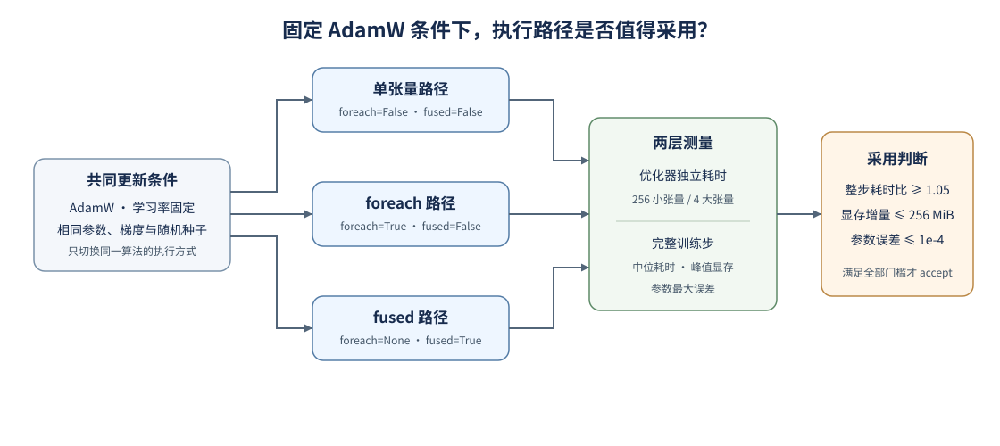
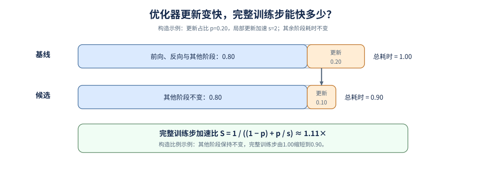

# 75. Optimizer Execution Path Benchmark | Optimizer Execution Path Benchmark

**难度：** Hard | **环境：** CPU 验证比较规则；单 GPU 测量执行路径 | **标签：** `AdamW`、`foreach`、`fused`、`基准对比` | **目标人群：** 需要理解训练步耗时构成者

> 🚀 **云端运行环境**
>
> 本章节的实战代码可以点击以下链接在免费 GPU 算力平台上直接运行：
>
> [](https://colab.research.google.com/github/datawhalechina/llm-algo-leetcode/blob/main/02_PyTorch_Algorithms/75_Optimizer_Execution_Path_Benchmark.ipynb)
> [](https://modelscope.cn/my/mynotebook) *(国内推荐：魔搭社区免费实例)*


## 本节导读

同一个 AdamW 更新可以逐张量执行，也可以使用 foreach 或 fused 路径。独立测量优化器调用能显示路径本身的差别，但训练步还包含前向和反向；本节用固定的小型训练任务检查局部提速是否能传递到整体，并同时核对显存与参数结果。学习率保持不变，不扫描调度策略。

**关键词：** `AdamW`、`optimizer execution path`、`training step`、`CUDA events`

## 前置阅读

**导语：** 先看优化器如何更新参数，再用训练基线的测量口径解释完整训练步的时间与显存。
- [12. 优化器更新与学习率调度](./12_Optimizer_Updates_and_Learning_Rate_Scheduling.md)
- [73. 训练性能分析](./73_Training_Performance_Analysis.md)

### Step 1：固定训练条件，对比 AdamW 的执行路径

三种候选仍使用 AdamW：single-tensor 逐个处理张量，foreach 批量提交同类张量运算，fused 融合更新中的多个运算。比较时只切换执行路径，学习率、权重衰减、初始参数、梯度和随机种子保持一致；实现收益还取决于张量布局与设备，因此同时测优化器调用和完整训练步。

| 比较环节 | 固定条件 | 记录证据 |
|:---|:---|:---|
| 优化器调用 | 相同总元素数；分别使用多小张量和少大张量 | AdamW 单步耗时、峰值分配显存 |
| 完整训练步 | 相同 MLP、输入、目标、批量与更新次数 | 训练步中位耗时、峰值显存、最终损失 |
| 数值核对 | 相同初始参数、梯度、学习率与权重衰减 | 相对单张量路径的最大参数误差 |
| 采用门槛 | 完整训练步至少快 5%，显存增量不超过 256 MiB，最大参数误差不超过 1e-4 | `accept` 或 `tune` 及各项门槛结果 |



### Step 2：张量布局如何改变更新成本

两种布局的总元素数相同，变化的是张量数量与单张量大小。逐张量路径可能反复承担调度和 kernel 启动开销；foreach 与 fused 有机会合并这些工作，但实际差异也受形状、数据类型和 PyTorch/CUDA 版本影响。这个对照用于解释张量组织带来的成本，不单独作为采用依据。

| 布局 | 张量数量 | 每个张量元素数 | 总元素数 |
|:---|---:|---:|---:|
| 多小张量 | 256 | 65,536 | 16,777,216 |
| 少大张量 | 4 | 4,194,304 | 16,777,216 |

### Step 3：用完整训练步和数值误差决定是否采用

优化器更新只占完整训练步的一部分，因此局部提速会被前向和反向的耗时稀释。设基线中优化器更新占比为 $p$，更新路径的局部加速比为 $s$，其余阶段耗时不变，则完整训练步加速比为

$$S = \frac{1}{(1-p)+p/s}$$

其中 $S$ 是完整训练步加速比。例如 $p=0.2$、$s=2$ 时，$S\approx1.11$，而不是 2。公式用于说明局部收益的上限；最终仍以配对测得的完整训练步为准，并同时检查显存增量与参数误差。

| 证据 | 比较方式 | 用途 |
|:---|:---|:---|
| 优化器单步中位数 | 两种张量布局分别与单张量路径比较 | 解释局部更新开销，不作为采用门槛 |
| 完整训练步中位数 | 固定 MLP、输入和测量轮数，候选与基线配对 | 主要速度门槛 |
| 峰值分配显存 | 完整训练步测量峰值 | 限制额外资源代价 |
| 参数最大绝对误差 | 更新后的参数逐项对比 | 检查数值路径差异 |



### Step 4：核对候选契约并筛选执行路径

候选遍历、字段读取和结果汇总已经提供。补全共同训练条件、执行路径映射和采用门槛三个判断；测试覆盖配置漂移、候选缺失、局部计时更快但整步收益不足，以及显存或数值门槛未通过。

| 任务与目的 | 已知条件 | 完成标准 | 测试验证 |
|:---|:---|:---|:---|
| TODO 1：核对共同训练条件 | AdamW、学习率、权重衰减和调度器 | 所有候选使用相同配置 | 配置漂移或优化器不符时判无效 |
| TODO 2：核对执行路径 | foreach/fused 开关与候选名称 | 开关与路径定义一致 | 路径错配时判无效 |
| TODO 3：筛选可采用路径 | 配对记录中的完整训练步、显存和参数误差 | 三项门槛同时通过；optimizer-only 计时不参与准入 | 整步收益不足、显存超限或误差超限均不能采用 |
| 固定骨架行为 | 候选集合、workload/seed 身份与测量字段 | 不完整或不可比证据返回 pending | 缺失测量和错误阈值均返回 pending |


```python
import math
from typing import Dict, List

```


```python
OPTIMIZER_PATHS = {
    'single_tensor': {'foreach': False, 'fused': False},
    'foreach': {'foreach': True, 'fused': False},
    'fused': {'foreach': None, 'fused': True},
}

def validate_comparison_contract(
    candidates: List[Dict[str, object]],
    learning_rate: float,
    weight_decay: float,
) -> Dict[str, object]:
    """确认候选只改变 AdamW 的执行路径。"""
    names = [row.get('name') for row in candidates]
    errors = []
    if len(names) != len(set(names)):
        errors.append('duplicate_candidate')
    if set(names) != set(OPTIMIZER_PATHS):
        errors.append('candidate_set_mismatch')
    for row in candidates:
        name = row.get('name')
        if name not in OPTIMIZER_PATHS:
            continue
        # ==========================================
        # TODO 1：核对共同训练配置
        # common_config_matches = ???  # bool；AdamW、学习率、权重衰减和调度器与基准一致
        # ==========================================
        raise NotImplementedError('TODO 1：请核对共同配置')
        if not common_config_matches:
            errors.append(f'{name}:common_config_mismatch')
        # ==========================================
        # TODO 2：核对候选执行路径
        # execution_path_matches = ???  # bool；foreach/fused 开关符合该候选的路径定义
        # ==========================================
        raise NotImplementedError('TODO 2：请核对执行路径')
        if not execution_path_matches:
            errors.append(f'{name}:execution_path_mismatch')
    return {'valid': not errors, 'errors': errors}

def select_optimizer_path(
    records: List[Dict[str, object]],
    minimum_speedup: float = 1.05,
    max_memory_increase_mb: float = 256.0,
    max_parameter_error: float = 1e-4,
) -> Dict[str, object]:
    """只按完整训练步收益与显存、数值门槛筛选路径。"""
    names = [row.get('name') for row in records]
    thresholds = (minimum_speedup, max_memory_increase_mb, max_parameter_error)
    invalid_threshold = any(
        not isinstance(value, (int, float)) or not math.isfinite(value)
        for value in thresholds
    )
    if (
        invalid_threshold
        or minimum_speedup <= 0
        or max_memory_increase_mb < 0
        or max_parameter_error < 0
    ):
        return {
            'decision': 'pending',
            'reason': 'invalid_threshold',
            'selected': None,
        }
    if len(names) != len(set(names)) or set(names) != set(OPTIMIZER_PATHS):
        return {
            'decision': 'pending',
            'reason': 'candidate_set_mismatch',
            'selected': None,
        }
    baseline = next(row for row in records if row.get('name') == 'single_tensor')
    if baseline.get('status') != 'ok':
        return {
            'decision': 'pending',
            'reason': 'baseline_unusable',
            'selected': None,
        }
    for row in records:
        if (
            row.get('status') != 'ok'
            or row.get('workload_id') != baseline.get('workload_id')
            or row.get('seed') != baseline.get('seed')
        ):
            return {
                'decision': 'pending',
                'reason': 'incomparable_evidence',
                'selected': None,
            }
        values = [
            row.get(key)
            for key in (
                'training_step_ms',
                'peak_allocated_mb',
                'max_parameter_error',
            )
        ]
        invalid_measurement = any(
            not isinstance(value, (int, float)) or not math.isfinite(value)
            for value in values
        )
        if (
            invalid_measurement
            or row['training_step_ms'] <= 0
            or row['peak_allocated_mb'] < 0
            or row['max_parameter_error'] < 0
        ):
            return {
                'decision': 'pending',
                'reason': 'missing_measurement',
                'selected': None,
            }
    evaluated = []
    for row in records:
        if row is baseline:
            continue
        speedup = baseline['training_step_ms'] / row['training_step_ms']
        memory_increase = row['peak_allocated_mb'] - baseline['peak_allocated_mb']
        parameter_error = row['max_parameter_error']
        # ==========================================
        # TODO 3：筛选可采用路径
        # eligible = ???  # bool；完整训练步加速、显存增量和参数误差均通过门槛
        # ==========================================
        raise NotImplementedError('TODO 3：请筛选可采用路径')
        evaluated.append({
            'name': row['name'],
            'eligible': eligible,
            'training_speedup': speedup,
            'optimizer_step_ms': row.get('optimizer_step_ms'),
        })
    selected = [row for row in evaluated if row['eligible']]
    selected.sort(key=lambda row: -row['training_speedup'])
    return {
        'decision': 'accept' if selected else 'tune',
        'selected': selected[0]['name'] if selected else None,
        'candidates': evaluated,
    }

```


```python
def test_contract_rejects_incomplete_and_duplicate_candidates():
    """候选必须齐全且不重复。"""
    candidates = [
        {
            'name': name,
            'optimizer': 'AdamW',
            'learning_rate': 1e-4,
            'weight_decay': 0.01,
            'scheduler': None,
            **path,
        }
        for name, path in OPTIMIZER_PATHS.items()
    ]
    assert validate_comparison_contract(candidates, 1e-4, 0.01)['valid']
    assert not validate_comparison_contract(candidates[:-1], 1e-4, 0.01)['valid']
    duplicated = candidates + [dict(candidates[0])]
    assert not validate_comparison_contract(duplicated, 1e-4, 0.01)['valid']

def test_contract_rejects_common_config_drift():
    """拒绝优化器或共同训练条件发生变化的候选。"""
    candidates = [
        {
            'name': name,
            'optimizer': 'AdamW',
            'learning_rate': 1e-4,
            'weight_decay': 0.01,
            'scheduler': None,
            **path,
        }
        for name, path in OPTIMIZER_PATHS.items()
    ]
    drifted = [dict(row) for row in candidates]
    drifted[1]['learning_rate'] = 2e-4
    assert not validate_comparison_contract(drifted, 1e-4, 0.01)['valid']
    wrong_optimizer = [dict(row) for row in candidates]
    wrong_optimizer[0]['optimizer'] = 'SGD'
    assert not validate_comparison_contract(wrong_optimizer, 1e-4, 0.01)['valid']

def test_contract_rejects_execution_path_mismatch():
    """候选开关必须符合其 foreach/fused 路径定义。"""
    candidates = [
        {
            'name': name,
            'optimizer': 'AdamW',
            'learning_rate': 1e-4,
            'weight_decay': 0.01,
            'scheduler': None,
            **path,
        }
        for name, path in OPTIMIZER_PATHS.items()
    ]
    wrong_path = [dict(row) for row in candidates]
    wrong_path[1]['fused'] = True
    assert not validate_comparison_contract(wrong_path, 1e-4, 0.01)['valid']

def _selection_fixture():
    """构造可比的基线与两条 AdamW 执行路径记录。"""
    baseline = {
        'name': 'single_tensor', 'status': 'ok', 'workload_id': 'mlp-v1',
        'seed': 42, 'training_step_ms': 10.0, 'optimizer_step_ms': 2.0,
        'peak_allocated_mb': 900.0, 'max_parameter_error': 0.0,
    }
    foreach = {
        'name': 'foreach', 'status': 'ok', 'workload_id': 'mlp-v1',
        'seed': 42, 'training_step_ms': 9.0, 'optimizer_step_ms': 1.0,
        'peak_allocated_mb': 910.0, 'max_parameter_error': 1e-6,
    }
    fused = {
        'name': 'fused', 'status': 'ok', 'workload_id': 'mlp-v1',
        'seed': 42, 'training_step_ms': 9.8, 'optimizer_step_ms': 0.5,
        'peak_allocated_mb': 910.0, 'max_parameter_error': 1e-6,
    }
    return baseline, foreach, fused

def test_selection_requires_complete_comparable_candidates():
    """候选缺失或 seed 不同，选择结果必须保持 pending。"""
    baseline, foreach, fused = _selection_fixture()
    assert select_optimizer_path([baseline, fused])['decision'] == 'pending'
    mismatched = {**foreach, 'seed': 7}
    assert select_optimizer_path([baseline, mismatched, fused])['decision'] == 'pending'

def test_selection_uses_full_step_not_local_optimizer_time():
    """局部优化器更快但完整训练步未达门槛时不采用。"""
    baseline, foreach, fused = _selection_fixture()
    no_gain = {**foreach, 'training_step_ms': 10.0}
    local_only = {**fused, 'training_step_ms': 9.8}
    result = select_optimizer_path([baseline, no_gain, local_only])
    assert result['decision'] == 'tune'
    assert all(not item['eligible'] for item in result['candidates'])

def test_selection_accepts_fastest_candidate_passing_all_gates():
    """完整训练步、显存和数值门槛通过后选择合格候选。"""
    baseline, foreach, fused = _selection_fixture()
    result = select_optimizer_path([baseline, foreach, fused])
    assert result['decision'] == 'accept'
    assert result['selected'] == 'foreach'

def test_selection_rejects_memory_and_numeric_gate_failures():
    """提速候选仍须通过显存增量和参数误差门槛。"""
    baseline, foreach, fused = _selection_fixture()
    no_gain = {**foreach, 'training_step_ms': 10.0}
    memory_blocked = {**fused, 'training_step_ms': 9.0, 'peak_allocated_mb': 1200.0}
    error_blocked = {**fused, 'training_step_ms': 9.0, 'max_parameter_error': 1e-2}
    assert select_optimizer_path([baseline, no_gain, memory_blocked])['decision'] == 'tune'
    assert select_optimizer_path([baseline, no_gain, error_blocked])['decision'] == 'tune'

def test_selection_marks_invalid_evidence_pending():
    """证据缺失、非有限或阈值无效时返回待判断。"""
    baseline = {
        'name': 'single_tensor', 'status': 'ok', 'workload_id': 'mlp-v1',
        'seed': 42, 'training_step_ms': 10.0, 'optimizer_step_ms': 2.0,
        'peak_allocated_mb': 900.0, 'max_parameter_error': 0.0,
    }
    foreach = {
        'name': 'foreach', 'status': 'ok', 'workload_id': 'mlp-v1',
        'seed': 42, 'training_step_ms': 9.0, 'optimizer_step_ms': 1.0,
        'peak_allocated_mb': 910.0, 'max_parameter_error': 1e-6,
    }
    fused = {**foreach, 'name': 'fused'}
    missing = {**fused}
    del missing['peak_allocated_mb']
    assert select_optimizer_path([baseline, foreach, missing])['decision'] == 'pending'
    non_finite = {**fused, 'training_step_ms': float('nan')}
    assert select_optimizer_path([baseline, foreach, non_finite])['decision'] == 'pending'
    assert select_optimizer_path([baseline, foreach, fused], minimum_speedup=0)['decision'] == 'pending'

test_contract_rejects_incomplete_and_duplicate_candidates()
test_contract_rejects_common_config_drift()
test_contract_rejects_execution_path_mismatch()
test_selection_requires_complete_comparable_candidates()
test_selection_uses_full_step_not_local_optimizer_time()
test_selection_accepts_fastest_candidate_passing_all_gates()
test_selection_rejects_memory_and_numeric_gate_failures()
test_selection_marks_invalid_evidence_pending()
print('AdamW 执行路径契约、证据有效性与采用门槛测试通过。')

```

🛑 **STOP HERE** 🛑

## 参考代码与解析

### 代码


```python
OPTIMIZER_PATHS = {
    'single_tensor': {'foreach': False, 'fused': False},
    'foreach': {'foreach': True, 'fused': False},
    'fused': {'foreach': None, 'fused': True},
}

def validate_comparison_contract(
    candidates: List[Dict[str, object]],
    learning_rate: float,
    weight_decay: float,
) -> Dict[str, object]:
    """验证候选只改变 AdamW 的执行路径。"""
    names = [row.get('name') for row in candidates]
    errors = []
    if len(names) != len(set(names)):
        errors.append('duplicate_candidate')
    if set(names) != set(OPTIMIZER_PATHS):
        errors.append('candidate_set_mismatch')
    for row in candidates:
        name = row.get('name')
        if name not in OPTIMIZER_PATHS:
            continue
        # TODO 1：核对共同训练配置
        common_config_matches = (
            row.get('optimizer') == 'AdamW'
            and row.get('learning_rate') == learning_rate
            and row.get('weight_decay') == weight_decay
            and row.get('scheduler') is None
        )
        # TODO 2：核对候选执行路径
        execution_path_matches = {
            'foreach': row.get('foreach'),
            'fused': row.get('fused'),
        } == OPTIMIZER_PATHS[name]
        if not common_config_matches:
            errors.append(f'{name}:common_config_mismatch')
        if not execution_path_matches:
            errors.append(f'{name}:execution_path_mismatch')
    return {'valid': not errors, 'errors': errors}

def select_optimizer_path(
    records: List[Dict[str, object]],
    minimum_speedup: float = 1.05,
    max_memory_increase_mb: float = 256.0,
    max_parameter_error: float = 1e-4,
) -> Dict[str, object]:
    """按完整训练步、显存和数值门槛筛选执行路径。"""
    import math

    thresholds = (minimum_speedup, max_memory_increase_mb, max_parameter_error)
    invalid_threshold = any(
        not isinstance(value, (int, float))
        or not math.isfinite(value)
        or value < 0
        for value in thresholds
    )
    if invalid_threshold or minimum_speedup <= 0:
        return {
            'decision': 'pending',
            'reason': 'invalid_threshold',
            'selected': None,
        }
    names = [row.get('name') for row in records]
    if len(names) != len(set(names)) or set(names) != set(OPTIMIZER_PATHS):
        return {
            'decision': 'pending',
            'reason': 'candidate_set_mismatch',
            'selected': None,
        }
    baseline = next(row for row in records if row.get('name') == 'single_tensor')
    required = ('training_step_ms', 'peak_allocated_mb', 'max_parameter_error')
    for row in records:
        if (
            row.get('status') != 'ok'
            or row.get('workload_id') != baseline.get('workload_id')
            or row.get('seed') != baseline.get('seed')
        ):
            return {
                'decision': 'pending',
                'reason': 'incomparable_evidence',
                'selected': None,
            }
        values = [row.get(key) for key in required]
        invalid_measurement = any(
            not isinstance(value, (int, float)) or not math.isfinite(value)
            for value in values
        )
        if (
            invalid_measurement
            or row['training_step_ms'] <= 0
            or row['peak_allocated_mb'] < 0
            or row['max_parameter_error'] < 0
        ):
            return {
                'decision': 'pending',
                'reason': 'invalid_measurement',
                'selected': None,
            }
    evaluated = []
    for row in records:
        if row is baseline:
            continue
        speedup = baseline['training_step_ms'] / row['training_step_ms']
        memory_increase = row['peak_allocated_mb'] - baseline['peak_allocated_mb']
        error = row['max_parameter_error']
        # TODO 3：筛选可采用路径
        eligible = (
            speedup >= minimum_speedup
            and memory_increase <= max_memory_increase_mb
            and error <= max_parameter_error
        )
        evaluated.append({
            'name': row['name'],
            'eligible': eligible,
            'training_speedup': round(speedup, 4),
            'optimizer_step_ms': row.get('optimizer_step_ms'),
            'peak_memory_increase_mb': round(memory_increase, 3),
            'max_parameter_error': error,
        })
    selected = [row for row in evaluated if row['eligible']]
    selected.sort(key=lambda row: (-row['training_speedup'], row['peak_memory_increase_mb']))
    return {
        'decision': 'accept' if selected else 'tune',
        'selected': selected[0]['name'] if selected else None,
        'candidates': evaluated,
    }

```

### 解析

先固定共同训练条件，再核对执行路径，最后依据完整训练步结果判断是否采用。

**TODO 1：** `common_config_matches` 检查优化器、学习率、权重衰减和调度器是否一致。若这些条件变化，测量差异就不能归因于执行路径；对应测试覆盖候选缺失、优化器不符和配置漂移。

**TODO 2：** `execution_path_matches` 将 foreach/fused 开关与候选名称逐项核对；错配时拒绝比较，对应测试会改动一个开关验证失败路径。

**TODO 3：** `eligible` 要求完整训练步加速比、显存增量和参数误差同时达标。optimizer-only 耗时只解释局部变化，不能代替整步收益；测试分别覆盖无收益、显存超限、误差超限及证据不足时的 `pending`。

### Step 5（项目实验）：测量 AdamW 执行路径

CPU 部分验证候选契约与采用规则；单 GPU 部分测量 PyTorch 的三种 AdamW 执行路径。实验使用仓库内固定张量和小型 MLP，不下载模型或数据集，输出原始测量 JSON 和采用决策 JSON。

| 核对内容 | CPU 练习与测试 | 单 GPU 实验与结果 |
|:---|:---|:---|
| 比较契约 | 检查候选、学习率、权重衰减与调度器是否一致 | 固定 AdamW 配置和同一组初始权重，只切换执行路径 |
| 性能证据 | 用样例记录测试决策逻辑 | CUDA event 测优化器调用和完整训练步，并记录峰值显存 |
| 采用判断 | 复核完整训练步、显存与参数误差三项门槛 | 保存全部重复样本、汇总统计和 `accept / tune` |

#### 5.1 本次运行配置

运行环境：`PERF-CUDA-MECHANISM`，单卡显存至少 8 GiB；环境创建与验证见[性能分析 Quickstart](../topic_discussion/performance_analysis/quickstart.md#perf-cuda-mechanism-quickstart)。

配置单元只填写本次标签和运行阶段；固定训练条件与采用门槛由仓库基准定义提供。先用 `prepare` 顺序运行 5.1–5.6；预检通过后改为 `measure` 再顺序运行，最后改为 `close` 读取证据并登记决策。

| 阶段 | GPU 行为 | 写入 |
|:---|:---|:---|
| `prepare` | 只检查环境和比较合同 | 无 |
| `measure` | 执行固定重复测量 | 原始测量 JSON |
| `close` | 复用已保存测量，不重新跑 GPU | 决策登记 JSON |


```python
RUN_LABEL = 'replace_with_unique_label'  # 本次实验的唯一标签。
RUN_STAGE = 'prepare'  # 可选 prepare / measure / close；measure 使用 GPU，close 只读结果。


```

#### 5.2 环境与结果路径预检

核对 CUDA、可用显存、结果目录写权限和本次标签对应的输出路径；此处不执行基准。

```python
import importlib
import json
import os
from pathlib import Path
import torch

from tools.project_runtime import bootstrap_project_root, save_json_record_once
PROJECT_ROOT = bootstrap_project_root()
benchmark = importlib.import_module('tools.optimizer_path_benchmark')
benchmark = importlib.reload(benchmark)
CONFIG = benchmark.EXPERIMENT_CONFIG
if RUN_STAGE not in {'prepare', 'measure', 'close'}:
    raise ValueError('RUN_STAGE 只能是 prepare、measure 或 close。')
if RUN_STAGE in {'measure', 'close'} and RUN_LABEL == 'replace_with_unique_label':
    raise ValueError('真实运行前请在 5.1 设置唯一 RUN_LABEL。')
RESULTS_DIR = PROJECT_ROOT / 'benchmarks/results/75_optimizer_path'
RAW_PATH = RESULTS_DIR / f'optimizer_path_{RUN_LABEL}.json'
DECISION_PATH = RESULTS_DIR / f'optimizer_path_decision_{RUN_LABEL}.json'
free_bytes, total_bytes = torch.cuda.mem_get_info() if torch.cuda.is_available() else (0, 0)
PREFLIGHT = {'stage': RUN_STAGE, 'torch': torch.__version__, 'torch_cuda': torch.version.cuda, 'cuda_available': torch.cuda.is_available(), 'device': torch.cuda.get_device_name(0) if torch.cuda.is_available() else None, 'free_memory_mb': round(free_bytes / 1024**2, 1), 'result_directory_writable': os.access(PROJECT_ROOT / 'benchmarks/results', os.W_OK), 'raw_path': str(RAW_PATH), 'decision_path': str(DECISION_PATH)}
if RUN_STAGE == 'measure' and (not torch.cuda.is_available() or free_bytes < 2 * 1024**3):
    raise RuntimeError('测量要求 CUDA 可用且当前空闲显存至少 2 GiB。')
if RUN_STAGE == 'measure' and RAW_PATH.exists():
    raise FileExistsError(f'原始证据已存在，不覆盖：{RAW_PATH}；请使用新 RUN_LABEL。')
if RUN_STAGE == 'measure' and not PREFLIGHT['result_directory_writable']:
    raise PermissionError(f'结果目录不可写：{PROJECT_ROOT / "benchmarks/results"}')
print(json.dumps(PREFLIGHT, ensure_ascii=False, indent=2))

```

#### 5.3 派生候选并核对可比性

从 5.2 加载的固定实验配置派生候选，核对候选只改变 AdamW 执行路径。

```python
CANDIDATES = [{'name': name, 'optimizer': 'AdamW', 'learning_rate': CONFIG['learning_rate'], 'weight_decay': CONFIG['weight_decay'], 'scheduler': None, 'path': path} for name, path in benchmark.OPTIMIZER_PATHS.items()]
CONTRACT = benchmark.validate_optimizer_candidates(CANDIDATES, learning_rate=CONFIG['learning_rate'], weight_decay=CONFIG['weight_decay'])
if not CONTRACT['valid']:
    raise RuntimeError(f'比较合同无效：{CONTRACT["errors"]}')
print({'candidate_names': [row['name'] for row in CANDIDATES], 'workloads': benchmark.WORKLOADS, **CONFIG, 'scheduler': None})

```

#### 5.4 测量并保存原始证据

`measure` 执行预热与重复测量，将逐次样本和汇总值写入原始 JSON；其他阶段跳过 GPU 测量。

```python
if RUN_STAGE == 'measure':
    raw_result = benchmark.run_optimizer_path_benchmark(learning_rate=CONFIG['learning_rate'], weight_decay=CONFIG['weight_decay'], seed=CONFIG['seed'], warmup=CONFIG['warmup'], iterations=CONFIG['iterations'], repeats=CONFIG['repeats'])
    raw_result.update({'run_label': RUN_LABEL, 'project': '75', 'semantic_id': 'PERF-OPTIMIZER-PATH', 'thresholds': {key: CONFIG[key] for key in ('minimum_training_speedup', 'maximum_peak_memory_increase_mb', 'maximum_parameter_error')}})
    save_json_record_once(RAW_PATH, raw_result)
    print(f'原始测量已保存：{RAW_PATH}')
else:
    print(f'跳过 GPU 测量：RUN_STAGE={RUN_STAGE}')

```

#### 5.5 读取测量并核对证据

读取同标签原始记录，核对身份、候选、布局、重复次数和必需指标；结构或状态不完整时停止，不重新测量或改写结果。

```python
import math
EVIDENCE = None
DECISION_INPUTS = None
if RUN_STAGE in {'measure', 'close'}:
    if not RAW_PATH.is_file():
        raise FileNotFoundError(f'找不到本标签原始测量：{RAW_PATH}；先运行 RUN_STAGE=measure。')
    EVIDENCE = json.loads(RAW_PATH.read_text(encoding='utf-8'))
    required_top = {'schema_version', 'run_label', 'device', 'torch', 'torch_cuda', 'optimizer', 'learning_rate', 'weight_decay', 'scheduler', 'seed', 'warmup', 'iterations', 'repeats', 'paths', 'training_step'}
    if not required_top.issubset(EVIDENCE) or EVIDENCE['schema_version'] != 'optimizer-path-benchmark/v1' or EVIDENCE['run_label'] != RUN_LABEL:
        raise RuntimeError('原始测量字段、schema 或 RUN_LABEL 不匹配。')
    if EVIDENCE.get('optimizer') != 'AdamW' or EVIDENCE.get('learning_rate') != CONFIG['learning_rate'] or EVIDENCE.get('weight_decay') != CONFIG['weight_decay'] or EVIDENCE.get('scheduler') is not None or any(EVIDENCE.get(key) != CONFIG[key] for key in ('seed', 'warmup', 'iterations', 'repeats')):
        raise RuntimeError('优化器或固定训练条件与实验配置不匹配。')
    expected_names = set(benchmark.OPTIMIZER_PATHS)
    if EVIDENCE['repeats'] != CONFIG['repeats'] or set(EVIDENCE['training_step']) != expected_names or set(EVIDENCE['paths']) != set(benchmark.WORKLOADS):
        raise RuntimeError('候选集合、布局或重复次数与固定合同不匹配。')
    for name, row in EVIDENCE['training_step'].items():
        if row.get('status') != 'ok' or not isinstance(row.get('runs'), list) or len(row['runs']) != CONFIG['repeats']:
            raise RuntimeError(f'{name} 的训练步状态或重复样本数不完整。')
        required_metrics = ('training_step_ms_median', 'peak_allocated_mb_median', 'max_parameter_error_vs_single_tensor')
        values = [row.get(key) for key in required_metrics]
        if any(not isinstance(value, (int, float)) or not math.isfinite(value) for value in values) or row['training_step_ms_median'] <= 0 or row['peak_allocated_mb_median'] < 0 or row['max_parameter_error_vs_single_tensor'] < 0:
            raise RuntimeError(f'{name} 缺少必要训练步指标。')
    for layout, paths in EVIDENCE['paths'].items():
        if set(paths) != expected_names:
            raise RuntimeError(f'{layout} 的候选集合不完整。')
        for name, row in paths.items():
            if row.get('status') != 'ok' or not isinstance(row.get('runs'), list) or len(row['runs']) != CONFIG['repeats']:
                raise RuntimeError(f'{layout}/{name} 的状态或重复样本数不完整。')
            path_metrics = (row.get('optimizer_step_ms_median'), row.get('peak_allocated_mb_median'))
            if any(not isinstance(value, (int, float)) or not math.isfinite(value) or value < 0 for value in path_metrics):
                raise RuntimeError(f'{layout}/{name} 缺少必要优化器指标。')
    optimizer_ms = {name: sum(EVIDENCE['paths'][layout][name]['optimizer_step_ms_median'] for layout in EVIDENCE['paths']) / len(EVIDENCE['paths']) for name in benchmark.OPTIMIZER_PATHS}
    DECISION_INPUTS = [{'name': name, 'status': row['status'], 'workload_id': 'fixed_mlp_training_step_v1', 'seed': EVIDENCE['seed'], 'training_step_ms': row['training_step_ms_median'], 'optimizer_step_ms': optimizer_ms[name], 'peak_allocated_mb': row['peak_allocated_mb_median'], 'max_parameter_error': row['max_parameter_error_vs_single_tensor']} for name, row in EVIDENCE['training_step'].items()]
    print(json.dumps({'device': EVIDENCE['device'], 'torch': EVIDENCE['torch'], 'optimizer_only_ms': EVIDENCE['paths'], 'training_step': EVIDENCE['training_step']}, ensure_ascii=False, indent=2))
else:
    print('尚无当前标签实测结果；prepare 阶段不生成测量数据。')

```

#### 5.6 形成决策并登记结果

完整训练步加速、显存增量和参数误差共同决定是否采用；`close` 复用 5.4 的原始证据，不重复运行 GPU。

| 决策 | 证据条件 | 下一步 |
|:---|:---|:---|
| `accept` | 证据完整可比，且至少一个候选同时通过完整训练步加速、显存增量和参数误差门槛 | 采用加速比最高的合格路径；结论仅适用于本 workload |
| `tune` | 证据完整可比，但没有候选同时通过三项门槛 | 保留基线，调整执行路径或负载后重新测量 |
| `pending` | 标签、候选、重复样本或测量值缺失、无效或不可比 | 修复证据后再做决策 |

```python
if RUN_STAGE == 'close':
    decision = benchmark.decide_optimizer_path(DECISION_INPUTS, minimum_training_speedup=CONFIG['minimum_training_speedup'], maximum_peak_memory_increase_mb=CONFIG['maximum_peak_memory_increase_mb'], maximum_parameter_error=CONFIG['maximum_parameter_error'])
    registration = {'schema_version': 'optimizer-path-decision/v1', 'project': '75', 'semantic_id': 'PERF-OPTIMIZER-PATH', 'run_label': RUN_LABEL, 'raw_evidence_path': str(RAW_PATH.relative_to(PROJECT_ROOT)), 'raw_schema': EVIDENCE['schema_version'], 'device': EVIDENCE['device'], 'torch': EVIDENCE['torch'], 'torch_cuda': EVIDENCE['torch_cuda'], 'decision': decision, 'evidence_scope': 'single_gpu_synthetic_mlp_adamw_path_benchmark', 'next_action': '只将结论用于本次 PyTorch、GPU 与 workload；若需迁移到完整模型，另做目标训练验证。'}
    if DECISION_PATH.exists():
        existing = json.loads(DECISION_PATH.read_text(encoding='utf-8'))
        if existing != registration:
            raise FileExistsError(f'同名决策登记内容冲突，不覆盖：{DECISION_PATH}')
        receipt_status = 'already_complete'
    else:
        save_json_record_once(DECISION_PATH, registration)
        receipt_status = 'saved'
    saved_registration = json.loads(DECISION_PATH.read_text(encoding='utf-8'))
    if saved_registration != registration or not RAW_PATH.is_file():
        raise RuntimeError('决策登记与当前原始证据不一致，或原始证据路径不存在。')
    registration_receipt = {'status': receipt_status, 'path': str(DECISION_PATH), 'schema_version': saved_registration['schema_version'], 'run_label': saved_registration['run_label'], 'raw_evidence_path': saved_registration['raw_evidence_path'], 'decision': saved_registration['decision']['decision']}
    print(json.dumps(registration_receipt, ensure_ascii=False, indent=2))
    print(json.dumps(decision, ensure_ascii=False, indent=2))
else:
    print(f'跳过决策登记：RUN_STAGE={RUN_STAGE}；只有 close 写入决策 JSON。')

```

**当前登记结果**

| 项目身份 | 运行条件 | 原始证据 | 正式证据 | 清单与交接 | 结论 |
|:---|:---|:---|:---|:---|:---|
| 75 · `PERF-OPTIMIZER-PATH` · `rtx5070ti_adamw_path_v1` | RTX 5070 Ti Laptop GPU；PyTorch 2.11.0+cu128；固定 MLP；3 次重复 | [原始测量 JSON](../../benchmarks/results/75_optimizer_path/optimizer_path_rtx5070ti_adamw_path_v1.json) | [决策 JSON](../../benchmarks/results/75_optimizer_path/optimizer_path_decision_rtx5070ti_adamw_path_v1.json) | 无；本基准不生成 manifest 或 handoff | `accept`：本 workload 下选 `fused`；完整训练步加速 1.691×，峰值分配显存减少 7.938 MiB，最大参数误差 1.79e-7；不外推到其他模型 |

## 相关阅读

若要比较优化器执行路径与激活重算、卸载等训练内存策略，可继续看 [76. 激活检查点与卸载基准](./76_Activation_Checkpoint_Offload_Benchmark.md)。
