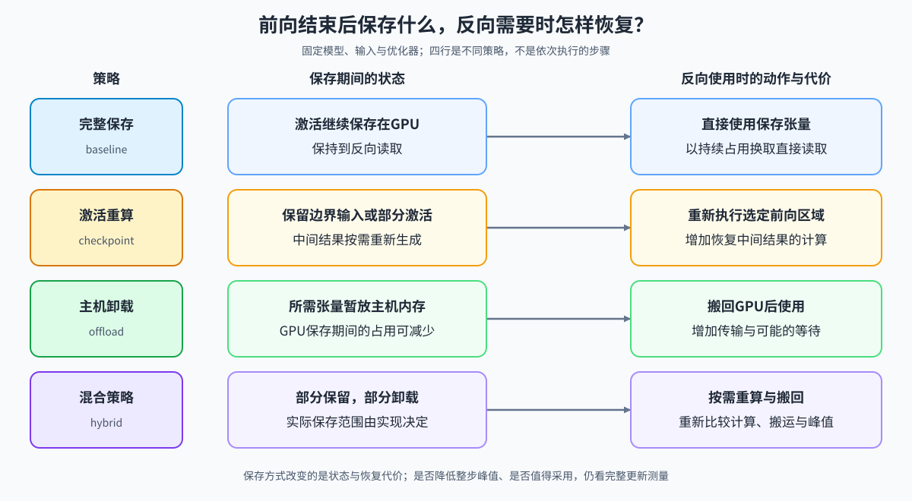
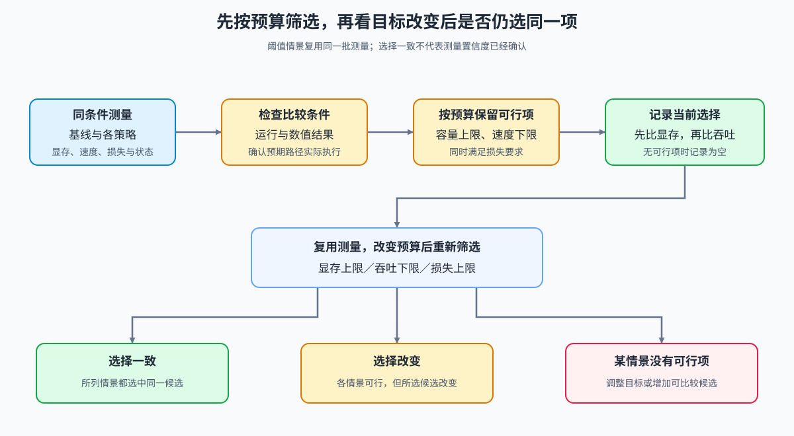

# 76. Activation Checkpoint Offload Benchmark | Activation / Checkpoint / Offload 对比项目

**难度：** Hard | **环境：** CPU 可完成正确性验证；GPU 用于策略 benchmark | **标签：** `显存优化`, `Checkpoint/Offload`, `基准对比` | **目标人群：** 准备比较训练显存策略的学习者

> 🚀 **云端运行环境**
>
> 本章节的实战代码可以点击以下链接在免费 GPU 算力平台上直接运行：
>
> [](https://colab.research.google.com/github/datawhalechina/llm-algo-leetcode/blob/main/02_PyTorch_Algorithms/76_Activation_Checkpoint_Offload_Benchmark.ipynb)
> [](https://modelscope.cn/my/mynotebook) *(国内推荐：魔搭社区免费实例)*


---

## 本节导读

前面的内容介绍了激活值如何参与反向传播，以及保存、重算和搬运之间的代价。本节围绕同一训练任务比较 checkpoint、offload 和组合方案，观察它们如何改变显存占用、训练速度和运行稳定性。完成后，你应能根据显存压力和速度代价判断哪种策略值得继续验证。

**关键词：** `activation`, `checkpoint`, `offload`, `memory`, `benchmark`

---

## 前置阅读

**导语：** 先理解 checkpoint 和 offload 如何改变激活值的保存与计算，再参考 73 节的测量口径，比较同一训练任务下不同策略的显存收益和速度代价。
- [19. Activation Checkpointing | 激活检查点](./19_Activation_Checkpointing.md)
- [42. Activation Offload | 激活卸载](./42_Activation_Offload.md)
- [73. Training Performance Analysis | 训练性能分析](./73_Training_Performance_Analysis.md)


---

### Step 1：把固定训练基线转换为策略候选实验
本项目接收训练性能基线和其中的容量假设，固定模型、数据与更新过程，只改变反向传播所需激活值的保存位置和恢复方式。最终交付同时包含策略测量、预算门槛下的候选选择和阈值敏感性。

| 输入资产 | 项目操作 | 证据与交付物 |
|:---|:---|:---|
| 训练性能基线 | 核对模型、数据、精度、批次、序列长度和更新配置 | 可追溯的共同训练任务 |
| 激活策略候选 | 分别运行完整保存、选择性重算、主机卸载和混合策略 | 每种策略的真实执行记录 |
| 配对测量协议 | 统一预热、重复次数、随机种子和测量边界 | 峰值显存、训练步耗时、吞吐与 loss |
| 候选门禁 | 检查失败、质量、显存收益和吞吐保留率 | `accept`、`tune` 或 `reject` 的候选报告 |




### Step 2：区分保存、重算和搬运的生命周期
四种候选改变的是激活值在前向结束到反向使用之间的生命周期。完整保存以容量换取直接读取；选择性重算减少保存量但增加前向计算；主机卸载把容量压力转成传输和同步；混合策略同时引入重算与搬运。比较时必须证明声明路径真实生效。

| 策略 | 前向后的激活状态 | 反向前的恢复动作 | 主要代价 |
|:---|:---|:---|:---|
| 完整保存 | 激活保留在设备显存 | 直接读取 | 容量占用 |
| 选择性重算 | 只保留边界输入或部分激活 | 重新执行选定前向区域 | 额外计算 |
| 主机卸载 | 保存张量移到主机内存 | 搬回设备并等待可用 | 传输与同步 |
| 混合策略 | 部分激活丢弃，部分移到主机 | 重算与搬运共同恢复 | 计算、传输与调度 |

### Step 3：指标与项目判定
显存最低的方案不一定最值得采用。先确认训练任务与执行路径可比，再联合峰值显存、训练步耗时、吞吐、loss 和失败状态判断候选；最后检查预算门槛改变后选择是否仍然成立。

| 指标 | 含义 | 用于判断 |
|:---|:---|:---|
| peak allocated | 张量实际达到的显存峰值 | 观察显存收益 |
| peak reserved | allocator 保留的显存峰值 | 观察缓存和碎片影响 |
| step time / samples/s | 重算、搬运和同步的时间代价 | 观察吞吐损失 |
| val loss / OOM | 训练质量和可运行性 | 过滤不可接受方案 |
| 执行路径 | 重算活动、主机保存与传输证据 | 排除声明启用但实际回退的候选 |
| 判定规则 | 无硬失败和关键缺证，质量达标，并满足显存收益与吞吐保留率 | 输出 `accept / tune / reject` |



### Step 4：比较策略并检查预算结论是否稳定

用同一小型网络比较 baseline、checkpoint、offload 和 hybrid 的输出、损失与全部参数梯度，再用固定测量样例检查预算门槛变化是否改变策略选择。CPU 练习不测显存收益；GPU 阶段只运行一次候选对照，收紧阈值时复用这批结果。无需下载模型或准备 CUDA。

| 任务与目的 | 已知条件 | 完成标准 | 测试验证 |
|:---|:---|:---|:---|
| TODO 1：绑定实验身份 | 已有基线、策略报告和固定训练任务 | 拒绝工作负载、硬件或重复次数不一致的比较 | 身份不一致和重复策略均被发现 |
| TODO 2：构造配对证据 | 已通过身份检查的基线与候选 | 保留失败状态，并计算显存、吞吐和质量差异 | OOM 不伪造成收益，正常候选产生完整差异 |
| TODO 3：选择情景候选 | 各预算情景下的可行候选 | 记录可行集合，并按显存、吞吐顺序选出候选 | 松紧预算分别得到预期选择 |
| TODO 4：判断结论稳定性 | 各情景的 selected_candidate | 区分 stable、threshold_sensitive 和 no_feasible_candidate | 情景选择一致、变化或为空均有测试 |


```python
import math
from typing import Dict, List

```


```python
# 4 个核心 TODO：实验身份、配对差异、情景选取与结论稳定性。
# 阈值情景复用同一批测量，不重复运行模型。

def _metrics_are_finite(report: Dict[str, object]) -> bool:
    values = [report.get('peak_memory_mb'), report.get('samples_per_s'), report.get('eval_loss')]
    return all(isinstance(value, (int, float)) and math.isfinite(value) for value in values)

def validate_strategy_experiment(baseline: Dict[str, object], candidates: List[Dict[str, object]]) -> Dict[str, object]:
    """确认候选与基线属于同一训练任务和设备条件。"""
    issues = []
    candidate_names = []
    identity_keys = ('workload_id', 'hardware_id', 'repeat_count')
    for candidate in candidates:
        name = candidate.get('name')
        if not isinstance(name, str) or not name:
            issues.append('candidate:missing_name')
            continue
        if name in candidate_names:
            issues.append(f'{name}:duplicate_name')
        candidate_names.append(name)
        for key in identity_keys:
            # ==========================================
            # TODO 1：核对候选与基线身份
            # identity_matches = ???  # bool；当前身份字段与基线相同
            # ==========================================
            raise NotImplementedError('TODO 1：请核对候选身份')
            if not identity_matches:
                issues.append(f'{name}:{key}_mismatch')
        if candidate.get('execution_path_verified') is not True:
            issues.append(f'{name}:execution_path_unverified')
    if not _metrics_are_finite(baseline):
        issues.append('baseline:invalid_metrics')
    return {'is_valid': not issues, 'issues': issues, 'candidate_names': candidate_names}

def build_strategy_pair_evidence(baseline: Dict[str, object], candidates: List[Dict[str, object]]) -> Dict[str, object]:
    """以固定基线构造候选差异，并保留失败运行。"""
    comparisons = []
    counts = {'comparable': 0, 'oom': 0, 'failed': 0, 'invalid': 0}
    for candidate in candidates:
        name = candidate.get('name')
        status = candidate.get('status', 'ok')
        if status in {'oom', 'failed'}:
            counts[status] += 1
            comparisons.append({'name': name, 'status': status})
            continue
        if not _metrics_are_finite(candidate):
            counts['invalid'] += 1
            comparisons.append({'name': name, 'status': 'invalid'})
            continue
        counts['comparable'] += 1
        # ==========================================
        # TODO 2：计算候选相对基线的差异
        # memory_saving_mb = ???  # MB；正值表示候选显存更低
        # throughput_ratio = ???  # 无单位；候选吞吐除以基线吞吐
        # quality_delta = ???  # loss；候选验证损失减去基线损失
        # ==========================================
        raise NotImplementedError('TODO 2：请计算配对差异')
        comparisons.append({
            'name': name, 'status': 'comparable',
            'repeat_count': candidate['repeat_count'],
            'execution_path_verified': candidate.get('execution_path_verified') is True,
            'candidate_peak_memory_mb': candidate['peak_memory_mb'],
            'candidate_samples_per_s': candidate['samples_per_s'],
            'candidate_eval_loss': candidate['eval_loss'],
            'memory_saving_mb': memory_saving_mb,
            'throughput_ratio': throughput_ratio,
            'quality_delta': quality_delta,
        })
    return {
        'baseline': baseline, 'comparisons': comparisons,
        'comparable_count': counts['comparable'], 'oom_count': counts['oom'],
        'failed_count': counts['failed'], 'invalid_count': counts['invalid'],
    }

def decide_strategy_sensitivity(evidence: Dict[str, object], scenarios: List[Dict[str, object]]) -> Dict[str, object]:
    """在不同预算门槛下重算候选选择并判断结论稳定性。"""
    baseline = evidence.get('baseline', {})
    if not scenarios:
        raise ValueError('至少需要一个预算情景')
    options = [{'name': 'baseline', 'status': 'comparable', 'candidate_peak_memory_mb': baseline.get('peak_memory_mb'), 'candidate_samples_per_s': baseline.get('samples_per_s'), 'candidate_eval_loss': baseline.get('eval_loss'), 'execution_path_verified': True}]
    options.extend(item for item in evidence.get('comparisons', []) if item.get('status') == 'comparable' and item.get('execution_path_verified') is True)
    results = []
    for scenario in scenarios:
        required = ('memory_cap_mb', 'min_samples_per_s', 'max_val_loss')
        if any(not isinstance(scenario.get(key), (int, float)) or not math.isfinite(scenario[key]) for key in required):
            raise ValueError(f'预算情景无效: {scenario.get("name")}')
        feasible = [item for item in options if _metrics_are_finite({'peak_memory_mb': item.get('candidate_peak_memory_mb'), 'samples_per_s': item.get('candidate_samples_per_s'), 'eval_loss': item.get('candidate_eval_loss')}) and item['candidate_peak_memory_mb'] <= scenario['memory_cap_mb'] and item['candidate_samples_per_s'] >= scenario['min_samples_per_s'] and item['candidate_eval_loss'] <= scenario['max_val_loss']]
        feasible.sort(key=lambda item: (item['candidate_peak_memory_mb'], -item['candidate_samples_per_s']))
        # ==========================================
        # TODO 3：按预算选择候选并记录情景结果
        # feasible_names = ???  # list[str]；本情景下满足全部预算的候选名
        # selected_candidate = ???  # str | None；按骨架排序后的首个候选名
        # ==========================================
        raise NotImplementedError('TODO 3：请记录预算情景结果')
        results.append({'name': scenario.get('name'), 'feasible_names': feasible_names, 'selected_candidate': selected_candidate})
    selected = [item['selected_candidate'] for item in results]
    # ==========================================
    # TODO 4：比较情景选择并判断结论稳定性
    # sensitivity_status = ???  # stable、threshold_sensitive 或 no_feasible_candidate
    # ==========================================
    raise NotImplementedError('TODO 4：请判断预算敏感性')
    return {'status': sensitivity_status, 'scenarios': results}

```


```python
# 测试你的实现
def _strategy_fixture():
    """构造同一 workload 和设备上的基线、候选与失败记录。"""
    baseline = {
        'name': 'baseline', 'workload_id': 'train-b2-s1024', 'hardware_id': 'gpu-a',
        'repeat_count': 5, 'status': 'ok', 'execution_path_verified': True,
        'peak_memory_mb': 11000.0, 'samples_per_s': 8.0, 'eval_loss': 1.06,
    }
    candidates = [
        {**baseline, 'name': 'checkpoint', 'peak_memory_mb': 8200.0, 'samples_per_s': 6.8, 'eval_loss': 1.08},
        {**baseline, 'name': 'offload', 'status': 'oom', 'peak_memory_mb': None, 'samples_per_s': None, 'eval_loss': None},
    ]
    return baseline, candidates

def test_strategy_identity_gate():
    """同一身份通过，设备错配、重复名称和未核验路径被拒绝。"""
    baseline, candidates = _strategy_fixture()
    assert validate_strategy_experiment(baseline, candidates)['is_valid'] is True
    mismatch = validate_strategy_experiment(baseline, [{**candidates[0], 'hardware_id': 'gpu-b'}])
    assert mismatch['is_valid'] is False
    assert 'checkpoint:hardware_id_mismatch' in mismatch['issues']
    duplicate = validate_strategy_experiment(baseline, [candidates[0], dict(candidates[0])])
    assert 'checkpoint:duplicate_name' in duplicate['issues']
    unverified = validate_strategy_experiment(baseline, [{**candidates[0], 'execution_path_verified': False}])
    assert 'checkpoint:execution_path_unverified' in unverified['issues']

def test_pair_evidence_preserves_failures_and_computes_deltas():
    """正常候选产生配对差异，OOM 记录只计数、不伪造成收益。"""
    baseline, candidates = _strategy_fixture()
    evidence = build_strategy_pair_evidence(baseline, candidates)
    checkpoint = next(item for item in evidence['comparisons'] if item['name'] == 'checkpoint')
    assert checkpoint['memory_saving_mb'] == 2800.0
    assert round(checkpoint['throughput_ratio'], 2) == 0.85
    assert round(checkpoint['quality_delta'], 2) == 0.02
    assert evidence['oom_count'] == 1 and evidence['comparable_count'] == 1
    oom = next(item for item in evidence['comparisons'] if item['name'] == 'offload')
    assert oom == {'name': 'offload', 'status': 'oom'}
    invalid = {**candidates[0], 'name': 'invalid', 'eval_loss': float('nan')}
    with_invalid = build_strategy_pair_evidence(baseline, [candidates[0], invalid])
    assert with_invalid['invalid_count'] == 1

def test_budget_sensitivity_changes_selected_candidate():
    """收紧吞吐门槛后重算选择，并识别阈值敏感结论。"""
    baseline, candidates = _strategy_fixture()
    evidence = build_strategy_pair_evidence(baseline, candidates)
    scenarios = [
        {'name': 'reference', 'memory_cap_mb': 12000.0, 'min_samples_per_s': 1.0, 'max_val_loss': 1.1},
        {'name': 'throughput_tighter', 'memory_cap_mb': 12000.0, 'min_samples_per_s': 7.0, 'max_val_loss': 1.1},
    ]
    sensitivity = decide_strategy_sensitivity(evidence, scenarios)
    assert sensitivity['status'] == 'threshold_sensitive'
    assert sensitivity['scenarios'][0]['selected_candidate'] == 'checkpoint'
    assert sensitivity['scenarios'][1]['selected_candidate'] == 'baseline'
    stable = decide_strategy_sensitivity(evidence, [scenarios[0], scenarios[0]])
    assert stable['status'] == 'stable'
    no_feasible = {**scenarios[0], 'name': 'no_feasible', 'min_samples_per_s': 20.0}
    assert decide_strategy_sensitivity(evidence, [no_feasible])['status'] == 'no_feasible_candidate'

test_strategy_identity_gate()
test_pair_evidence_preserves_failures_and_computes_deltas()
test_budget_sensitivity_changes_selected_candidate()

# CPU 正确性 cell：使用小型网络验证四种策略的 autograd 语义，不启动 GPU benchmark。
# 预期输出是 loss / gradient 一致性和 saved-tensor 观察结果；不要把这些数值填入 GPU 结果表。
import contextlib
import torch
from torch import nn
from torch.utils.checkpoint import checkpoint

VALID_STRATEGIES = {'baseline', 'checkpoint', 'offload', 'hybrid'}

def run_cpu_strategy(strategy, observe_saved_tensors=False):
    """在小型 CPU 网络上比较输出、损失和参数梯度。"""
    if strategy not in VALID_STRATEGIES:
        raise ValueError(f'未知策略: {strategy}')
    torch.manual_seed(42)
    first = nn.Linear(8, 16)
    second = nn.Linear(16, 4)
    x = torch.randn(2, 8)
    target = torch.randn(2, 4)
    offload_context = (
        torch.autograd.graph.save_on_cpu(pin_memory=False)
        if strategy in {'offload', 'hybrid'} else contextlib.nullcontext()
    )
    saved, unpacked = [], []
    def pack(tensor):
        """记录 autograd 保存张量的形状、大小与设备。"""
        saved.append({'shape': tuple(tensor.shape), 'numel': tensor.numel(), 'device': str(tensor.device)})
        return tensor
    def unpack(tensor):
        """记录 autograd 反向阶段取回的张量。"""
        unpacked.append({'shape': tuple(tensor.shape), 'numel': tensor.numel(), 'device': str(tensor.device)})
        return tensor
    observe_context = (
        torch.autograd.graph.saved_tensors_hooks(pack, unpack)
        if observe_saved_tensors and strategy not in {'offload', 'hybrid'} else contextlib.nullcontext()
    )
    with observe_context:
        with offload_context:
            if strategy in {'checkpoint', 'hybrid'}:
                hidden = checkpoint(first, x, use_reentrant=False)
            else:
                hidden = first(x)
            loss = ((second(hidden) - target) ** 2).mean()
            loss.backward()
    gradients = [parameter.grad.detach().clone() for layer in (first, second) for parameter in layer.parameters()]
    observation = {
        'saved_count': len(saved) if observe_saved_tensors and strategy not in {'offload', 'hybrid'} else None,
        'unpacked_count': len(unpacked) if observe_saved_tensors and strategy not in {'offload', 'hybrid'} else None,
        'saved_numel': sum(item['numel'] for item in saved) if observe_saved_tensors and strategy not in {'offload', 'hybrid'} else None,
        'note': 'save_on_cpu owns the autograd hooks; inspect offload placement with GPU profiling.' if strategy in {'offload', 'hybrid'} else 'saved_tensors_hooks observation',
    }
    return (second(hidden).detach(), loss.detach(), gradients, observation)

baseline_output, baseline_loss, baseline_grads, baseline_observation = run_cpu_strategy('baseline', observe_saved_tensors=True)
assert torch.isfinite(baseline_output).all() and torch.isfinite(baseline_loss).all()
assert baseline_observation['saved_count'] > 0
assert baseline_observation['saved_count'] == baseline_observation['unpacked_count']
print(f"baseline saved tensors: {baseline_observation['saved_count']}, saved elements: {baseline_observation['saved_numel']}")
for strategy in ('checkpoint', 'offload', 'hybrid'):
    output, loss, grads, observation = run_cpu_strategy(strategy, observe_saved_tensors=strategy == 'checkpoint')
    assert torch.isfinite(output).all() and torch.isfinite(loss).all()
    assert torch.allclose(output, baseline_output, atol=1e-6, rtol=1e-5)
    assert torch.allclose(loss, baseline_loss, atol=1e-6, rtol=1e-5)
    assert all(torch.allclose(g, b, atol=1e-6, rtol=1e-5) for g, b in zip(grads, baseline_grads))
    if strategy == 'checkpoint':
        assert observation['saved_count'] > 0
        assert observation['saved_count'] == observation['unpacked_count']
    else:
        assert observation['saved_count'] is None
    print(f'{strategy}: loss/gradient check passed')
try:
    run_cpu_strategy('unknown')
except ValueError:
    pass
else:
    raise AssertionError('未知策略应明确报错')
print('CPU correctness test passed; this does not measure real GPU memory saving.')

```

🛑 **STOP HERE** 🛑

## 参考代码与解析

### 代码


```python
import math
from typing import Dict, List

def _metrics_are_finite(report: Dict[str, object]) -> bool:
    values = [report.get('peak_memory_mb'), report.get('samples_per_s'), report.get('eval_loss')]
    return all(isinstance(value, (int, float)) and math.isfinite(value) for value in values)

def validate_strategy_experiment(baseline: Dict[str, object], candidates: List[Dict[str, object]]) -> Dict[str, object]:
    issues = []
    candidate_names = []
    identity_keys = ('workload_id', 'hardware_id', 'repeat_count')
    for candidate in candidates:
        name = candidate.get('name')
        if not isinstance(name, str) or not name:
            issues.append('candidate:missing_name')
            continue
        if name in candidate_names:
            issues.append(f'{name}:duplicate_name')
        candidate_names.append(name)
        for key in identity_keys:
            # TODO 1：核对候选与基线身份
            identity_matches = candidate.get(key) == baseline.get(key)
            if not identity_matches:
                issues.append(f'{name}:{key}_mismatch')
        if candidate.get('execution_path_verified') is not True:
            issues.append(f'{name}:execution_path_unverified')
    if not _metrics_are_finite(baseline):
        issues.append('baseline:invalid_metrics')
    return {'is_valid': not issues, 'issues': issues, 'candidate_names': candidate_names}

def build_strategy_pair_evidence(baseline: Dict[str, object], candidates: List[Dict[str, object]]) -> Dict[str, object]:
    comparisons = []
    counts = {'comparable': 0, 'oom': 0, 'failed': 0, 'invalid': 0}
    for candidate in candidates:
        name = candidate.get('name')
        status = candidate.get('status', 'ok')
        if status in {'oom', 'failed'}:
            counts[status] += 1
            comparisons.append({'name': name, 'status': status})
            continue
        if not _metrics_are_finite(candidate):
            counts['invalid'] += 1
            comparisons.append({'name': name, 'status': 'invalid'})
            continue
        counts['comparable'] += 1
        # TODO 2：计算候选相对基线的差异
        memory_saving_mb = baseline['peak_memory_mb'] - candidate['peak_memory_mb']
        throughput_ratio = candidate['samples_per_s'] / baseline['samples_per_s']
        quality_delta = candidate['eval_loss'] - baseline['eval_loss']
        comparisons.append({
            'name': name, 'status': 'comparable',
            'repeat_count': candidate['repeat_count'],
            'execution_path_verified': candidate.get('execution_path_verified') is True,
            'candidate_peak_memory_mb': candidate['peak_memory_mb'],
            'candidate_samples_per_s': candidate['samples_per_s'],
            'candidate_eval_loss': candidate['eval_loss'],
            'memory_saving_mb': memory_saving_mb,
            'throughput_ratio': throughput_ratio,
            'quality_delta': quality_delta,
        })
    return {
        'baseline': baseline, 'comparisons': comparisons,
        'comparable_count': counts['comparable'], 'oom_count': counts['oom'],
        'failed_count': counts['failed'], 'invalid_count': counts['invalid'],
    }

def decide_strategy_sensitivity(evidence: Dict[str, object], scenarios: List[Dict[str, object]]) -> Dict[str, object]:
    baseline = evidence.get('baseline', {})
    if not scenarios:
        raise ValueError('至少需要一个预算情景')
    options = [{'name': 'baseline', 'status': 'comparable', 'candidate_peak_memory_mb': baseline.get('peak_memory_mb'), 'candidate_samples_per_s': baseline.get('samples_per_s'), 'candidate_eval_loss': baseline.get('eval_loss'), 'execution_path_verified': True}]
    options.extend(item for item in evidence.get('comparisons', []) if item.get('status') == 'comparable' and item.get('execution_path_verified') is True)
    results = []
    for scenario in scenarios:
        required = ('memory_cap_mb', 'min_samples_per_s', 'max_val_loss')
        if any(not isinstance(scenario.get(key), (int, float)) or not math.isfinite(scenario[key]) for key in required):
            raise ValueError(f'预算情景无效: {scenario.get("name")}')
        feasible = [item for item in options if _metrics_are_finite({'peak_memory_mb': item.get('candidate_peak_memory_mb'), 'samples_per_s': item.get('candidate_samples_per_s'), 'eval_loss': item.get('candidate_eval_loss')}) and item['candidate_peak_memory_mb'] <= scenario['memory_cap_mb'] and item['candidate_samples_per_s'] >= scenario['min_samples_per_s'] and item['candidate_eval_loss'] <= scenario['max_val_loss']]
        feasible.sort(key=lambda item: (item['candidate_peak_memory_mb'], -item['candidate_samples_per_s']))
        # TODO 3：选择情景候选
        feasible_names = [item['name'] for item in feasible]
        selected_candidate = feasible[0]['name'] if feasible else None
        results.append({'name': scenario.get('name'), 'feasible_names': feasible_names, 'selected_candidate': selected_candidate})
    selected = [item['selected_candidate'] for item in results]
    # TODO 4：比较情景选择并判断结论稳定性
    sensitivity_status = 'no_feasible_candidate' if any(item is None for item in selected) else 'stable' if len(set(selected)) == 1 else 'threshold_sensitive'
    return {'status': sensitivity_status, 'scenarios': results}

```

### 解析

#### TODO 1：核对候选与基线身份
工作负载、设备和重复次数任一不同，候选就不能与基线配对；执行路径未核验的策略也不能进入比较。`test_strategy_identity_gate` 覆盖身份错配、重复名称和路径未核验。

#### TODO 2：计算候选相对基线的差异
显存节省使用“基线减候选”，吞吐比使用“候选除基线”，验证损失差使用“候选减基线”。`test_pair_evidence_preserves_failures_and_computes_deltas` 同时核对差值方向，并确认 OOM 保留为失败状态。

#### TODO 3：选择情景候选
先按当前情景的显存、吞吐和验证损失门槛确定可行集合，再从排序后的集合中选出候选；基线也参与比较。`test_budget_sensitivity_changes_selected_candidate` 覆盖基准与收紧吞吐门槛时的选择差异。

#### TODO 4：判断结论稳定性
各情景选中同一候选时为 `stable`；选择变化时为 `threshold_sensitive`；任一情景没有可行项时为 `no_feasible_candidate`。同一测试检查阈值变化导致的状态。
### Step 5（项目实验）：比较训练显存策略

本实验分两步：G0 在固定 AdamW 训练配置下比较 baseline、checkpoint、offload 和 hybrid；G1 使用无动量 SGD 长度阶梯单独观察激活显存。两步使用同一唯一标签，运行顺序是 `prepare → g0 → g1 → close`。`close` 会复用 G0 结果重算预算情景，不增加 GPU 运行。

| 核对内容 | CPU 练习与测试 | GPU 实验与结果 |
|:---|:---|:---|
| 比较条件 | 检查任务、硬件、重复次数和失败状态 | G0 复用 73 的训练配置，G1 使用独立 SGD 配置；分别核对同范围样本 |
| 策略语义 | 小网络比较四种策略的输出、损失和全部参数梯度 | 测量真实模型的显存、吞吐和验证损失；CPU 梯度一致不替代真实模型核对 |
| 收益与预算 | 计算候选差异并复算阈值情景 | G0 的预算结论在 76 收口；G1 单独形成激活隔离结论，安全停止不代表已测到 OOM 边界 |

#### 5.1 本次运行配置

运行环境：`PERF-CUDA-MECHANISM`，单卡显存至少 8 GiB；环境创建与验证见[性能分析 Quickstart](../topic_discussion/performance_analysis/quickstart.md#perf-cuda-mechanism-quickstart)。

只需填写本次标签和运行阶段。修改阶段后按 5.1–5.6 顺序运行。

| `RUN_STAGE` | 操作 | 是否使用 GPU |
| --- | --- | --- |
| `prepare` | 核对固定配置和已登记结果 | 否 |
| `g0` | 重复测量四种完整训练策略 | 是 |
| `g1` | 在同标签完整 G0 基础上运行长度阶梯 | 是 |
| `close` | 读取 G0/G1 并生成分范围结论 | 否 |


```python
# ===== 学习者配置：本单元只声明本次运行意图 =====
RUN_LABEL = 'replace_with_unique_label'  # 默认占位符；执行 g0 前改为本次唯一标签，后续阶段保持不变。
RUN_STAGE = 'prepare'  # 默认 prepare 只读检查；可选 prepare / g0 / g1 / close。

```

#### 5.2 固定实验配置与环境预检

检查项目路径、Python、PyTorch、CUDA、模型文件和固定输入清单。`prepare` 只读文件，不加载模型。


```python
"""加载固定项目合同并检查运行环境；不安装依赖、不加载模型。"""
from pathlib import Path
import hashlib
import json
import os
import sys

# ===== 固定实验配置 =====
PROJECT_ID = '76'
SEMANTIC_ID = 'PERF-MEMORY-STRATEGY'
SCHEMA_VERSION = 'training-performance-project/v1'
DECISION_SCHEMA_VERSION = 'memory-strategy-decision/v1'
MODEL_ID = 'Qwen/Qwen2.5-0.5B-Instruct'
MODEL_SOURCE = 'local'
MODEL_CACHE_DIR = 'model_cache'
DTYPE_MODE = 'fp32'
WORKLOAD = 'pressure'
WORKLOADS = {
    'pressure': {'batch_size': 1, 'seq_len': 768, 'warmup': 2, 'iters': 5},
}
BOUNDARY_SEQ_LENS = [1024, 1280, 1536, 1792]
STRATEGIES = ['baseline', 'checkpoint', 'offload', 'hybrid']
SEED = 42
MEMORY_CAP_MB = 11200.0
MIN_SAMPLES_PER_S = 1.0
MAX_VAL_LOSS = None
INPUT_MANIFEST_SCHEMA_VERSION = 'memory-strategy-input-manifest/v1'
INPUT_MANIFEST_RELATIVE_PATH = Path('benchmarks/results/76_input_manifest_rtx5070ti_activation_memory_v1.json')
APPROVED_G0_RELATIVE_PATH = Path('benchmarks/results/76_real_gpu_memory_rtx5070ti_activation_memory_v1.json')
APPROVED_G1_RELATIVE_PATH = Path('benchmarks/results/76_real_gpu_memory_boundary_rtx5070ti_activation_memory_v1.json')
OUTPUT_RELATIVE_PATH = Path(f'benchmarks/results/{PROJECT_ID}_real_gpu_memory_{RUN_LABEL}.json')
BOUNDARY_OUTPUT_RELATIVE_PATH = Path(f'benchmarks/results/{PROJECT_ID}_real_gpu_memory_boundary_{RUN_LABEL}.json')
DECISION_OUTPUT_RELATIVE_PATH = Path(f'benchmarks/results/{PROJECT_ID}_memory_strategy_decision_{RUN_LABEL}.json')

if RUN_STAGE not in {'prepare', 'g0', 'g1', 'close'}:
    raise ValueError("RUN_STAGE 只能是 'prepare'、'g0'、'g1' 或 'close'。")
if RUN_STAGE in {'g0', 'g1', 'close'} and RUN_LABEL == 'replace_with_unique_label':
    raise ValueError('执行或收口前请把 RUN_LABEL 改为本次唯一标签。')
configured_root = os.environ.get('LLM_ALGO_PROJECT_ROOT')
start_dir = Path(configured_root).expanduser().resolve() if configured_root else Path.cwd().resolve()
GPU_PROJECT_ROOT = next(
    (candidate for candidate in (start_dir, *start_dir.parents)
     if (candidate / 'tools/project_runtime.py').is_file()),
    None,
)
if GPU_PROJECT_ROOT is None:
    colab_root = Path('/content/llm-algo-leetcode')
    if (colab_root / 'tools/project_runtime.py').is_file():
        GPU_PROJECT_ROOT = colab_root
if GPU_PROJECT_ROOT is None:
    raise RuntimeError('找不到项目根目录：请设置 LLM_ALGO_PROJECT_ROOT，或先把仓库放到 /content/llm-algo-leetcode。')
os.chdir(GPU_PROJECT_ROOT)
if str(GPU_PROJECT_ROOT) not in sys.path:
    sys.path.insert(0, str(GPU_PROJECT_ROOT))

manifest_path = GPU_PROJECT_ROOT / INPUT_MANIFEST_RELATIVE_PATH
if not manifest_path.is_file():
    raise FileNotFoundError(f'找不到输入清单：{manifest_path}')
input_manifest = json.loads(manifest_path.read_text(encoding='utf-8'))
if input_manifest.get('schema_version') != INPUT_MANIFEST_SCHEMA_VERSION:
    raise ValueError('76 输入清单 schema 不匹配')
baseline_entry = input_manifest.get('source_artifacts', {}).get('training_baseline', {})
BASELINE_73_RELATIVE_PATH = Path(baseline_entry.get('path', ''))
baseline_path = GPU_PROJECT_ROOT / BASELINE_73_RELATIVE_PATH
if not baseline_path.is_file():
    raise FileNotFoundError(f'找不到 73 训练基线：{baseline_path}')
if hashlib.sha256(baseline_path.read_bytes()).hexdigest() != baseline_entry.get('sha256'):
    raise ValueError('73 训练基线 SHA256 与输入清单不一致')
print(f'project_root: {GPU_PROJECT_ROOT}')
try:
    import torch
except ImportError:
    print('未检测到 PyTorch；请按维护文档安装匹配的 torch CUDA wheel 后再运行 GPU benchmark。')
else:
    print(f'torch: {torch.__version__}')
    print(f'cuda_build: {torch.version.cuda}; cuda_available: {torch.cuda.is_available()}')
    if torch.cuda.is_available():
        props = torch.cuda.get_device_properties(0)
        print(f'gpu: {props.name}; memory_gib: {props.total_memory / 2**30:.1f}')

```

#### 5.3 对照合同与结果路径

从固定配置派生工作负载和结果路径。`prepare` 读取已登记结果；`g0`、`g1`、`close` 只读取当前标签的文件，G1 不会自动补跑 G0。


```python
# 只读派生：需要改变运行意图时回到 5.1。
if WORKLOAD not in WORKLOADS:
    raise ValueError(f'未知 WORKLOAD: {WORKLOAD}')
if not STRATEGIES or 'baseline' not in STRATEGIES:
    raise ValueError('STRATEGIES 必须包含 baseline')
if BOUNDARY_SEQ_LENS != sorted(set(BOUNDARY_SEQ_LENS)) or any(
    length <= WORKLOADS[WORKLOAD]['seq_len'] for length in BOUNDARY_SEQ_LENS
):
    raise ValueError('BOUNDARY_SEQ_LENS 必须严格递增、不能重复，并且全部大于 G0 seq_len')

workload_config = dict(WORKLOADS[WORKLOAD])
BATCH_SIZE = workload_config['batch_size']
SEQ_LEN = workload_config['seq_len']
WARMUP = workload_config['warmup']
ITERS = workload_config['iters']
REPEATS = 3
READ_G0_RELATIVE_PATH = APPROVED_G0_RELATIVE_PATH if RUN_STAGE == 'prepare' else OUTPUT_RELATIVE_PATH
READ_G1_RELATIVE_PATH = APPROVED_G1_RELATIVE_PATH if RUN_STAGE == 'prepare' else BOUNDARY_OUTPUT_RELATIVE_PATH
if RUN_STAGE == 'g1' and (GPU_PROJECT_ROOT / BOUNDARY_OUTPUT_RELATIVE_PATH).is_file():
    raise FileExistsError('同标签 G1 已完成；请改用 close，或更换 RUN_LABEL 后重新实验。')
EXPERIMENT_IDENTITY = {
    'model_id': MODEL_ID, 'workload': WORKLOAD, 'dtype_mode': DTYPE_MODE,
    'strategies': list(STRATEGIES), 'batch_size': BATCH_SIZE, 'seq_len': SEQ_LEN,
    'repeats': REPEATS, 'boundary_seq_lens': list(BOUNDARY_SEQ_LENS), 'seed': SEED,
    'run_label': RUN_LABEL, 'run_stage': RUN_STAGE,
    'read_g0': str(READ_G0_RELATIVE_PATH), 'read_g1': str(READ_G1_RELATIVE_PATH),
}
print(EXPERIMENT_IDENTITY)

```

#### 5.4 采集策略测量

`g0` 运行 AdamW 完整训练对照；`g1` 要求同标签且重复完整的 G0，再运行无动量 SGD 长度阶梯。每个更长序列开始前先检查显存余量，余量不足时记录安全边界，不用实际 OOM 探测。


```python
# 根据 RUN_STAGE 执行单一 GPU 阶段；prepare/close 不加载模型。
import json
import hashlib
import gc
import os
import sys
import time
from contextlib import nullcontext
from pathlib import Path

# 先定位仓库并加入 sys.path，再导入项目工具；避免 Colab 直接打开时找不到 tools。
PROJECT_ROOT = Path(os.environ.get('LLM_ALGO_PROJECT_ROOT', Path.cwd())).expanduser().resolve()
if not (PROJECT_ROOT / 'tools/project_runtime.py').is_file():
    colab_root = Path('/content/llm-algo-leetcode')
    if (colab_root / 'tools/project_runtime.py').is_file():
        PROJECT_ROOT = colab_root
    else:
        for candidate in (PROJECT_ROOT, *PROJECT_ROOT.parents):
            if (candidate / 'tools/project_runtime.py').is_file():
                PROJECT_ROOT = candidate
                break
        else:
            raise RuntimeError('找不到项目根目录；请设置 LLM_ALGO_PROJECT_ROOT。')
if str(PROJECT_ROOT) not in sys.path:
    sys.path.insert(0, str(PROJECT_ROOT))
from tools.project_runtime import ensure_output_path, resolve_project_root, environment_preflight, runtime_snapshot, save_json_record_once, standard_experiment_config, standard_training_metrics, validate_training_config
from tools.training_memory_runtime import measure_training_run
import importlib
import tools.memory_strategy_runtime as memory_strategy_runtime
importlib.reload(memory_strategy_runtime)  # Jupyter 可能缓存了升级前的共享模块。
from tools.memory_strategy_runtime import (
    summarize_memory_boundary,
    decide_memory_boundary,
    summarize_memory_strategy_candidates,
    decide_memory_strategy_project,
    evaluate_memory_budget_sensitivity,
)

PROJECT_ROOT = resolve_project_root(PROJECT_ROOT)
if str(PROJECT_ROOT) not in sys.path:
    sys.path.insert(0, str(PROJECT_ROOT))
OUTPUT_PATH = PROJECT_ROOT / OUTPUT_RELATIVE_PATH
print(f'项目根目录: {PROJECT_ROOT}')
print(f'结果保存路径: {OUTPUT_PATH}')

if RUN_STAGE in {'g0', 'g1'}:
    import torch
    valid_dtype_modes = {'fp32', 'bf16'}
    valid_strategies = {'baseline', 'checkpoint', 'offload', 'hybrid'}
    if DTYPE_MODE not in valid_dtype_modes:
        raise ValueError(f'DTYPE_MODE 必须是 {sorted(valid_dtype_modes)} 之一，当前为 {DTYPE_MODE!r}')
    if not STRATEGIES or len(set(STRATEGIES)) != len(STRATEGIES) or not set(STRATEGIES).issubset(valid_strategies):
        raise ValueError(f'STRATEGIES 必须是 valid_strategies 的非空子集且不能重复，当前为 {STRATEGIES!r}')
    if MEMORY_CAP_MB <= 0 or MIN_SAMPLES_PER_S < 0:
        raise ValueError('MEMORY_CAP_MB 必须大于 0，MIN_SAMPLES_PER_S 不能小于 0。')
    if REPEATS < 1:
        raise ValueError('REPEATS 必须至少为 1。')
    from tools.model_runtime import resolve_model
    from transformers import AutoConfig, AutoModelForCausalLM

    if WORKLOAD not in WORKLOADS:
        raise ValueError(f'未知 workload: {WORKLOAD}，可选值：{sorted(WORKLOADS)}')
    workload_config = WORKLOADS[WORKLOAD]
    BATCH_SIZE = workload_config['batch_size']
    SEQ_LEN = workload_config['seq_len']
    WARMUP = workload_config['warmup']
    ITERS = workload_config['iters']
    validate_training_config({'batch_size': BATCH_SIZE, 'seq_len': SEQ_LEN, 'warmup': WARMUP, 'iters': ITERS, 'seed': SEED})
    preflight = environment_preflight(torch, required_packages=('transformers',), require_gpu=True, output_path=OUTPUT_PATH)
    print({'environment_preflight': preflight})
    if not preflight['ready']:
        raise RuntimeError('环境预检未通过，请先按 next_actions 修复；没有加载模型。')
    print({'runtime': runtime_snapshot(torch)})
    if not torch.cuda.is_available():
        raise RuntimeError(f'RUN_STAGE={RUN_STAGE!r} 需要 CUDA，但当前 CUDA 不可用。')

    torch.manual_seed(SEED)
    torch.cuda.manual_seed_all(SEED)
    device = torch.device('cuda')
    baseline_report_path = PROJECT_ROOT / BASELINE_73_RELATIVE_PATH
    if not baseline_report_path.exists():
        raise FileNotFoundError(f'找不到 73 baseline：{baseline_report_path}，请先运行 73 的相同 workload。')
    baseline_report = json.loads(baseline_report_path.read_text(encoding='utf-8'))
    baseline_config = baseline_report.get('config', {})
    expected_baseline = {
        'model_id': MODEL_ID, 'batch_size': BATCH_SIZE, 'seq_len': SEQ_LEN,
        'dtype': 'float32', 'optimizer': 'AdamW', 'workload': WORKLOAD,
        'warmup': WARMUP, 'iters': ITERS,
    }
    if DTYPE_MODE == 'bf16':
        expected_baseline['amp_dtype'] = 'torch.bfloat16'
        if baseline_config.get('mode') != 'bf16_probe':
            raise ValueError('BF16 扩展实验需要 73 的 bf16_probe 报告。')
    mismatches = {
        key: {'baseline': baseline_config.get(key), 'current': value}
        for key, value in expected_baseline.items()
        if baseline_config.get(key) != value
    }
    if mismatches:
        raise ValueError(f'73 与 76 的 workload 口径不一致，请先重跑 73：{mismatches}')
    model_path = resolve_model(MODEL_ID, source=MODEL_SOURCE, cache_dir=MODEL_CACHE_DIR)
    print(f'模型路径: {model_path}')
    model_config = AutoConfig.from_pretrained(model_path)

    def make_inputs(seq_len):
        generator = torch.Generator(device='cpu').manual_seed(SEED + seq_len)
        train_ids = torch.randint(0, model_config.vocab_size, (BATCH_SIZE, seq_len), generator=generator)
        eval_ids = torch.randint(0, model_config.vocab_size, (BATCH_SIZE, seq_len), generator=generator)
        return train_ids, eval_ids

    def strategy_context(name):
        if name in {'offload', 'hybrid'}:
            return torch.autograd.graph.save_on_cpu(pin_memory=False)
        return nullcontext()

    def run_strategy(name, *, seq_len=SEQ_LEN, warmup=WARMUP, iters=ITERS, optimizer_name='adamw'):
        torch.manual_seed(SEED)
        shared_input_ids_cpu, eval_input_ids_cpu = make_inputs(seq_len)
        model = AutoModelForCausalLM.from_pretrained(model_path, dtype=torch.float32)
        model.config.use_cache = False
        if name in {'checkpoint', 'hybrid'}:
            model.gradient_checkpointing_enable()
        model.to(device).train()
        if optimizer_name == 'adamw':
            optimizer = torch.optim.AdamW(model.parameters(), lr=1e-5)
        elif optimizer_name == 'sgd':
            optimizer = torch.optim.SGD(model.parameters(), lr=1e-4, momentum=0.0)
        else:
            raise ValueError(f'未知 optimizer_name: {optimizer_name}')
        input_ids = shared_input_ids_cpu.to(device)
        labels = input_ids.clone()
        eval_input_ids = eval_input_ids_cpu.to(device)
        eval_labels = eval_input_ids.clone()

        def train_step():
            optimizer.zero_grad(set_to_none=True)
            with strategy_context(name):
                with torch.autocast(device_type='cuda', dtype=torch.bfloat16, enabled=DTYPE_MODE == 'bf16'):
                    loss = model(input_ids=input_ids, labels=labels).loss
                loss.backward()
            optimizer.step()
            return float(loss.detach().item())

        result = measure_training_run(
            train_step, torch_module=torch, batch_size=BATCH_SIZE,
            warmup=warmup, iters=iters,
        )
        model.eval()
        with torch.no_grad():
            with torch.autocast(device_type='cuda', dtype=torch.bfloat16, enabled=DTYPE_MODE == 'bf16'):
                eval_loss = float(model(input_ids=eval_input_ids, labels=eval_labels).loss.item())
        result = {
            'name': name,
            'seq_len': seq_len,
            'optimizer': optimizer_name,
            'status': 'ok',
            'step_time_ms': result['step_time_ms'],
            'samples_per_s': result['samples_per_s'],
            'loss': result['loss'],
            'eval_loss': round(eval_loss, 6),
            'peak_memory_mb': result['peak_mem_mb'],
            'peak_reserved_mb': result['peak_reserved_mb'],
        }
        del optimizer, model, input_ids, labels, eval_input_ids, eval_labels
        gc.collect()
        torch.cuda.empty_cache()
        return result

    raw_run_strategy = run_strategy
    def run_strategy(name, *, seq_len=SEQ_LEN, warmup=WARMUP, iters=ITERS, optimizer_name='adamw'):
        try:
            return raw_run_strategy(name, seq_len=seq_len, warmup=warmup, iters=iters, optimizer_name=optimizer_name)
        except torch.cuda.OutOfMemoryError as exc:
            oom_result = {
                'name': name,
                'seq_len': seq_len,
                'optimizer': optimizer_name,
                'status': 'oom',
                'error': str(exc).split('\n')[0],
            }
        gc.collect()  # 在异常作用域退出后释放 traceback 持有的模型张量。
        torch.cuda.empty_cache()
        return oom_result

    def aggregate_strategy_runs(name, runs):
        successful = [item for item in runs if item.get('status') == 'ok']
        if not successful:
            return {**runs[0], 'runs': runs, 'successful_runs': 0, 'oom_runs': len(runs), 'stability': None}
        numeric_keys = ('step_time_ms', 'samples_per_s', 'loss', 'eval_loss', 'peak_memory_mb', 'peak_reserved_mb')
        aggregated = {
            key: round(sum(item[key] for item in successful) / len(successful), 3)
            for key in numeric_keys
        }
        def value_range(key):
            values = [item[key] for item in successful]
            return round(max(values) - min(values), 3)
        stability = {
            'step_time_range_ms': value_range('step_time_ms'),
            'throughput_range_samples_per_s': value_range('samples_per_s'),
            'peak_memory_range_mb': value_range('peak_memory_mb'),
            'successful_runs': len(successful),
            'oom_runs': len(runs) - len(successful),
        }
        status = 'ok' if len(successful) == len(runs) else 'partial_oom'
        return {**successful[0], **aggregated, 'status': status, 'runs': runs, 'successful_runs': len(successful), 'oom_runs': len(runs) - len(successful), 'stability': stability}

    def run_strategy_repeated(name, *, seq_len=SEQ_LEN, repeats=REPEATS, warmup=WARMUP, iters=ITERS, optimizer_name='adamw', first_run=None):
        runs = [] if first_run is None else [first_run]
        runs.extend(run_strategy(name, seq_len=seq_len, warmup=warmup, iters=iters, optimizer_name=optimizer_name) for _ in range(repeats - len(runs)))
        return aggregate_strategy_runs(name, runs)

    # 同口径 G0 可作为 G1 血缘；完整性只约束完整训练采用结论。
    g0_reused = False
    g0_complete = False
    existing_g0 = None
    if Path(OUTPUT_PATH).exists():
        try:
            existing_g0 = json.loads(Path(OUTPUT_PATH).read_text(encoding='utf-8'))
        except (OSError, json.JSONDecodeError):
            existing_g0 = None
    expected_g0_identity = {
        'model_id': MODEL_ID, 'workload': WORKLOAD, 'batch_size': BATCH_SIZE,
        'seq_len': SEQ_LEN, 'mode': DTYPE_MODE, 'optimizer': 'AdamW',
    }
    if existing_g0 is not None:
        if existing_g0.get('run_label') != RUN_LABEL:
            raise ValueError(f'76 结果标签不匹配：{existing_g0.get("run_label")} != {RUN_LABEL}')
        existing_config = existing_g0.get('config', {})
        existing_candidates = existing_g0.get('candidates', [])
        g0_reused = (
            all(existing_config.get(key) == value for key, value in expected_g0_identity.items())
            and [item.get('name') for item in existing_candidates] == STRATEGIES
        )
        g0_complete = g0_reused and all(
            item.get('successful_runs', 0) >= REPEATS for item in existing_candidates
        )
    if RUN_STAGE == 'g1' and not g0_reused:
        raise RuntimeError('G1 要求同一 RUN_LABEL 且口径匹配的 G0；请先设置 RUN_STAGE=\'g0\'。')
    if g0_reused:
        candidates = existing_candidates
        print(f'复用已有 G0：{OUTPUT_PATH}；complete={g0_complete}')
    else:
        candidates = [run_strategy_repeated(name) for name in STRATEGIES]
    budget = {'memory_cap_mb': MEMORY_CAP_MB, 'min_samples_per_s': MIN_SAMPLES_PER_S, 'min_memory_saving_mb': 512.0, 'min_throughput_ratio': 0.70}
    baseline_candidate = next((item for item in candidates if item.get('name') == 'baseline' and item.get('status', 'ok') == 'ok'), None)
    if MAX_VAL_LOSS is None and baseline_candidate is not None:
        max_eval_loss = baseline_candidate['eval_loss'] * 1.02
    elif MAX_VAL_LOSS is None:
        max_eval_loss = float('inf')
    else:
        max_eval_loss = MAX_VAL_LOSS
    quality_floor = {'max_val_loss': round(max_eval_loss, 6)}
    summary = summarize_memory_strategy_candidates(candidates, budget, quality_floor)
    result = {
        'schema_version': SCHEMA_VERSION, 'semantic_id': SEMANTIC_ID,
        'run_mode': 'real_gpu', 'run_label': RUN_LABEL,
        'task': 'task3_training_memory_optimization',
        'g0_reused': g0_reused,
        'environment_preflight': preflight,
        'stage': 'activation_checkpoint_offload_benchmark',
        'source_baseline': str(baseline_report_path.relative_to(PROJECT_ROOT)),
        'source_baseline_sha256': hashlib.sha256(baseline_report_path.read_bytes()).hexdigest(),
        'baseline_validation': {'status': 'matched', 'config': expected_baseline},
        'evidence_level': 'fixed_workload_strategy_smoke' if DTYPE_MODE == 'fp32' else 'bf16_capacity_strategy_smoke',
        'config': {
            'model_id': MODEL_ID, 'workload': WORKLOAD, 'batch_size': BATCH_SIZE, 'seq_len': SEQ_LEN,
            'dtype': 'float32', 'amp_dtype': 'torch.bfloat16' if DTYPE_MODE == 'bf16' else None, 'mode': DTYPE_MODE, 'optimizer': 'AdamW',
            'warmup': WARMUP, 'iters': ITERS, 'strategies': STRATEGIES,
            'torch': torch.__version__, 'torch_cuda': torch.version.cuda,
            'device': torch.cuda.get_device_name(0), 'seed': SEED,
        },
        'budget': budget, 'quality_floor': quality_floor,
        'candidates': candidates, 'summary': summary,
        'repeat_summary': {
            item['name']: {
                'status': item.get('status'),
                'successful_runs': item.get('successful_runs', 0),
                'oom_runs': item.get('oom_runs', 0),
                'stability': item.get('stability'),
            }
            for item in candidates
        },
    }
    result['experiment'] = standard_experiment_config(result['config'])
    result['standard_metrics'] = {item['name']: standard_training_metrics(item) for item in candidates}
    output_path = Path(OUTPUT_PATH)
    if not g0_reused:
        save_json_record_once(output_path, result)
    print(json.dumps(result, ensure_ascii=False, indent=2))

    if RUN_STAGE == 'g1':
        # G1：用无 momentum SGD 隔离激活显存，并在每个更长序列前做安全门禁。
        g1_warmup, g1_iters, g1_repeats = 1, 3, 3
        print('G1 activation isolation baseline: optimizer=SGD, seq_len=', SEQ_LEN)
        g1_base_candidates = [
            run_strategy_repeated(
                name, seq_len=SEQ_LEN, repeats=g1_repeats, warmup=g1_warmup,
                iters=g1_iters, optimizer_name='sgd',
            )
            for name in STRATEGIES
        ]
        g1_baseline_candidate = next(item for item in g1_base_candidates if item.get('name') == 'baseline' and item.get('status') == 'ok')
        g1_quality_floor = {'max_val_loss': round(g1_baseline_candidate['eval_loss'] * 1.02, 6)}
        boundary_records = [{'seq_len': SEQ_LEN, 'source': 'g1_sgd_baseline', 'candidates': g1_base_candidates}]
        total_memory_mb = torch.cuda.get_device_properties(device).total_memory / 2**20
        safety_margin_mb = max(2048.0, total_memory_mb * 0.15)
        admission_checks = []
        boundary_blocked = False
        previous_seq_len = SEQ_LEN
        previous_baseline = next(item for item in g1_base_candidates if item.get('name') == 'baseline')
        for boundary_seq_len in BOUNDARY_SEQ_LENS:
            gc.collect()
            torch.cuda.empty_cache()
            free_memory_mb, _ = torch.cuda.mem_get_info(device)
            free_memory_mb /= 2**20
            projected_peak_mb = previous_baseline['peak_memory_mb'] * boundary_seq_len / previous_seq_len
            safe_process_limit_mb = free_memory_mb - safety_margin_mb
            admitted = projected_peak_mb <= safe_process_limit_mb
            admission_check = {
                'seq_len': boundary_seq_len,
                'status': 'admitted' if admitted else 'blocked',
                'free_memory_mb': round(free_memory_mb, 2),
                'safety_margin_mb': round(safety_margin_mb, 2),
                'safe_process_limit_mb': round(safe_process_limit_mb, 2),
                'projected_peak_mb': round(projected_peak_mb, 2),
                'projection': 'conservative_linear_from_previous_sgd_peak_allocated',
            }
            admission_checks.append(admission_check)
            if not admitted:
                boundary_blocked = True
                print(f'G1 safety stop before seq_len={boundary_seq_len}: {admission_check}')
                break
            print(f'G1 admitted: seq_len={boundary_seq_len}')
            boundary_candidates = [
                run_strategy_repeated(
                    name, seq_len=boundary_seq_len, repeats=g1_repeats,
                    warmup=g1_warmup, iters=g1_iters, optimizer_name='sgd',
                )
                for name in STRATEGIES
            ]
            boundary_records.append({'seq_len': boundary_seq_len, 'source': 'g1_sgd', 'candidates': boundary_candidates})
            previous_baseline = next(item for item in boundary_candidates if item.get('name') == 'baseline')
            if previous_baseline.get('status') != 'ok':
                boundary_blocked = True
                break
            previous_seq_len = boundary_seq_len

        boundary_summary = summarize_memory_boundary(boundary_records, budget, g1_quality_floor)
        boundary_admission = {
            'status': 'completed_with_safety_boundary' if boundary_blocked else 'completed',
            'total_memory_mb': round(total_memory_mb, 2),
            'safety_margin_mb': round(safety_margin_mb, 2),
            'checks': admission_checks,
        }
        boundary_result = {
            'schema_version': SCHEMA_VERSION, 'semantic_id': SEMANTIC_ID,
            'run_mode': 'real_gpu', 'run_label': RUN_LABEL,
            'task': 'task3_training_memory_optimization',
            'stage': 'activation_memory_boundary',
            'source_g0': str(output_path.relative_to(PROJECT_ROOT)),
            'source_g0_sha256': hashlib.sha256(output_path.read_bytes()).hexdigest(),
            'environment_preflight': preflight,
            'status': boundary_admission['status'],
            'evidence_level': 'safe_activation_isolation_length_ladder',
            'config': {
                **result['config'], 'optimizer': 'SGD', 'optimizer_momentum': 0.0,
                'warmup': g1_warmup, 'iters': g1_iters, 'repeats': g1_repeats,
                'seq_lens': [SEQ_LEN, *BOUNDARY_SEQ_LENS],
                'comparison_scope': 'activation_memory_isolation',
            },
            'budget': budget,
            'quality_floor': g1_quality_floor,
            'admission': boundary_admission,
            'length_records': boundary_records,
            'summary': boundary_summary,
            'assessment': decide_memory_boundary(boundary_summary),
        }
        BOUNDARY_OUTPUT_PATH = ensure_output_path(PROJECT_ROOT, BOUNDARY_OUTPUT_RELATIVE_PATH)
        save_json_record_once(BOUNDARY_OUTPUT_PATH, boundary_result)
        print(f'G1 结果保存路径: {BOUNDARY_OUTPUT_PATH}')
        print(json.dumps({'summary': boundary_summary, 'admission': boundary_admission}, ensure_ascii=False, indent=2))
    else:
        print(f'G0 已完成：{OUTPUT_PATH}')
else:
    print(f'跳过 GPU 执行：当前 RUN_STAGE={RUN_STAGE!r}。')

```

#### 5.5 核对 G0/G1 结果

读取 G0/G1 文件，核对配置、重复次数、稳定性、OOM 和显存安全检查。本单元不加载模型、不覆盖文件。


```python
import hashlib
result_path = PROJECT_ROOT / READ_G0_RELATIVE_PATH
if not result_path.is_file():
    raise FileNotFoundError(f'找不到 G0 结果：{result_path}')
report = json.loads(result_path.read_text(encoding='utf-8'))
rows = [{
    'strategy': item.get('name'), 'status': item.get('status'),
    'successful_runs': item.get('successful_runs', 0), 'oom_runs': item.get('oom_runs', 0),
    'step_time_ms': item.get('step_time_ms'), 'samples_per_s': item.get('samples_per_s'),
    'peak_memory_mb': item.get('peak_memory_mb'), 'eval_loss': item.get('eval_loss'),
    'stability': item.get('stability'),
} for item in report.get('candidates', [])]
boundary_path = PROJECT_ROOT / READ_G1_RELATIVE_PATH
boundary_report = json.loads(boundary_path.read_text(encoding='utf-8')) if boundary_path.is_file() else None
evidence_review = {
    'g0_path': str(result_path.relative_to(PROJECT_ROOT)),
    'g0_sha256': hashlib.sha256(result_path.read_bytes()).hexdigest(),
    'schema_version': report.get('schema_version'), 'semantic_id': report.get('semantic_id'),
    'run_label': report.get('run_label'), 'config': report.get('config'),
    'candidate_rows': rows, 'summary': report.get('summary'),
    'g1_path': str(boundary_path.relative_to(PROJECT_ROOT)) if boundary_report else None,
    'g1_status': boundary_report.get('status') if boundary_report else 'not_recorded',
    'g1_summary': boundary_report.get('summary') if boundary_report else None,
    'g1_admission': boundary_report.get('admission') if boundary_report else None,
}
def review_strategy_reports(g0, g1):
    """核对策略集合、原始重复样本和 G0/G1 比较范围。"""
    import math
    issues = []
    expected_label = 'rtx5070ti_activation_memory_v1' if RUN_STAGE == 'prepare' else RUN_LABEL
    def check_identity(record, prefix):
        if not isinstance(record, dict):
            issues.append(f'{prefix}:missing_report')
            return {}
        for key, expected in (('schema_version', SCHEMA_VERSION), ('semantic_id', SEMANTIC_ID), ('run_label', expected_label)):
            if record.get(key) != expected:
                issues.append(f'{prefix}:{key}_mismatch')
        return record.get('config') or {}
    def check_candidates(candidates, prefix):
        if not isinstance(candidates, list) or sorted(str(item.get('name')) for item in candidates) != sorted(STRATEGIES):
            issues.append(f'{prefix}:strategy_set_mismatch')
            return False
        complete = True
        for item in candidates:
            runs = item.get('runs', [])
            if not isinstance(runs, list):
                issues.append(f'{prefix}:{item.get("name")}:invalid_runs')
                complete = False
                continue
            successful = [run for run in runs if run.get('status') == 'ok']
            if item.get('successful_runs') != len(successful):
                issues.append(f'{prefix}:{item.get("name")}:repeat_count_mismatch')
            complete &= item.get('status') == 'ok' and len(successful) >= REPEATS
            for row in ([item] if item.get('status') == 'ok' else []) + successful:
                for key in ('step_time_ms', 'samples_per_s', 'peak_memory_mb', 'eval_loss'):
                    value = row.get(key)
                    if type(value) not in (int, float) or not math.isfinite(value) or (key != 'eval_loss' and value <= 0):
                        issues.append(f'{prefix}:{item.get("name")}:invalid_{key}')
        return complete
    c0 = check_identity(g0, 'g0')
    c1 = check_identity(g1, 'g1')
    for key in ('model_id', 'workload', 'batch_size', 'seq_len', 'dtype', 'seed', 'device', 'torch', 'torch_cuda'):
        if c0.get(key) is None or c0.get(key) != c1.get(key):
            issues.append(f'comparison_identity_mismatch:{key}')
    for key, value in (('model_id', MODEL_ID), ('workload', WORKLOAD), ('batch_size', BATCH_SIZE), ('seq_len', SEQ_LEN), ('seed', SEED)):
        if c0.get(key) != value:
            issues.append(f'g0:config_mismatch:{key}')
    if c0.get('optimizer') != 'AdamW':
        issues.append('g0:optimizer_mismatch')
    if (c1.get('optimizer') != 'SGD' or c1.get('optimizer_momentum') != 0.0
            or c1.get('comparison_scope') != 'activation_memory_isolation'):
        issues.append('g1:isolation_scope_mismatch')
    complete = check_candidates(g0.get('candidates'), 'g0')
    if isinstance(g1, dict):
        records = g1.get('length_records')
        if not isinstance(records, list) or not records:
            issues.append('g1:missing_length_records')
        for record in records if isinstance(records, list) else []:
            check_candidates(record.get('candidates'), f'g1:{record.get("seq_len")}')
    return issues, complete

review_issues, g0_complete = review_strategy_reports(report, boundary_report)
evidence_review['issues'] = review_issues
evidence_review['g0_complete'] = g0_complete
evidence_review['g1_ready'] = boundary_report is not None and not review_issues
evidence_review['ready_for_decision'] = not review_issues
print(evidence_review)

```

#### 5.6 形成分范围结论

`close` 保存分范围决策，并核对标签、schema、G0/G1 文件、输入清单和来源哈希。

| 结论 | 依据 | 用途 |
| --- | --- | --- |
| 完整训练 `accept / tune / reject` | G0 的 AdamW 固定训练配置及基准门槛 | 与预算敏感性一起写入 76 收口资产 |
| 激活显存专项 | G1 的 checkpoint 在 `seq_len=1280` 达到已测范围的显存与吞吐门槛；未确认长度边界 | 不外推到更长序列或完整训练配置 |
| `measure / tune` | 质量、显存或吞吐门槛未同时通过 | 按安全预算重新评估测试范围或调整策略 |

本次 G1 原始记录的运行状态为 `blocked`：显存安全余量检查阻止继续测试更长序列，已测试到 `seq_len=1280`，没有测到 OOM 边界。checkpoint 仅在这个已测范围内达到显存收益与吞吐门槛；这不代表更长序列容量已验证，也不改变 G0 决定的完整训练顶层结论。

**当前登记结果**

| 字段 | 登记内容 |
| --- | --- |
| 项目与标签 | 76 节 checkpoint / offload；`rtx5070ti_activation_memory_v1` |
| 运行条件 | RTX 5070 Ti Laptop GPU；G0 为 AdamW 固定训练，G1 为 Activation 隔离长度阶梯 |
| 原始证据 | [G0 策略对照](../../benchmarks/results/76_real_gpu_memory_rtx5070ti_activation_memory_v1.json)、[G1 边界实验](../../benchmarks/results/76_real_gpu_memory_boundary_rtx5070ti_activation_memory_v1.json) |
| 正式证据 | G0、G1 原始文件分别记录完整训练策略结论与激活显存专项结论；G1 状态为 `blocked`，专项门槛结论仅适用于已测范围 |
| 清单与登记 | [输入清单](../../benchmarks/results/76_input_manifest_rtx5070ti_activation_memory_v1.json)；决策和预算情景写入 76 收口资产 |
| 结论 | 顶层 `tune`；checkpoint 在已测激活显存范围内达到收益与吞吐门槛，长度边界未确认 |

```python
if RUN_STAGE == 'close':
    if not evidence_review['ready_for_decision']:
        raise RuntimeError(f'G0/G1 证据身份复核未通过：{evidence_review}')
    if evidence_review['g0_complete']:
        g0_decision = decide_memory_strategy_project(report['summary'])
        base_budget = report['budget']
        base_quality = report['quality_floor']
        budget_scenarios = [
            {'name': 'reference', 'budget': dict(base_budget), 'quality_floor': dict(base_quality)},
            {'name': 'memory_cap_5pct_tighter', 'budget': {**base_budget, 'memory_cap_mb': base_budget['memory_cap_mb'] * 0.95}, 'quality_floor': dict(base_quality)},
            {'name': 'throughput_floor_10pct_higher', 'budget': {**base_budget, 'min_samples_per_s': base_budget['min_samples_per_s'] * 1.10}, 'quality_floor': dict(base_quality)},
            {'name': 'quality_floor_1pct_tighter', 'budget': dict(base_budget), 'quality_floor': {**base_quality, 'max_val_loss': base_quality['max_val_loss'] * 0.99}},
            {'name': 'combined_tighter', 'budget': {**base_budget, 'memory_cap_mb': base_budget['memory_cap_mb'] * 0.95, 'min_samples_per_s': base_budget['min_samples_per_s'] * 1.10}, 'quality_floor': {**base_quality, 'max_val_loss': base_quality['max_val_loss'] * 0.99}},
        ]
        budget_sensitivity = evaluate_memory_budget_sensitivity(report['candidates'], budget_scenarios)
    else:
        g0_decision = {
            'decision': 'tune',
            'reason': 'g0_incomplete_repeats',
            'next_action': 'rerun_g0_with_a_new_label_after_freeing_gpu_memory',
            'incomplete_candidates': [
                row['strategy'] for row in evidence_review['candidate_rows']
                if row['successful_runs'] < REPEATS
            ],
        }
        budget_sensitivity = {'status': 'not_evaluated', 'reason': 'g0_incomplete_repeats', 'scenario_count': 0, 'results': []}
    if boundary_report is None:
        g1_decision = {'decision': 'not_recorded', 'reason': 'missing_boundary_evidence'}
    elif boundary_report.get('status') == 'blocked' and not boundary_report.get('summary', {}).get('eligible_strategies'):
        g1_decision = {'decision': 'blocked', 'reason': 'safety_headroom_guard', 'next_action': 'keep_last_safe_length_or_use_a_dedicated_gpu'}
    else:
        g1_decision = decide_memory_boundary(boundary_report['summary'])
    g1_decision.setdefault('scope', 'activation_memory_isolation')
    g1_decision.setdefault('promotable_to_full_training', False)
    if boundary_report is not None:
        g1_decision['evidence_status'] = boundary_report.get('status')
        g1_decision['tested_seq_lens'] = boundary_report.get('summary', {}).get('tested_seq_lens', [])
        g1_decision['limitations'] = [
            'optimizer_state_is_intentionally_removed_with_zero_momentum_sgd',
            'result_does_not_establish_adamw_full_training_adoption',
        ]
        if boundary_report.get('status') == 'blocked':
            g1_decision['limitations'].append('length_ladder_stopped_at_the_safety_boundary')
    g1_sha256 = hashlib.sha256(boundary_path.read_bytes()).hexdigest() if boundary_report else None
    decision_asset = {
        'schema_version': 'memory-strategy-decision/v1', 'semantic_id': SEMANTIC_ID,
        'run_label': RUN_LABEL, 'source_g0': evidence_review['g0_path'],
        'source_g0_sha256': evidence_review['g0_sha256'], 'source_g1': evidence_review['g1_path'],
        'source_g1_sha256': g1_sha256,
        'top_level_decision_scope': 'full_training_adoption',
        'decision': g0_decision,
        'summary': (budget_sensitivity['results'][0]['summary'] if budget_sensitivity.get('results') else report.get('summary', {})),
        'decision_scopes': {
            'full_training_adoption': {**g0_decision, 'scope': 'full_training_adoption'},
            'activation_memory_mechanism': g1_decision,
        },
        'g0_decision': g0_decision, 'g1_decision': g1_decision,
        'budget_sensitivity': budget_sensitivity,
    }
    decision_output_path = PROJECT_ROOT / DECISION_OUTPUT_RELATIVE_PATH
    if decision_output_path.exists():
        existing_decision = json.loads(decision_output_path.read_text(encoding='utf-8'))
        if existing_decision != decision_asset:
            raise RuntimeError('同名决策资产内容不一致；请更换 RUN_LABEL，禁止覆盖。')
        decision_status = 'already_complete'
    else:
        save_json_record_once(decision_output_path, decision_asset)
        decision_status = 'written'
    registered_g0_path = PROJECT_ROOT / decision_asset['source_g0']
    registered_g1_path = PROJECT_ROOT / decision_asset['source_g1'] if decision_asset['source_g1'] else None
    registration_receipt = {
        'run_label_matches': decision_asset.get('run_label') == RUN_LABEL,
        'schema_matches': decision_asset.get('schema_version') == 'memory-strategy-decision/v1',
        'top_level_decision_recorded': isinstance(decision_asset.get('decision', {}).get('decision'), str),
        'decision_and_sources_exist': (
            decision_output_path.is_file() and registered_g0_path.is_file()
            and registered_g1_path is not None and registered_g1_path.is_file() and manifest_path.is_file()
        ),
        'source_hashes_match': (
            hashlib.sha256(registered_g0_path.read_bytes()).hexdigest() == decision_asset['source_g0_sha256']
            and registered_g1_path is not None
            and hashlib.sha256(registered_g1_path.read_bytes()).hexdigest() == decision_asset['source_g1_sha256']
        ),
    }
    if not all(registration_receipt.values()):
        raise RuntimeError(f'显存策略登记核对失败：{registration_receipt}')
    print({'status': decision_status, 'saved': str(decision_output_path), 'registration_receipt': registration_receipt, 'decision': decision_asset})
else:
    print(f'跳过决策写入：当前 RUN_STAGE={RUN_STAGE!r}；只有 close 会写入。')

```

---
## 相关阅读

- [Training Deep Nets with Sublinear Memory Cost 论文](https://arxiv.org/abs/1604.06174)
- [ZeRO-Offload 论文](https://arxiv.org/abs/2101.06840)
- [PyTorch activation checkpointing 文档](https://pytorch.org/docs/stable/checkpoint.html)
- [73 训练性能分析](./73_Training_Performance_Analysis.md)
- [74 Profiling 驱动的端到端优化](./74_Profiling_Driven_End_to_End_Optimization.md)
