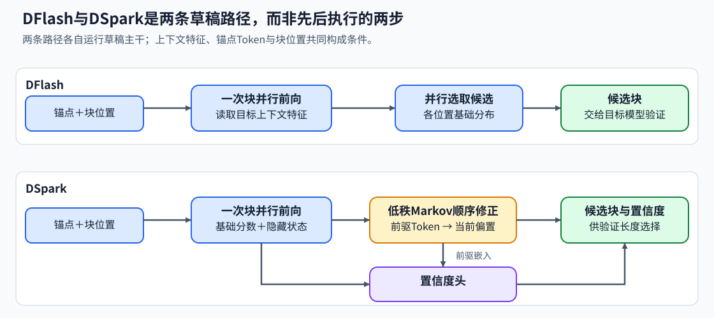
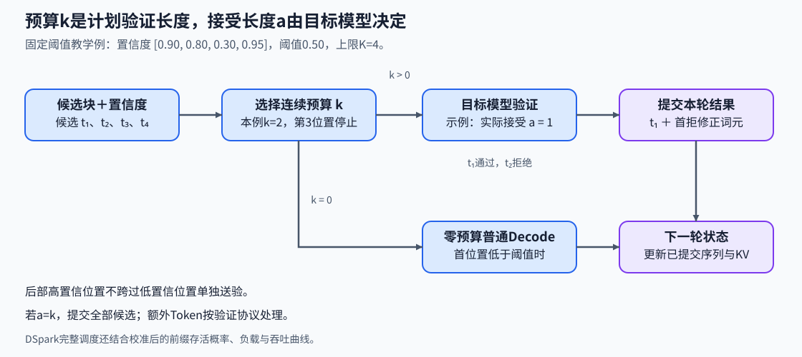

# INF-PARALLEL-DRAFTING. DFlash and DSpark | INF-PARALLEL-DRAFTING. DFlash 与 DSpark｜并行草稿与置信度调度

**难度：** Hard | **环境：** CPU-first | **标签：** `推理优化`, `投机解码`, `DFlash`, `DSpark`

> 🚀 **云端运行环境**
>
> 本章节的实战代码可以点击以下链接在免费 GPU 算力平台上直接运行：
>
> [](https://colab.research.google.com/github/datawhalechina/llm-algo-leetcode/blob/main/02_PyTorch_Algorithms/INF-PARALLEL-DRAFTING_DFlash_and_DSpark.ipynb)
> [](https://modelscope.cn/my/mynotebook) *(国内推荐：魔搭社区免费实例)*


## 本节导读

自回归草稿器逐个生成候选，草稿长度越大，串行开销越高。DFlash 同时提出一组候选；DSpark 再用轻量顺序修正恢复局部依赖，并用逐位置置信度控制送入目标模型的候选长度。本节关注候选如何形成、依赖如何恢复，以及低置信候选如何触发普通解码回退。

## 前置阅读

- [Part 02 · 23 投机解码](./23_Speculative_Decoding.md)

### Step 1：从串行草稿到块并行草稿

DFlash 改变的是候选生成的依赖关系：自回归草稿必须等待前一位置，块并行草稿则由同一次前向同时给出多个位置的基础分数。它缩短了草稿路径，但后部位置缺少真实前驱条件，候选质量可能随位置向后衰减。

| 草稿路径 | 位置依赖 | 单轮输出 | 主要代价 |
| --- | --- | --- | --- |
| 自回归草稿 | 后一位置等待前一候选 | 顺序候选 | 草稿时延随长度增长 |
| DFlash | 多个位置并行形成 | 候选块 | 后部候选可能偏离 |
| DSpark | 并行主干后增加轻量顺序修正 | 候选块与置信度 | 增加修正与校准成本 |



### Step 2：用低秩 Markov 机制恢复局部依赖

DSpark 保留并行主干产生的基础分数，再用前一候选对应的低维状态修正当前位置。前驱 Token 先映射为秩为 $r$ 的状态向量，再经投影得到词表偏置；当 $r$ 远小于词表大小时，顺序修正的状态与计算规模低于重新执行完整草稿模型。

| 对象 | 表示 | 作用 |
| --- | --- | --- |
| 并行主干 | 每个位置的基础词表分数 | 一次形成整个候选块的基础分布 |
| 前驱状态 | $e(x_{i-1}) \in \mathbb{R}^{r}$ | 压缩前一候选携带的局部条件 |
| 低秩投影 | $b_i=e(x_{i-1})P$，$P\in\mathbb{R}^{r\times V}$ | 把局部条件还原为词表偏置 |
| 修正分数 | 基础分数 $+b_i$ | 顺序更新当前位置并影响下一位置 |

### Step 3：用置信度控制验证预算

逐位置置信度决定本轮送入目标模型的连续候选前缀。预算从左向右增长，一旦遇到低于阈值的位置就停止；若首位置也不可信，预算应为零并回退到普通 Decode。目标模型仍负责接受或拒绝，草稿置信度不能替代验证。

| 状态 | 预算结果 | 后续动作 |
| --- | --- | --- |
| 首位置低于阈值 | $k=0$ | 不提交草稿候选，执行普通 Decode |
| 前 $k$ 个位置连续通过 | $0<k<K$ | 只验证长度为 $k$ 的连续前缀 |
| 所有位置通过 | $k=K$ | 验证完整候选块 |



### Step 4：实现并行候选、低秩修正与连续预算

| TODO / 函数 | 学习者完成的机制 | 必须满足的约束 | 测试证据 |
| --- | --- | --- | --- |
| TODO 1 · `dflash_parallel_candidates` | 从各位置基础分数形成并行候选块 | 每个位置独立选择，不读取相邻位置候选 | 候选结果、位置独立性、空块与维度失配 |
| TODO 2 · `project_markov_bias` | 将前驱 Token 的低维状态投影为词表偏置 | 投影维度匹配；未知前驱返回零偏置 | 数值投影、未知前驱、秩与词表维度错误 |
| TODO 3 · `choose_confident_prefix` | 选择连续高置信候选前缀 | 首个低置信位置立即停止；允许零预算；不超过上限 | 中途停止、首位置失败、空序列、预算截断与非法输入 |


```python
from typing import Dict, List, Sequence

```


```python
def _validate_block_logits(block_logits: Sequence[Sequence[float]]) -> int:
    """校验位置数和词表维度，并返回词表大小。"""
    if not block_logits or not block_logits[0]:
        raise ValueError("候选块分数不能为空")
    vocab_size = len(block_logits[0])
    if any(len(row) != vocab_size for row in block_logits):
        raise ValueError("所有位置必须共享词表维度")
    return vocab_size


def dflash_parallel_candidates(block_logits: Sequence[Sequence[float]]) -> List[int]:
    """对候选块中的每个位置独立选择最高分 Token。"""
    vocab_size = _validate_block_logits(block_logits)
    # ==========================================
    # TODO 1：形成位置相互独立的并行候选块。
    # ==========================================
    # candidates = ???  # 每个位置独立选择的最高分 Token；列表长度等于位置数。
    return candidates


def project_markov_bias(
    previous_token: int,
    markov_embeddings: Dict[int, Sequence[float]],
    markov_projection: Sequence[Sequence[float]],
    vocab_size: int,
) -> List[float]:
    """把前驱 Token 的低维状态投影为词表偏置。"""
    if vocab_size <= 0 or not markov_projection:
        raise ValueError("词表大小和 Markov 投影不能为空")
    rank = len(markov_projection)
    if any(len(row) != vocab_size for row in markov_projection):
        raise ValueError("Markov 投影的每一行必须匹配词表维度")
    latent = markov_embeddings.get(previous_token)
    if latent is None:
        return [0.0] * vocab_size
    if len(latent) != rank:
        raise ValueError("前驱状态维度必须匹配 Markov 秩")
    # ==========================================
    # TODO 2：执行低秩状态到词表偏置的投影。
    # ==========================================
    # bias = ???  # 长度为 vocab_size；第 v 项为各秩分量与投影第 v 列的内积。
    return bias


def dspark_markov_candidates(
    block_logits: Sequence[Sequence[float]],
    anchor_token: int,
    markov_embeddings: Dict[int, Sequence[float]],
    markov_projection: Sequence[Sequence[float]],
) -> List[int]:
    """按候选顺序使用低秩 Markov 偏置修正并行主干分数。"""
    vocab_size = _validate_block_logits(block_logits)
    previous = anchor_token
    candidates: List[int] = []
    for row in block_logits:
        bias = project_markov_bias(previous, markov_embeddings, markov_projection, vocab_size)
        corrected = [float(score) + delta for score, delta in zip(row, bias)]
        previous = max(range(vocab_size), key=lambda token: corrected[token])
        candidates.append(previous)
    return candidates


def choose_confident_prefix(
    confidences: Sequence[float],
    threshold: float,
    max_tokens: int = 8,
) -> int:
    """返回值得交给目标模型验证的连续候选长度。"""
    if not 0.0 <= threshold <= 1.0:
        raise ValueError("置信度阈值必须位于 [0, 1]")
    if max_tokens < 1:
        raise ValueError("最大预算必须大于零")
    prefix_length = 0
    for confidence in confidences[:max_tokens]:
        if not 0.0 <= confidence <= 1.0:
            raise ValueError("每个置信度必须位于 [0, 1]")
        # ==========================================
        # TODO 3：在首个低置信位置停止连续前缀。
        # ==========================================
        # should_stop = ???  # 当前置信度不足以进入验证前缀时为 True。
        if should_stop:
            break
        prefix_length += 1
    return prefix_length


def build_draft_record(mode, candidates, confidences, threshold, max_tokens=8):
    """把候选块和验证预算整理为统一记录。"""
    if mode not in {"dflash", "dspark"}:
        raise ValueError("mode 必须是 dflash 或 dspark")
    if not candidates or len(candidates) != len(confidences):
        raise ValueError("候选与置信度必须非空且等长")
    budget = choose_confident_prefix(confidences, threshold, max_tokens=max_tokens)
    return {
        "mode": mode,
        "block_tokens": list(candidates),
        "verify_tokens": list(candidates[:budget]),
        "proposed": len(candidates),
        "verify_budget": budget,
        "fallback_to_decode": budget == 0,
    }

```

### 测试

测试分别锁定位置独立性、低秩投影和零预算回退，避免只检查一个正常样例。


```python
def test_dflash_parallel_candidates():
    """并行候选应逐位置选择，修改一行不能影响其他位置。"""
    logits = [[0.1, 0.8, 0.1], [0.6, 0.2, 0.2], [0.1, 0.2, 0.7]]
    assert dflash_parallel_candidates(logits) == [1, 0, 2]
    changed = [logits[0], [0.1, 0.2, 0.9], logits[2]]
    assert dflash_parallel_candidates(changed) == [1, 2, 2]
    for invalid in ([], [[0.1, 0.9], [0.3]]):
        try:
            dflash_parallel_candidates(invalid)
        except ValueError:
            pass
        else:
            raise AssertionError("空块或词表维度失配时应失败")


def test_project_markov_bias():
    """低秩状态应按投影列还原为词表偏置。"""
    embeddings = {7: [2.0, -1.0]}
    projection = [[0.5, 0.0, 1.0], [1.0, -1.0, 0.5]]
    assert project_markov_bias(7, embeddings, projection, 3) == [0.0, 1.0, 1.5]
    assert project_markov_bias(9, embeddings, projection, 3) == [0.0, 0.0, 0.0]
    try:
        project_markov_bias(7, {7: [1.0]}, projection, 3)
    except ValueError:
        pass
    else:
        raise AssertionError("前驱状态与 Markov 秩不匹配时应失败")


def test_dspark_markov_candidates():
    """前一候选应通过低秩状态改变下一位置的修正方向。"""
    logits = [[0.4, 0.6], [0.7, 0.3], [0.6, 0.4]]
    embeddings = {9: [1.0], 0: [-1.0], 1: [1.0]}
    projection = [[0.5, -0.5]]
    assert dspark_markov_candidates(logits, 9, embeddings, projection) == [0, 1, 0]


def test_choose_confident_prefix():
    """连续预算应支持中途停止、零预算、空序列与上限截断。"""
    assert choose_confident_prefix([0.9, 0.8, 0.3, 0.95], 0.5, 4) == 2
    assert choose_confident_prefix([0.1, 0.9], 0.5, 4) == 0
    assert choose_confident_prefix([], 0.5, 4) == 0
    assert choose_confident_prefix([0.9] * 10, 0.5, 4) == 4
    for args in (([1.1], 0.5, 4), ([0.9], -0.1, 4), ([0.9], 0.5, 0)):
        try:
            choose_confident_prefix(*args)
        except ValueError:
            pass
        else:
            raise AssertionError("非法置信度、阈值或预算上限应失败")


def test_unified_draft_record():
    """零预算记录不得向目标模型提交候选，并应显式触发回退。"""
    record = build_draft_record("dspark", [4, 5], [0.2, 0.9], 0.5, 2)
    assert record["verify_tokens"] == []
    assert record["verify_budget"] == 0
    assert record["fallback_to_decode"] is True
    try:
        build_draft_record("unknown", [1], [0.9], 0.5)
    except ValueError:
        pass
    else:
        raise AssertionError("未知草稿模式应失败")


test_dflash_parallel_candidates()
test_project_markov_bias()
test_dspark_markov_candidates()
test_choose_confident_prefix()
test_unified_draft_record()
print("✅ 并行草稿、低秩修正与连续预算测试通过")

```

---

🛑 **STOP HERE** 🛑
<br><br><br><br><br><br><br><br><br><br>
> 请先尝试自己完成代码并跑通测试。<br>
> 如果遇到困难，再向下查看参考代码与解析。
<br><br><br><br><br><br><br><br><br><br>

---
## 参考代码与解析

### 代码

```python
def _validate_block_logits(block_logits: Sequence[Sequence[float]]) -> int:
    """校验位置数和词表维度，并返回词表大小。"""
    if not block_logits or not block_logits[0]:
        raise ValueError("候选块分数不能为空")
    vocab_size = len(block_logits[0])
    if any(len(row) != vocab_size for row in block_logits):
        raise ValueError("所有位置必须共享词表维度")
    return vocab_size


# ==========================================
# TODO 1：形成位置相互独立的并行候选块。
# ==========================================
def dflash_parallel_candidates(block_logits: Sequence[Sequence[float]]) -> List[int]:
    """对候选块中的每个位置独立选择最高分 Token。"""
    vocab_size = _validate_block_logits(block_logits)
    candidates = [max(range(vocab_size), key=lambda token: row[token]) for row in block_logits]
    return candidates


# ==========================================
# TODO 2：执行低秩状态到词表偏置的投影。
# ==========================================
def project_markov_bias(
    previous_token: int,
    markov_embeddings: Dict[int, Sequence[float]],
    markov_projection: Sequence[Sequence[float]],
    vocab_size: int,
) -> List[float]:
    """把前驱 Token 的低维状态投影为词表偏置。"""
    if vocab_size <= 0 or not markov_projection:
        raise ValueError("词表大小和 Markov 投影不能为空")
    rank = len(markov_projection)
    if any(len(row) != vocab_size for row in markov_projection):
        raise ValueError("Markov 投影的每一行必须匹配词表维度")
    latent = markov_embeddings.get(previous_token)
    if latent is None:
        return [0.0] * vocab_size
    if len(latent) != rank:
        raise ValueError("前驱状态维度必须匹配 Markov 秩")
    bias = [
        sum(float(latent[index]) * float(markov_projection[index][token]) for index in range(rank))
        for token in range(vocab_size)
    ]
    return bias


def dspark_markov_candidates(
    block_logits: Sequence[Sequence[float]],
    anchor_token: int,
    markov_embeddings: Dict[int, Sequence[float]],
    markov_projection: Sequence[Sequence[float]],
) -> List[int]:
    """按候选顺序使用低秩 Markov 偏置修正并行主干分数。"""
    vocab_size = _validate_block_logits(block_logits)
    previous = anchor_token
    candidates: List[int] = []
    for row in block_logits:
        bias = project_markov_bias(previous, markov_embeddings, markov_projection, vocab_size)
        corrected = [float(score) + delta for score, delta in zip(row, bias)]
        previous = max(range(vocab_size), key=lambda token: corrected[token])
        candidates.append(previous)
    return candidates


# ==========================================
# TODO 3：在首个低置信位置停止连续前缀。
# ==========================================
def choose_confident_prefix(
    confidences: Sequence[float],
    threshold: float,
    max_tokens: int = 8,
) -> int:
    """返回值得交给目标模型验证的连续候选长度。"""
    if not 0.0 <= threshold <= 1.0:
        raise ValueError("置信度阈值必须位于 [0, 1]")
    if max_tokens < 1:
        raise ValueError("最大预算必须大于零")
    prefix_length = 0
    for confidence in confidences[:max_tokens]:
        if not 0.0 <= confidence <= 1.0:
            raise ValueError("每个置信度必须位于 [0, 1]")
        should_stop = confidence < threshold
        if should_stop:
            break
        prefix_length += 1
    return prefix_length


def build_draft_record(mode, candidates, confidences, threshold, max_tokens=8):
    """把候选块和验证预算整理为统一记录。"""
    if mode not in {"dflash", "dspark"}:
        raise ValueError("mode 必须是 dflash 或 dspark")
    if not candidates or len(candidates) != len(confidences):
        raise ValueError("候选与置信度必须非空且等长")
    budget = choose_confident_prefix(confidences, threshold, max_tokens=max_tokens)
    return {
        "mode": mode,
        "block_tokens": list(candidates),
        "verify_tokens": list(candidates[:budget]),
        "proposed": len(candidates),
        "verify_budget": budget,
        "fallback_to_decode": budget == 0,
    }

```

### 解析

#### TODO 1：形成并行候选块

- **机制：** 每个位置只读取自己的基础分数，因此一次前向可以直接形成整个候选块。
- **不变量：** 修改某一位置的分数只能改变该位置的候选，不能传播到其他位置。
- **测试证据：** 测试改变中间位置后，其余候选保持不变；空块和词表维度不一致时必须失败。

#### TODO 2：投影低秩 Markov 状态

- **机制：** 前驱 Token 先取得低维状态，再与投影矩阵相乘，得到修正当前位置所需的词表偏置。
- **不变量：** 状态长度必须等于 Markov 秩，投影的每一行必须覆盖完整词表；未知前驱不应引入任意偏置。
- **测试证据：** 测试核对投影数值、零偏置回退和秩不匹配错误，并验证前驱候选会改变后续修正方向。

#### TODO 3：选择连续置信前缀

- **机制：** 验证预算只包含从首位置开始连续通过阈值的候选，首个低置信位置截断整个后缀。
- **不变量：** 预算可以为零，不能超过候选数和配置上限；零预算必须回退普通 Decode。
- **测试证据：** 测试覆盖中途停止、首位置失败、空序列、预算截断、非法输入和统一记录中的零候选提交。

## 相关阅读

- [Part 02 · 35 原生多 Token 预测](./35_Multi_Token_Decoding.md)
- [Part 02 · INF-PROPOSAL 动态候选预算](./INF-PROPOSAL_Dynamic_Proposal_Budget.md)
- [DFlash 论文](https://arxiv.org/abs/2602.06036)
- [DSpark 论文](https://arxiv.org/abs/2607.05147)
- [vLLM Speculators：DSpark](https://docs.vllm.ai/projects/speculators/en/latest/user_guide/algorithms/dspark/)
- [推理优化实验资产表](../topic_discussion/inference_optimization/experiment_assets.md)
