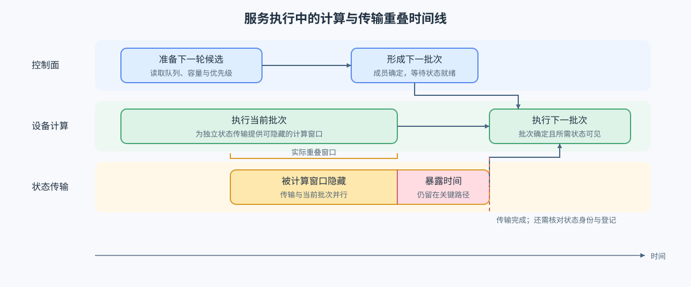
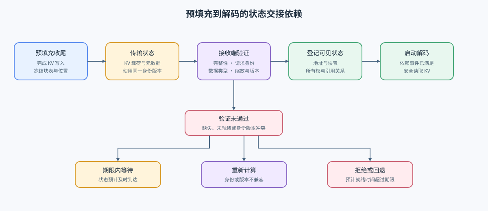

# INF-SERVING-OVERLAP. Serving Overlap and State Handoff | 服务重叠与状态交接

**难度：** Hard | **环境：** CPU-first | **标签：** `推理优化`, `执行重叠`, `状态交接`

> 🚀 **云端运行环境**
>
> 本章节的实战代码可以点击以下链接在免费 GPU 算力平台上直接运行：
>
> [](https://colab.research.google.com/github/datawhalechina/llm-algo-leetcode/blob/main/02_PyTorch_Algorithms/INF-SERVING-OVERLAP_Serving_Overlap_and_State_Handoff.ipynb)
> [](https://modelscope.cn/my/mynotebook) *(国内推荐：魔搭社区免费实例)*


## 本节导读

服务流水线可以让 CPU 准备下一批请求、GPU 执行当前批次以及 KV / 元数据传输发生重叠，但重叠不会消除数据依赖。你将区分总传输时间与真正暴露在关键路径上的时间，并检查预填充状态何时满足解码所需的所有权、版本和依赖条件。
## 前置阅读

- [38：Prefill / Decode Scheduling](./38_Prefill_Decode_Scheduling.md)：阶段切分与 Chunked Prefill。
- [39：Heterogeneous PD and Serving Tiers](./39_Hetero_PD_and_Serving_Tiers.md)：异构路由和服务分层。
### Step 1：哪些工作可以重叠

控制面准备、设备计算和状态传输只有在数据依赖解除、执行资源独立时才能并行。若两项工作争用同一计算资源、同一链路或同一状态，时间线上看似并发，也不会缩短关键路径。

| 工作 | 可重叠对象 | 主要约束 |
|:---|:---|:---|
| 下一轮批次准备 | 当前设备计算 | 调度状态、队列同步与数据就绪 |
| 主机—设备或设备间传输 | 与该状态无依赖的设备计算 | 复制引擎、链路带宽与依赖顺序 |
| 集合通信 | 无数据依赖的计算 | 计算单元、显存带宽与网络资源争用 |
| 预填充—解码交接 | 其他请求的计算 | 当前请求的解码仍须等待状态可见 |


### Step 2：总时间与暴露时间为什么不同

若状态传输耗时 `T_{transfer}`，可利用的独立计算窗口为 `T_{window}`，最小暴露传输时间近似为 `max(T_{transfer} - T_{window}, 0)`。这是理想下界；同步等待、带宽争用和任务粒度都会缩短有效窗口。

| 指标 | 含义 | 判断用途 |
|:---|:---|:---|
| 完整传输时间 | 状态移动的完整时间 | 链路与载荷成本 |
| 可重叠窗口 | 可与传输并行的独立工作 | 理论隐藏上限 |
| 暴露时间 | 仍留在关键路径的传输 | 对首 Token 延迟和相邻 Token 延迟的直接影响 |
| 重叠比例 | 被隐藏时间 / 完整传输时间 | 重叠是否真正缩短关键路径 |
### Step 3：KV 状态交接还包含所有权与元数据

预填充—解码分离时，交接对象不仅是 K/V 字节，还包括块表、序列位置、数据类型、缩放因子、请求标识和所有权状态。解码阶段在这些信息可见之前不能安全读取缓存；因此状态交接的完成点应由事件或协议确认，而不是只依据传输动作已经提交。

| 阶段 | 必须完成的状态 | 失败表现 |
|:---|:---|:---|
| 预填充收尾 | KV 写入完成、元数据冻结 | 读取未完成状态 |
| 状态传输 | 载荷与元数据到达目标 | 字节缺失、版本不一致 |
| 状态登记 | 块地址和所有权对解码阶段可见 | 找不到页、重复释放 |
| 解码启动 | 依赖事件满足 | 首 Token 阻塞或错误 |


### Step 4：实现暴露时间与状态交接门槛

本题用时间区间和状态字典复现状态交接。区间遍历、返回结构和启动动作已经给出；你将补全覆盖区间、链路换算、状态兼容性与 deadline 判断。测试分别覆盖重叠窗口、固定延迟、缺失元数据、版本不兼容和 deadline 边界。

| TODO / 函数 | 学习者完成的机制 | 必须满足的约束 | 测试证据 |
| --- | --- | --- | --- |
| TODO 1：计算暴露区间<br>`compute_exposed_interval` | 计算未被隐藏的传输区间 | 覆盖窗口先裁剪到传输区间，再合并重叠部分 | 无覆盖、局部覆盖、重叠窗口与完全隐藏 |
| TODO 2：估算交接时间<br>`estimate_handoff` | 换算完整状态交接时间 | 带宽单位统一为 Gbit/s；加入固定延迟并保留总时间与暴露时间 | 字节换算、固定延迟与覆盖窗口 |
| TODO 3：验证交接状态<br>`validate_handoff_state` | 检查状态可消费条件 | 分别收集未就绪依赖与请求身份、版本不兼容项 | 完整状态、缺失依赖和版本冲突 |
| TODO 4：选择解码动作<br>`plan_decode_start` | 选择解码启动动作 | 依赖未齐时仅在期限内等待；超时时拒绝或回退 | 立即启动、等待和超时三类决策 |

```python
from math import isclose
```


```python
def compute_exposed_interval(transfer_interval, cover_intervals):
    """计算传输区间未被独立工作覆盖的时间。"""
    start, end = transfer_interval
    if end < start:
        raise ValueError('transfer interval 非法')
    # TODO 1（关键路径）：先把覆盖窗口裁剪到传输区间，再合并重叠部分。
    # clipped = ???  # 排序后的有效交集区间；空交集不进入列表。
    merged = []
    for left, right in clipped:
        if not merged or left > merged[-1][1]:
            merged.append([left, right])
        else:
            merged[-1][1] = max(merged[-1][1], right)
    total_ms = end - start
    # hidden_ms = ???  # 合并后各覆盖区间长度之和，不得重复计数。
    return {'total_ms': total_ms, 'hidden_ms': hidden_ms, 'exposed_ms': total_ms - hidden_ms}


def estimate_handoff(payload_bytes, bandwidth_gbps, fixed_latency_ms, start_ms, cover_intervals):
    """估算状态传输区间、暴露时间和 overlap ratio。"""
    if payload_bytes < 0 or bandwidth_gbps <= 0 or fixed_latency_ms < 0:
        raise ValueError('payload、bandwidth 与 fixed latency 非法')
    # TODO 2（传输时间线）：完成 Gbit/s 到 bytes/ms 的换算并加入固定延迟。
    # bytes_per_ms = ???  # 当前链路每毫秒可传输的字节数。
    # transfer_ms = ???  # 固定延迟与 payload 传输时间之和。
    interval = (start_ms, start_ms + transfer_ms)
    exposure = compute_exposed_interval(interval, cover_intervals)
    return {
        'transfer_ms': transfer_ms, 'start_ms': interval[0], 'end_ms': interval[1],
        'exposed_ms': exposure['exposed_ms'],
        'overlap_ratio': exposure['hidden_ms'] / transfer_ms if transfer_ms else 1.0,
    }


def validate_handoff_state(handoff_state, expected_request_id, expected_version):
    """验证 Decode 消费状态所需的数据、所有权和版本契约。"""
    required = ['payload_ready', 'metadata_ready', 'ownership_ready']
    # TODO 3（状态协议）：分别收集未就绪依赖与身份/版本不兼容项。
    # missing = ???  # required 中值不为真的字段名。
    # incompatible = ???  # request_id 或 version 不符合预期时记录对应字段名。
    return {'ready': not missing and not incompatible, 'missing': missing, 'incompatible': incompatible}


def plan_decode_start(validation, ready_at_ms, deadline_ms):
    """根据交接验证和 deadline 选择 Decode 启动动作。"""
    if validation['incompatible']:
        return 'recompute'
    if validation['ready']:
        return 'ready'
    # TODO 4（启动决策）：依赖未齐时判断是否仍可在 deadline 内等待。
    # can_wait = ???  # ready_at_ms 恰好等于 deadline_ms 时仍可等待。
    return 'wait' if can_wait else 'fallback'

```

### 测试

测试检查完全隐藏、部分暴露、单位换算和状态依赖，避免只验证一个延迟公式。

```python
def test_interval_union_and_exposed_time():
    """交叠覆盖窗口必须先合并，避免重复扣减暴露时间。"""
    report = compute_exposed_interval((0.0, 10.0), [(1.0, 4.0), (3.0, 7.0), (12.0, 14.0)])
    assert report == {'total_ms': 10.0, 'hidden_ms': 6.0, 'exposed_ms': 4.0}

def test_handoff_estimate():
    """链路吞吐换算应保留固定延迟并得到正确暴露时间。"""
    report = estimate_handoff(125_000_000, 10.0, 1.0, 0.0, [(0.0, 6.0)])
    assert isclose(report['transfer_ms'], 101.0, rel_tol=1e-6)
    assert isclose(report['exposed_ms'], 95.0, rel_tol=1e-6)

def test_handoff_protocol_and_decision():
    """缺失依赖、版本变化与 deadline 应产生不同启动动作。"""
    state = {'payload_ready':True, 'metadata_ready':False, 'ownership_ready':True, 'request_id':'r1', 'version':3}
    validation = validate_handoff_state(state, 'r1', 3)
    assert validation['missing'] == ['metadata_ready'] and validation['incompatible'] == []
    assert plan_decode_start(validation, 8.0, 10.0) == 'wait'
    assert plan_decode_start(validation, 12.0, 10.0) == 'fallback'
    incompatible = validate_handoff_state({**state, 'metadata_ready':True, 'version':2}, 'r1', 3)
    assert plan_decode_start(incompatible, 8.0, 10.0) == 'recompute'
    ready = validate_handoff_state({**state, 'metadata_ready':True}, 'r1', 3)
    assert plan_decode_start(ready, 8.0, 10.0) == 'ready'

test_interval_union_and_exposed_time(); test_handoff_estimate(); test_handoff_protocol_and_decision()
print('✅ Serving Overlap 机制测试通过')
```

---

🛑 **STOP HERE** 🛑
<br><br><br><br><br><br><br><br><br><br>
> 请先尝试自己完成代码并跑通测试。<br>
> 如果遇到困难，再向下查看参考代码与解析。
<br><br><br><br><br><br><br><br><br><br>

---
## 参考代码与解析

### 代码

```python
# TODO 1：计算未被隐藏的传输区间。
def compute_exposed_interval(transfer_interval, cover_intervals):
    start, end = transfer_interval
    if end < start:
        raise ValueError('transfer interval 非法')
    clipped = sorted((max(start, a), min(end, b)) for a, b in cover_intervals if min(end, b) > max(start, a))
    merged = []
    for a, b in clipped:
        if not merged or a > merged[-1][1]: merged.append([a, b])
        else: merged[-1][1] = max(merged[-1][1], b)
    total = end - start; hidden = sum(b - a for a, b in merged)
    return {'total_ms': total, 'hidden_ms': hidden, 'exposed_ms': total - hidden}

# TODO 2：换算完整状态交接时间。
def estimate_handoff(payload_bytes, bandwidth_gbps, fixed_latency_ms, start_ms, cover_intervals):
    if payload_bytes < 0 or bandwidth_gbps <= 0: raise ValueError('invalid payload or bandwidth')
    bytes_per_ms = bandwidth_gbps * 1_000_000 / 8.0
    transfer_ms = fixed_latency_ms + payload_bytes / bytes_per_ms
    interval = (start_ms, start_ms + transfer_ms)
    exposure = compute_exposed_interval(interval, cover_intervals)
    return {'transfer_ms': transfer_ms, 'start_ms': interval[0], 'end_ms': interval[1], 'exposed_ms': exposure['exposed_ms'], 'overlap_ratio': exposure['hidden_ms'] / transfer_ms if transfer_ms else 1.0}

# TODO 3：检查状态可消费条件。
def validate_handoff_state(handoff_state, expected_request_id, expected_version):
    required = ['payload_ready', 'metadata_ready', 'ownership_ready']
    missing = [name for name in required if not handoff_state.get(name, False)]
    incompatible = []
    if handoff_state.get('request_id') != expected_request_id: incompatible.append('request_id')
    if handoff_state.get('version') != expected_version: incompatible.append('version')
    return {'ready': not missing and not incompatible, 'missing': missing, 'incompatible': incompatible}

# TODO 4：选择 Decode 启动动作。
def plan_decode_start(validation, ready_at_ms, deadline_ms):
    if validation['incompatible']: return 'recompute'
    if validation['ready']: return 'ready'
    return 'wait' if ready_at_ms <= deadline_ms else 'fallback'
```

### 解析

#### TODO 1：合并覆盖区间

- 将可重叠窗口裁剪到传输区间后合并；重叠区间只计算一次，隐藏时间与暴露时间之和必须等于完整传输时间。
- 答案通过区间裁剪与合并计算覆盖长度；测试覆盖相交窗口、区间外窗口、空窗口和完全覆盖。

#### TODO 2：换算交接时间

- 状态大小和链路带宽决定搬运时间，固定延迟单独计入；字节、比特和毫秒统一后才能扣除可隐藏区间。
- 答案先换算完整传输时间，再调用区间账本；测试核对总时间、隐藏时间和暴露时间三者关系。

#### TODO 3：验证交接状态

- 载荷、元数据、所有权、请求身份和版本共同决定接收端能否消费状态；字段缺失与身份或版本不兼容必须分开报告。
- 答案分别收集未就绪依赖和不兼容项；测试制造缺失状态、请求不匹配与版本冲突并核对失败原因。

#### TODO 4：选择启动动作

- 状态齐全时可以启动，身份或版本不兼容时必须重算；依赖未齐时，只有预计就绪时刻不晚于期限才允许等待。
- 答案按兼容性、就绪状态和期限依次决策；测试覆盖立即启动、等待、回退，以及就绪时刻等于期限的边界。

### Step 5：GPU 机制实验——CUDA Stream 的传输—计算重叠

| 学习问题 | CPU 机制实验 | GPU 真实实验 |
| --- | --- | --- |
| 独立传输能否被计算窗口隐藏 | 用时间区间计算理论隐藏时间、暴露时间和交接门槛 | 用 PyTorch CUDA Stream 对照串行与重叠时间线，检查真实复制路径、计算正确性和与理论下界的距离 |

GPU 结果只证明单卡传输—计算的物理重叠，不代表请求队列或预填充—解码服务协议已经成立。

#### 5.1 环境与固定工作负载

首次运行按[推理优化实验 Quickstart](../topic_discussion/inference_optimization/quickstart.md#inf-cuda-mechanism-quickstart)创建 `INF-CUDA-MECHANISM` 环境；Profile 与结果状态见[实验资产表](../topic_discussion/inference_optimization/experiment_assets.md)。运行前的 Profile 预检必须返回 `status=ok`。

| 配置层 | 本实验固定口径 | 修改规则 |
| --- | --- | --- |
| 载荷 | `16/64/128 MiB` 的固定主机—设备传输 | 修改档位后递增 workload version |
| 计算窗口 | `2048 × 2048` 的独立矩阵乘 | 矩阵规模、精度和输入保持一致 |
| 配对变量 | 同一载荷与矩阵下比较串行和双 Stream 重叠 | 两条路径使用相同数据并交错测量 |
| 测量 | 预热后记录 Median、P95、理论下界和重叠效率 | 不以单次耗时或均值替代长尾 |
| 结果 | 正确性、路径证据、硬件快照和 JSON 路径 | 正式复测使用唯一 `RUN_LABEL` |


```python
RUN_MODE = 'dry_run'  # 默认值 dry_run：只登记计划；改为 real_gpu 后执行真实 CUDA Stream 对照。
RUN_LABEL = 'default'  # 默认值 default：同一工作负载复测时改为新的唯一标签。
ENVIRONMENT_PROFILE = 'INF-CUDA-MECHANISM'  # 默认值：本专题单卡机制实验环境。
WORKLOAD_ID = 'inference-serving-overlap'  # 稳定工作负载身份。
WORKLOAD_VERSION = 'v2'  # v2 使用复用 Stream、交错配对和理论下界。
GPU_DTYPE = 'auto'  # 默认 auto：优先原生 BF16，否则使用 FP16。
PAYLOAD_MIB = [16, 64, 128]  # 默认值：三档固定 H2D payload，用于观察重叠收益随传输量变化。
MATRIX_SIZE = 2048  # 默认值：独立 BF16 方阵乘规模，提供可与传输重叠的计算窗口。
WARMUP_STEPS = 5  # 默认值：正式计时前的预热次数。
REPEAT_STEPS = 20  # 默认值：每种时间线的重复测量次数，用于 median/P95。
MIN_GAIN_RATIO = 0.02  # 默认值：Median 至少改善 2% 才通过收益门槛。
MAX_P95_RATIO = 1.05  # 默认值：重叠路径 P95 最多允许回退 5%。
SEED = 42  # 默认值：固定张量内容，保证串行与重叠路径可比较。

```

#### 5.2 执行串行与重叠时间线

执行单元只消费 5.1 配置。每个 payload 都使用相同的源张量和矩阵乘；候选路径通过两个 CUDA Stream 并发提交复制与计算，并用事件建立开始与完成依赖。


```python
import json
import statistics
from pathlib import Path

import torch

from tools.notebook_runtime import package_version
from tools.project_runtime import resolve_project_root


def percentile_95(values):
    ordered = sorted(values)
    return ordered[max(0, int(0.95 * len(ordered)) - 1)]


def select_gpu_dtype():
    if GPU_DTYPE == 'float16':
        return torch.float16
    if GPU_DTYPE == 'bfloat16':
        return torch.bfloat16
    if GPU_DTYPE != 'auto':
        raise ValueError('GPU_DTYPE 只能是 auto / float16 / bfloat16')
    try:
        supported = torch.cuda.is_bf16_supported(including_emulation=False)
    except TypeError:
        supported = torch.cuda.get_device_capability()[0] >= 8
    return torch.bfloat16 if supported else torch.float16


def time_case(host_source, device_target, left, right, copy_stream, compute_stream, overlap):
    start = torch.cuda.Event(enable_timing=True)
    copy_start = torch.cuda.Event(enable_timing=True)
    copy_done = torch.cuda.Event(enable_timing=True)
    compute_start = torch.cuda.Event(enable_timing=True)
    compute_done = torch.cuda.Event(enable_timing=True)
    end = torch.cuda.Event(enable_timing=True)
    torch.cuda.synchronize()
    start.record()
    if overlap:
        copy_stream.wait_event(start)
        compute_stream.wait_event(start)
        with torch.cuda.stream(copy_stream):
            copy_start.record()
            device_target.copy_(host_source, non_blocking=True)
            copy_done.record()
        with torch.cuda.stream(compute_stream):
            compute_start.record()
            product = left @ right
            compute_done.record()
        torch.cuda.current_stream().wait_event(copy_done)
        torch.cuda.current_stream().wait_event(compute_done)
    else:
        copy_start.record()
        device_target.copy_(host_source, non_blocking=True)
        copy_done.record()
        compute_start.record()
        product = left @ right
        compute_done.record()
    end.record()
    end.synchronize()
    return {
        'total_ms': start.elapsed_time(end),
        'copy_ms': copy_start.elapsed_time(copy_done),
        'compute_ms': compute_start.elapsed_time(compute_done),
        'checksum': float(product[0, 0]),
    }


result = {
    'schema_version': 'inference-mechanism-gpu/v2',
    'semantic_id': 'INF-SERVING-OVERLAP',
    'run_mode': RUN_MODE,
    'run_label': RUN_LABEL,
    'environment_profile': ENVIRONMENT_PROFILE,
    'framework': {'torch': package_version('torch')},
    'hardware': {'cuda_available': torch.cuda.is_available()},
    'workload': {
        'id': WORKLOAD_ID, 'version': WORKLOAD_VERSION, 'payload_mib': PAYLOAD_MIB,
        'matrix_size': MATRIX_SIZE, 'dtype': GPU_DTYPE,
        'warmup_steps': WARMUP_STEPS, 'repeat_steps': REPEAT_STEPS, 'seed': SEED,
        'minimum_gain_ratio': MIN_GAIN_RATIO, 'maximum_p95_ratio': MAX_P95_RATIO,
    },
    'cases': [], 'failure': None, 'evidence_level': 'dry_run', 'decision': 'not_measured',
}

if RUN_MODE == 'real_gpu':
    try:
        if not torch.cuda.is_available():
            raise RuntimeError('RUN_MODE=real_gpu，但 CUDA 不可用')
        properties = torch.cuda.get_device_properties(0)
        result['hardware'].update({'device': torch.cuda.get_device_name(0), 'cuda': torch.version.cuda, 'async_engine_count': getattr(properties, 'async_engine_count', None)})
        torch.manual_seed(SEED)
        dtype = select_gpu_dtype()
        result['workload']['resolved_dtype'] = str(dtype)
        left = torch.randn(MATRIX_SIZE, MATRIX_SIZE, device='cuda', dtype=dtype)
        right = torch.randn(MATRIX_SIZE, MATRIX_SIZE, device='cuda', dtype=dtype)
        copy_stream = torch.cuda.Stream()
        compute_stream = torch.cuda.Stream()
        distinct_streams = copy_stream.cuda_stream != compute_stream.cuda_stream
        for payload_mib in PAYLOAD_MIB:
            elements = payload_mib * 1024 * 1024 // torch.empty((), dtype=dtype).element_size()
            host_source = torch.randn(elements, dtype=dtype, pin_memory=True)
            device_target = torch.empty_like(host_source, device='cuda')
            for _ in range(WARMUP_STEPS):
                time_case(host_source, device_target, left, right, copy_stream, compute_stream, False)
                time_case(host_source, device_target, left, right, copy_stream, compute_stream, True)
            serial = []
            overlap = []
            for repeat_index in range(REPEAT_STEPS):
                order = (False, True) if repeat_index % 2 == 0 else (True, False)
                for overlap_enabled in order:
                    sample = time_case(
                        host_source, device_target, left, right, copy_stream, compute_stream, overlap_enabled
                    )
                    (overlap if overlap_enabled else serial).append(sample)
            serial_ms = statistics.median(item['total_ms'] for item in serial)
            overlap_ms = statistics.median(item['total_ms'] for item in overlap)
            serial_p95_ms = percentile_95([item['total_ms'] for item in serial])
            overlap_p95_ms = percentile_95([item['total_ms'] for item in overlap])
            copy_median_ms = statistics.median(item['copy_ms'] for item in serial)
            compute_median_ms = statistics.median(item['compute_ms'] for item in serial)
            theoretical_lower_bound_ms = max(copy_median_ms, compute_median_ms)
            hidden_ms = max(serial_ms - overlap_ms, 0.0)
            hideable_ms = max(serial_ms - theoretical_lower_bound_ms, 0.0)
            overlap_efficiency = min(hidden_ms / hideable_ms, 1.0) if hideable_ms > 0 else 0.0
            latency_ratio = overlap_ms / serial_ms
            p95_ratio = overlap_p95_ms / serial_p95_ms
            copy_correct = torch.equal(device_target.cpu(), host_source)
            compute_correct = abs(serial[0]['checksum'] - overlap[0]['checksum']) < 1e-2
            path_evidence = {
                'host_memory_pinned': bool(host_source.is_pinned()),
                'distinct_streams': bool(distinct_streams),
                'non_blocking_copy': True,
            }
            path_confirmed = all(path_evidence.values())
            result['cases'].append({
                'payload_mib': payload_mib,
                'serial_median_ms': serial_ms, 'serial_p95_ms': serial_p95_ms,
                'overlap_median_ms': overlap_ms, 'overlap_p95_ms': overlap_p95_ms,
                'copy_median_ms': copy_median_ms, 'compute_median_ms': compute_median_ms,
                'theoretical_lower_bound_ms': theoretical_lower_bound_ms,
                'latency_ratio': latency_ratio, 'p95_ratio': p95_ratio,
                'hidden_ms': hidden_ms, 'overlap_efficiency': overlap_efficiency,
                'copy_correct': copy_correct, 'compute_correct': compute_correct,
                'path_evidence': path_evidence, 'path_confirmed': path_confirmed,
                'benefit_gate_passed': latency_ratio <= 1.0 - MIN_GAIN_RATIO and p95_ratio <= MAX_P95_RATIO,
            })
        correct = all(item['copy_correct'] and item['compute_correct'] and item['path_confirmed'] for item in result['cases'])
        accepted_cases = sum(item['benefit_gate_passed'] for item in result['cases'])
        result['summary'] = {'correctness_passed': correct, 'accepted_cases': accepted_cases, 'total_cases': len(result['cases'])}
        result['evidence_level'] = 'local_mechanism_benchmark'
        result['decision'] = 'accept_physical_overlap' if correct and accepted_cases > 0 else ('tune_overlap_window' if correct else 'reject_incorrect_path')
    except Exception as exc:
        result['failure'] = {'type': type(exc).__name__, 'message': str(exc)}
        result['evidence_level'] = 'failed_real_gpu_attempt'
        result['decision'] = 'reject_until_environment_fixed'

root = resolve_project_root(Path.cwd())
result_path = root / '02_PyTorch_Algorithms' / 'benchmarks' / 'results' / f'inf_serving_overlap_{RUN_LABEL}.json'
result_path.parent.mkdir(parents=True, exist_ok=True)
result_path.write_text(json.dumps(result, ensure_ascii=False, indent=2), encoding='utf-8')
result_path

```

#### 5.3 读取结果

读取单一结果文件，先核对执行路径和正确性，再比较不同 payload 下的串行与重叠时间。


```python
report = json.loads(result_path.read_text(encoding='utf-8'))
summary = {key: report.get(key) for key in ['semantic_id', 'run_label', 'failure', 'evidence_level', 'decision']}
summary, report.get('cases', [])

```

#### 5.4 解释结果并作出决策

先检查复制结果、计算校验和、pinned memory、独立 Stream 与非阻塞复制，再比较三档 Payload 的总耗时、理论下界和 P95。该结果只证明单卡传输—计算的物理重叠，不代表完整服务队列或 Prefill–Decode 交接已经成立。

| 观察项 | 读取字段 | 当前结果 | 解释与动作 |
|:---|:---|:---|:---|
| 路径与正确性 | `path_evidence`、`path_confirmed`、`copy_correct`、`compute_correct` | 三档均通过；Host 内存 pinned、Stream 独立、复制非阻塞 | 当前路径条件成立，但仍需用时间线判断是否产生收益 |
| 资源与性能 | 串行 / 重叠 Median、P95、`latency_ratio` | 三档均通过收益门槛；总延迟比为 `0.788/0.934/0.965` | 重叠路径分别缩短约 `21.2%/6.6%/3.5%` |
| 暴露时间 | `copy_median_ms`、`compute_median_ms`、`theoretical_lower_bound_ms`、`hidden_ms`、`overlap_efficiency` | 隐藏时间约 `0.318–0.333 ms`，重叠效率 `95.7%–97.6%` | 传输占主导时更接近理论下界；收益仍取决于计算窗口 |
| 证据与决策 | `evidence_level`、`decision` | `local_mechanism_benchmark`；`accept_physical_overlap` | 当前证据确认物理重叠路径，不能直接外推为请求级吞吐收益 |

## 相关阅读

- [CUDA C++ Programming Guide: Asynchronous Concurrent Execution](https://docs.nvidia.com/cuda/cuda-c-programming-guide/index.html#asynchronous-concurrent-execution)
- [38：Prefill / Decode Scheduling](./38_Prefill_Decode_Scheduling.md)
- [70：Serving Scheduler Benchmark](./70_Serving_Scheduler_Benchmark.md)
